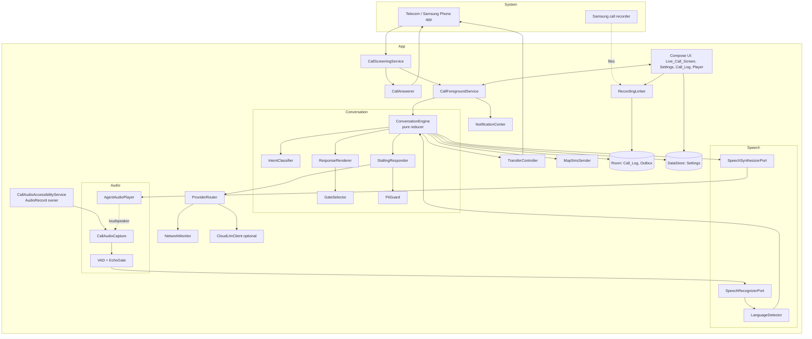
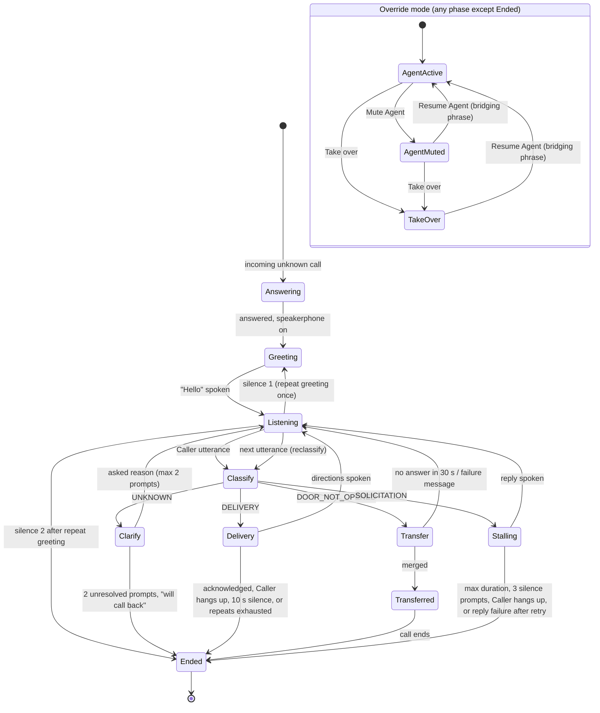
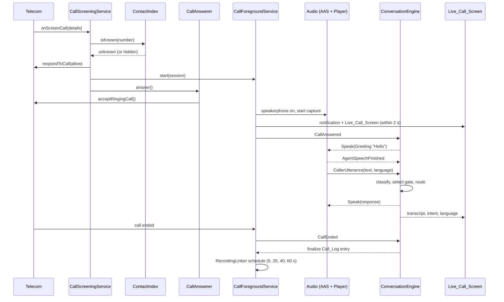

# Design Document: AI Call Screening Agent

## Overview

The App is a native Android application (Kotlin, Jetpack Compose with Material 3) for one User on one Samsung phone (One UI, India). It screens calls from numbers that are not in the User's contacts. An Agent answers on the speakerphone, greets the Caller, classifies the Caller's intent (delivery, door not opened, solicitation, unknown), and responds in Hindi or English. The User can hear the call and take over at any time.

All recognition, language detection, classification, gate selection and speech synthesis run on the device. A cloud LLM is an optional enhancement for solicitation stalling only, behind a timeout and a PII guard.

### Decisions at a glance

| # | Decision | Choice | Validated by |
|---|---|---|---|
| D1 | Audio path | Speakerphone + microphone. Agent TTS plays on the loudspeaker; the Caller's voice is captured from the loudspeaker by the microphone. Capture runs in an app that is also an enabled `AccessibilityService`, because that is the only non-system exemption Android 10+ documents for capturing audio during a voice call. | Spike S1 to S4 |
| D2 | Answering | `CallScreeningService` (role) supplies the number. `TelecomManager.acceptRingingCall()` (`ANSWER_PHONE_CALLS`) answers. | S1 |
| D3 | Transfer | Primary: second call to the Transfer_Target and merge (merge done by UI automation through the AccessibilityService). Fallback: high-priority alert to the User to Take over on the speaker. | S6 |
| D4 | Recording | Samsung Phone app auto-record. The App only links files from a SAF folder and plays them with Media3. | S5 |
| D5 | On-device AI | Silero VAD, Whisper (base or small, int8) for ASR with Vosk as fallback, text-based language detector, rule-based intent classifier, templates for responses, bundled Piper voices via sherpa-onnx for TTS. | S7 |

### Assumptions

- The App is installed for personal use (sideloaded or internal testing), not distributed on Google Play. Google Play's policy restricts non-accessibility use of `AccessibilityService`, so a Play-distributed build would need a different capture approach (see Risk R1).
- The phone runs Android 14 or 15 (One UI 6 or 7). Exact version and chipset are confirmed in spike S0.
- The User accepts that a hold or conference merge needs carrier support for call waiting and 3-way calling.
- The User keeps the Samsung Phone app as the default dialer. This is required for Requirement 12, because the Samsung recorder lives inside that app.
- The central `@myelly/ui` steering rule does not apply to this project. The App uses one shared set of reusable Compose components (`ui/components`) on Material 3 with a single theme (`ui/theme`).

## Architecture

### 1. Platform decisions

#### D1. How the Agent hears the Caller and speaks into the call

**What Android allows.** Android does not give a third-party app the call's uplink or downlink (`VOICE_UPLINK`, `VOICE_DOWNLINK` and `AudioDeviceInfo.TYPE_TELEPHONY` need the privileged `CAPTURE_AUDIO_OUTPUT`). The Android 10+ input-sharing rules say: while the audio mode is `MODE_IN_CALL` or `MODE_IN_COMMUNICATION`, the call always receives audio, and an ordinary app can capture only if it is an accessibility service (or a privileged app with `CAPTURE_AUDIO_OUTPUT`). Otherwise the ordinary app's `AudioRecord` receives silence. Source: [Sharing audio input](https://developer.android.com/media/platform/sharing-audio-input).

This changes the plan. A plain `AudioRecord` in a foreground service is expected to be silenced during the call. The primary approach therefore adds the `AccessibilityService` exemption, and spike S2 proves or disproves it on the actual phone before anything else is built.

**Primary approach (P-AUDIO).**

1. `AccessibilityService` (`CallAudioAccessibilityService`) is declared and enabled by the User once. It owns the `AudioRecord`, so the capture is made by an accessibility service.
2. Capture: `AudioRecord`, 16 kHz, mono, PCM16. Source order tried at runtime and fixed by spike S2: `VOICE_RECOGNITION`, then `MIC`, then `UNPROCESSED`, then `VOICE_COMMUNICATION`. Notes:
   - `VOICE_COMMUNICATION` is privacy-sensitive, so it has priority over ordinary capture, but it also applies the platform's call processing (AEC and noise suppression) tuned for a headset use case, which can degrade a voice coming from the loudspeaker. It is tried last.
   - `UNPROCESSED` has no AEC or noise suppression, which suits our own echo handling, but gain is low on some Samsung devices. Our AGC compensates.
   - An `AudioManager.AudioRecordingCallback` reports `isClientSilenced()`. If capture is silenced, the App switches to the fallback (below) and tells the User.
3. Output: the Agent never uses the Android TTS audio path directly. Every TTS engine produces PCM, and one `AgentAudioPlayer` plays it with an `AudioTrack`. Usage is tried in this order: `USAGE_VOICE_COMMUNICATION`, `USAGE_ASSISTANT`, `USAGE_MEDIA` (fixed by S3). The loudspeaker output reaches the Caller through the microphone's uplink path. Owning the PCM gives us exact start and end times, a stop within 500 ms (`pause` and `flush`), and a reference signal for echo removal.
4. Mode and route: the App does not set `AudioManager.mode` during a telephony call (the system holds `MODE_IN_CALL`). Speaker route is attempted in this order: `AudioManager.setSpeakerphoneOn(true)` (deprecated since API 31, but still the call-route switch on many builds), `setCommunicationDevice(speaker)` (API 31+), and an accessibility click on the Samsung in-call Speaker button. If none works, the App notifies the User (Requirement 13.17) and continues.
5. Volume: the App raises `STREAM_VOICE_CALL` to a configured level (default 80%) so the microphone picks up the TTS clearly. It restores the previous volume when the call ends.

**Echo and Caller/Agent/User separation.** The microphone hears three loudspeaker/room sources: the Caller (downlink), the Agent TTS, and the User when they speak. Three layers keep the Agent's own voice out of the Caller transcript (Requirement 13.15). Layers 1 and 3 are always on. Layer 2 is enabled only if spike S4 shows a benefit.

| Layer | Mechanism | Purpose |
|---|---|---|
| 1. Gate | `EchoGate` marks every audio frame inside `[ttsStart - 50 ms, ttsEnd + 600 ms]` as an "Agent window". Segments that lie fully inside an Agent window are not sent to ASR. Agent speech is split into short chunks (at most about 8 s each) with 400 ms listening gaps, so the Caller can still be heard and can ask to repeat. | Removes most echo and keeps ASR cheap. |
| 2. Reference echo removal | WebRTC AEC3 (or speexdsp AEC) with the TTS PCM as the render reference. Delay comes from `AudioTrack.getTimestamp()` and a cross-correlation search. The reference is the Agent's own signal, so the Caller's voice, which comes out of the loudspeaker as a different signal, is not cancelled. The call's own AEC is not used for this. | Lets the Caller's reply be heard while the Agent speaks (optional). |
| 3. Text filter | `EchoTextFilter` removes any ASR segment that overlaps an Agent window and whose normalized text has token similarity of at least 0.7 to an Agent utterance spoken in the last 15 s. | Guarantees that echo that slipped through is not in the transcript. |

The Agent does not stop talking because of microphone voice activity (Requirement 13.7). It stops only on Take over or Mute Agent.

**User versus Caller in the transcript.** There is no on-device diarization in the first version. Segments are labelled `CALLER` while the Agent is active (the User is expected to be quiet or to press Take over). While in Take_Over, speech from either person is labelled `LIVE` ("User or Caller"). A later option is a speaker-embedding model enrolled on the User's voice (sherpa-onnx speaker embedding), which fits the same `SpeakerLabeler` interface.

**Risk that the Caller cannot hear the TTS reliably.** The Caller hears the TTS only through the acoustic path (loudspeaker, then microphone, then call uplink). The phone's uplink noise suppression may treat the loudspeaker voice as noise and attenuate it, and the call AEC may cancel part of it because the downlink is the AEC reference. Mitigations: raise call volume, use short sentences, avoid long pauses, and add the Samsung in-call "Noise reduction" check to S3. If S3 fails (below 90% word intelligibility on 10 Hindi and 10 English test sentences at the Caller's end), the fallback applies.

**Fallback (F-AUDIO).**

- F1: if capture is silenced or unusable but TTS is audible to the Caller, the Agent works in "speak-only assisted mode". It greets, says a fixed prompt, and immediately alerts the User with a high-priority notification (full-screen intent) to Take over. This is a degraded behavior and is shown clearly in the UI.
- F2: if neither direction works, the project pivots to a VoIP/SIP number with a telephony provider (clean two-way audio streams). This is a different product: the Caller dials a provider number (or the User forwards to it), and Requirement 12 (Samsung recorder) no longer applies. This decision is taken after S1 to S4, not before.

**Alternatives considered.**

| Option | Hears Caller | Speaks to Caller | Samsung recorder still works | Effort | Verdict |
|---|---|---|---|---|---|
| A. Speakerphone + microphone, capture as accessibility service (chosen) | Via loudspeaker, then microphone | Via loudspeaker, then microphone | Yes (stock dialer unchanged) | Medium | Chosen. Needs S2 and S3 to pass. |
| B. Make the App the default dialer (`InCallService`) | No. `InCallService` gives call control and audio routing (`setAudioRoute`), not call PCM. | No | No. The Samsung Phone app is replaced, so its recorder is lost. | High | Rejected. It does not solve audio and breaks Requirement 12. It would, however, give a clean `Call.conference()` for transfer. |
| C. VoIP/SIP number with a provider (cloud media streams) | Yes, clean | Yes, clean | No (provider records) | High, plus recurring cost and telecom compliance | Pivot option if S2 or S3 fails. |
| D. Conditional call forwarding to a cloud IVR | Yes | Yes | No | Medium | Rejected. Carrier forwarding cannot filter by "not in contacts". |

Speakerphone was already the User's decision, and it fits the requirements (Requirement 13). Option A keeps the stock dialer, recorder and call stack untouched, which is why it is chosen.

#### D2. How the App answers, and number matching

- **Screening role.** `CallScreeningService` (role `ROLE_CALL_SCREENING`, requested through `RoleManager.createRequestRoleIntent`) receives `onScreenCall(Call.Details)`. It supplies the number through `details.handle` and `details.handlePresentation`. A screening service can only allow, reject, silence or skip a call. It cannot answer.
- **Answering.** After the screening service responds with "allow" (`CallResponse.Builder().build()`), the App calls `TelecomManager.acceptRingingCall()`. This needs the `ANSWER_PHONE_CALLS` runtime permission and does not need the default-dialer role. Because the call can be in the screening state at the first moment, the answer is retried every 100 ms until the call state is `RINGING` or 2 s have passed (call state comes from `TelephonyCallback.CallStateListener`, which needs `READ_PHONE_STATE`). Spike S1 measures the arrival-to-answer time against the 3 s requirement.
- **Ending the call.** `TelecomManager.endCall()` (`ANSWER_PHONE_CALLS`). It may be deprecated on newer API levels, so S1 checks it on the phone. If it fails, the App asks the User with a notification.
- **Hidden numbers.** `details.handle == null` or `handlePresentation != PRESENTATION_ALLOWED` is treated as Unknown_Caller (Requirement 1.5).
- **Matching.** `PhoneNumberMatcher.matchKey(raw)` strips every non-digit character, then removes trunk or country prefixes by keeping the last 10 digits when there are more than 10 digits, and otherwise the digits as given. The `ContactIndex` is an in-memory `Set<String>` of keys built from `ContactsContract.CommonDataKinds.Phone`, refreshed by a `ContentObserver`. The set is loaded at App start and when the screening role is granted, so the lookup is a hash lookup (well within 1 s). If the contacts cannot be read (permission revoked or query error), the screener leaves the call ringing and posts a notification within 5 s (Requirement 1.6).
- **Foreground start from a screening callback.** A foreground service with type `microphone` started from the background fails on Android 14 and later (while-in-use permission rule). The documented exemptions include a service started from a notification interaction and a service started when the app shows a visible activity or holds `SYSTEM_ALERT_WINDOW` with a visible overlay on Android 15 ([Restrictions on starting a foreground service from the background](https://developer.android.com/develop/background-work/services/fgs/restrictions-bg-start)). The design keeps the audio capture in the `AccessibilityService` process (bound by the system, so not subject to a background start) and runs the rest of the call (ASR, engine, playback, notification) in `CallForegroundService`, declared with type `mediaPlayback` because it plays the Agent's audio (`specialUse` is the alternative). If the system refuses to start it from `onScreenCall`, the App starts it from a full-screen-intent notification and the Live_Call_Screen activity instead. Which combination works on the phone is decided in S1 (Risk R5).

#### D3. How the transfer to a real person works

Android has no call-transfer API for a third-party app. Candidate options:

| Option | How | Works without default-dialer role | Result for Caller | Verdict |
|---|---|---|---|---|
| T1. Second call and merge | `TelecomManager.placeCall(tel:Transfer_Target)` puts the active call on hold and dials the target. When the target answers, tap Merge to create a 3-way conference. | Placing the call: yes (`CALL_PHONE`). Merge: no public API outside `InCallService`. The App presses Samsung's in-call Merge button through the `AccessibilityService`. | Caller, Transfer_Target and the User's phone are in one conference. The phone stays in the call as the bridge (not a true transfer). | Primary. UI automation on One UI is fragile, tested in S6. |
| T2. Alert the User to take over | High-priority full-screen notification (sound and vibration) with a Take over button. Agent keeps the Caller on the line with "please wait" prompts. | Yes | The User talks to the Caller directly. | Fallback. Always works because the call is already on the speaker. |
| T3. Conditional forwarding codes (`**21*`, `**61*` and similar) | Carrier MMI codes set forwarding for future calls. | Yes (dial codes) | Not per-call. Affects later calls. Cannot move a call already answered. | Rejected. |
| T4. Call the Transfer_Target and bridge audio through the phone | Phone holds two calls. | Android cannot mix two calls' audio without a merge. | Not possible. | Rejected. |
| T5. Explicit call transfer (carrier MMI "4") | Join two calls and drop out. | Carrier-dependent MMI | True transfer. | Not in scope. Possible follow-up experiment in S6. |

**Chosen:** T1 first, T2 if T1 fails or the User has not enabled the accessibility service. Transfer sequence:

1. The Agent says the transfer notice in the Caller's language (Requirement 4.1).
2. Within 2 s of the notice ending, `TransferController.start()` runs (Requirement 4.2): it posts the "call transferred" notification with the Caller's number (4.6) and calls `placeCall`.
3. It waits up to 30 s for the Merge button to become enabled (this means the second call is connected). Then it presses Merge and the Agent goes into `TRANSFERRED` (silent, listening only, stays until the call ends).
4. On 30 s timeout: the App ends the second call, resumes the held call (accessibility click on Swap/Resume), and the Agent tells the Caller that nobody is available (4.3), staying connected.
5. If `placeCall` fails or the Merge click is not found: run T2, notify the User within 10 s with the Caller's number (4.4), and the Agent tells the Caller to call again shortly if the User does not take over within 30 s.
6. If the Transfer_Target is not configured: no transfer, notify the User within 10 s, and the Agent asks the Caller to call again shortly (4.5).
7. With no network (Requirement 8.10): placing a call uses the cellular voice network and does not need data, so T1 applies unchanged. If it fails, the Agent says the transfer failed and the App writes the failure to the Call_Log.

**Honest assumption:** merge by UI automation and carrier 3-way calling have not been tested. The spike (S6) must show a successful merge on the User's carrier and Samsung build. If it does not, the product ships with T2 as the transfer and Requirement 4.2 is renegotiated ("alert and connect on take over").

#### D4. Recording

The Samsung Phone app records the call (User enables auto-record for unknown numbers in Phone settings; the App cannot start or stop it). The App never records audio itself and never copies files. It only does the following.

- Links a finished file from the Recording_Folder (Storage Access Framework tree URI from `ACTION_OPEN_DOCUMENT_TREE`, persisted with `takePersistableUriPermission`). The App never asks for broad storage access.
- Plays it with Media3 `ExoPlayer` from the `content://` URI (pause, resume, stop).
- Deletes a file with `DocumentsContract.deleteDocument` only after the User confirms.

Samsung stores call recordings in a "Recordings/Call" folder on recent One UI builds and names files like `Call recording <name or number>_<yymmdd>_<hhmmss>`; the exact folder and name pattern are read from the actual phone in spike S5 and are parsed leniently. Spike S5 validates: (1) auto-record starts for a call that the App answered through the screening role, (2) whether the recording captures the Caller, the Agent TTS (it should, through the microphone), and the User, (3) the delay between call end and file appearance (sets the retry spacing), and (4) the timestamp semantics (file start versus file modified).

#### D5. On-device AI stack

| Stage | Primary | Fallback | Approx. size | Notes |
|---|---|---|---|---|
| VAD | Silero VAD (via sherpa-onnx) | Energy VAD | about 2 MB | Endpoint hangover 400 ms; drops silence and noise before ASR so Whisper does not hallucinate on silence. |
| ASR | Whisper multilingual, int8, via sherpa-onnx or whisper.cpp. `base` (about 80 to 150 MB) is the default; `small` (about 250 to 370 MB) if S7 shows real-time factor below 0.35 on this phone. Per-utterance decode after VAD endpoint. | Vosk small `hi` (about 40 MB) and `en-in` (about 36 MB), streaming. Then Android `SpeechRecognizer` with offline packs fed through `EXTRA_AUDIO_SOURCE` (Android 13+). | see left | S7 benchmarks WER and latency on recorded loudspeaker audio in Hindi, English and Hinglish and fixes the choice. Sizes are approximate and are measured in S7. |
| Language identification | Text-based `ScriptLanguageDetector` (Devanagari tokens count as Hindi; Roman tokens are classified by a Hinglish lexicon) applying the majority rule of Requirement 7.5. | The ASR's language tag, used only when the text rule cannot decide. | less than 1 MB | Costs microseconds, so the 500 ms limit is met easily. |
| Intent | Rule engine: normalized phrase patterns in Devanagari, Roman-script Hinglish and English, with earliest-match-wins. Gate_Query patterns are a separate list. | Optional small fastText-style classifier (under 5 MB), consulted only when rules return UNKNOWN and off by default. | under 1 MB | Pure Kotlin, fully unit and property testable. |
| Response generation | Templates for greeting, delivery, transfer, clarify, gate and fallbacks. Stalling: fictitious-reply template library (offline). | Cloud LLM (optional) for stalling when the network is AVAILABLE, with a strict prompt, a PII guard and a hard deadline. | templates: under 1 MB | The cloud LLM is never required. |
| TTS | Bundled Piper voices through sherpa-onnx (`vits-piper-hi_IN-priyamvada-medium` female; `hi_IN-pratham` or `hi_IN-rohan` male; English male and female Piper voices). Each medium voice is about 60 MB. | Android `TextToSpeech` (Samsung or Google engine) with voice enumeration through `getVoices()` for substitutions (Requirement 7.12, 7.13). | about 250 MB for 4 voices | [sherpa-onnx lists Hindi Piper voices](https://k2-fsa.github.io/sherpa/onnx/tts/all/Hindi/vits-piper-hi_IN-priyamvada-medium.html). Voice licences are checked per voice before bundling. Requirement 7.15 requires bundled voices, so Android TTS is only a fallback. |
| Pre-recorded fallback phrases (Requirement 8.9, 7.14) | Generated at build time with the bundled voices and shipped as WAV files (male and female, Hindi and English). | none | about 2 MB | Used when synthesis fails, so they need no runtime TTS. |
| On-device translation (Requirement 9.19) | ML Kit on-device Translate when its model is already present (optional download the User starts in Settings). | Speak the provided text as is. | 30 MB per pair (optional) | Not bundled, because it is optional by the requirement. |

Total bundled model size is about 450 to 700 MB. It ships inside the APK or an install-time asset pack, uncompressed (`noCompress "onnx", "bin"`) and memory-mapped, so Offline_Mode works immediately after install (Requirement 8.11).

Mixed-script text (for example a Hindi sentence containing an English landmark) is split by `ScriptSplitter` into runs. Each run is spoken by the voice of its script and the same gender.

### 2. Latency budget

Requirement 8.6 and 2.1: the Agent starts speaking within 3 s after the Caller stops, in Offline_Mode. Budget (estimated for a recent Snapdragon or Exynos with 4 big cores; every row is measured in S7):

| Stage | Budget | Notes |
|---|---|---|
| VAD endpoint hangover | 400 ms | Fixed by the VAD tail. |
| ASR final decode (5 s utterance) | 900 ms | Whisper base int8, about 0.18 real-time factor. Whisper small only if it stays under 1.2 s. |
| Language detection + intent + gate query | 30 ms | Pure text. |
| Response generation (template) | 20 ms | Cloud LLM, when used, is capped by the deadline rule below. |
| TTS to first audio | 450 ms | Piper first chunk; sentences are synthesized in a pipeline while the first one plays. |
| Audio output buffer | 100 ms | `AudioTrack` low-latency mode. |
| **Total** | **about 1.9 s** | Leaves 1.1 s margin to the 3 s limit. |

**Cloud deadline rule.** Requirement 8.4 fixes a 1.5 s cloud timeout. For the stalling LLM the effective deadline is `min(1500 ms, 2400 ms - elapsedSinceEndOfSpeech)`, so a slow cloud reply can never push the response past the 3 s limit. The local template reply is generated first (about 20 ms) and is used whenever the cloud misses the deadline.

### 3. Component diagram



### 4. Call-flow state machine

`Phase` (what the Agent is doing) and `Mode` (who controls the Agent) are two independent dimensions. The diagram shows the phase machine and the override modes.



Rules that cross the diagram: gate queries never change the phase (the engine speaks the gate info and then follows the phase's next step); User "End call" goes to `Ended` from every state within 2 s; in `TakeOver` no phase transition is produced by timers, silence or max-duration events; in `AgentMuted` the Agent produces no speech but the transcript keeps growing; Resume Agent speaks a Bridging_Phrase and continues from the stored phase and Intent_Category.

### 5. Sequence diagram: incoming call



### 6. Module and package structure

Two Gradle modules keep the logic testable on the JVM without an emulator.

```
:core  (pure Kotlin/JVM, no Android imports; Kotest, kotlinx-serialization)
  model/        Settings, DeliveryStep, Gate*, CallLogEntry, Utterance, enums
  phone/        PhoneNumberMatcher, ScreeningDecision
  gate/         GateSelector, GateInfoRenderer
  intent/       RuleIntentClassifier, PhraseTables, TextNormalizer
  language/     ScriptLanguageDetector, ResponseLanguageResolver
  delivery/     DeliveryDirectionsRenderer, StepListValidator
  conversation/ ConversationEngine, ConversationState, ConversationEvent, Effect, SpeechSpec
  stalling/     FictitiousReplyLibrary, FictitiousGate, PiiGuard, PromptBuilder
  echo/         EchoTextFilter
  network/      NetworkClassifier, ProviderRouter
  recording/    RecordingMatcher, LinkPolicy
  settings/     SettingsValidator
  voice/        VoiceSelector, SpeakerPolicy

:app  (Android)
  telecom/      CallScreenerService, CallAnswerer, TransferController, ContactIndex
  audio/        CallAudioAccessibilityService, CallAudioCapture, AgentAudioPlayer, EchoGate, AudioRouteController
  asr/          WhisperRecognizer, VoskRecognizer, SystemRecognizer, SileroVad
  tts/          SherpaPiperSynthesizer, AndroidTtsSynthesizer, ScriptSplitter, FallbackPhrases
  nlg/          CloudLlmClient, StallingResponder
  net/          NetworkMonitor (ConnectivityManager + probe)
  data/         Room (CallLogDao, OutboxDao), SettingsStore (DataStore), mappers
  recording/    RecordingFolderRepository (SAF), RecordingLinker, PlaybackController (Media3)
  service/      CallForegroundService, NotificationCenter, OutboxWorker
  sms/          MapSmsSender
  ui/           theme/, components/ (shared composables), screens/ (LiveCall, Home, Settings, DeliverySteps, CallLog, CallDetail, Onboarding)
```

