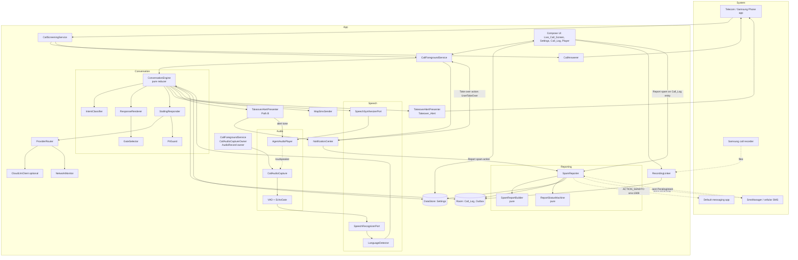
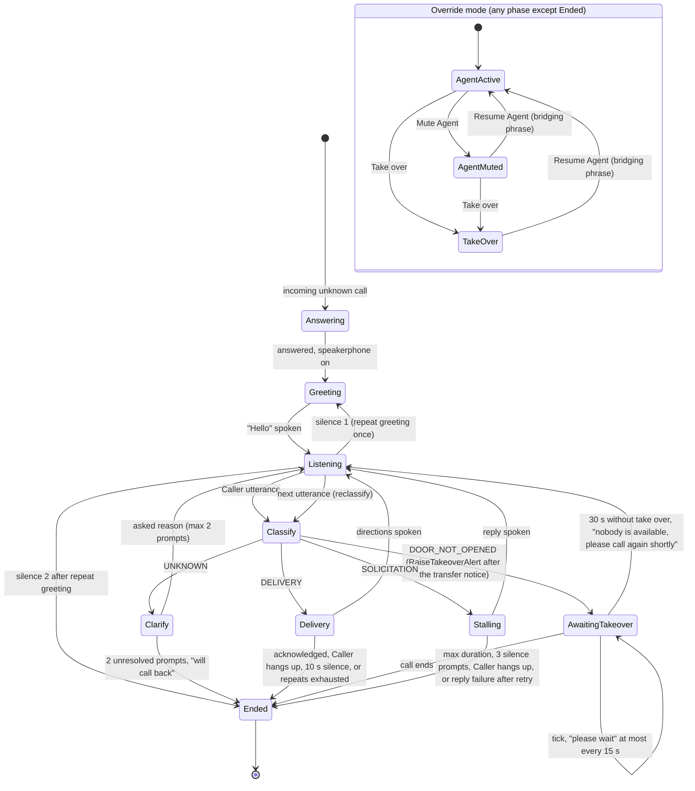
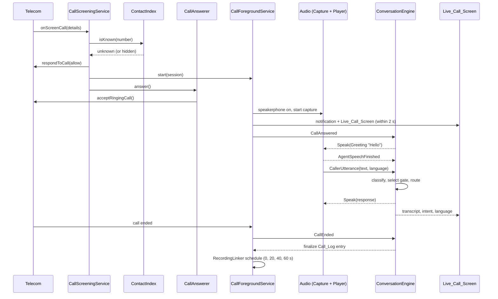
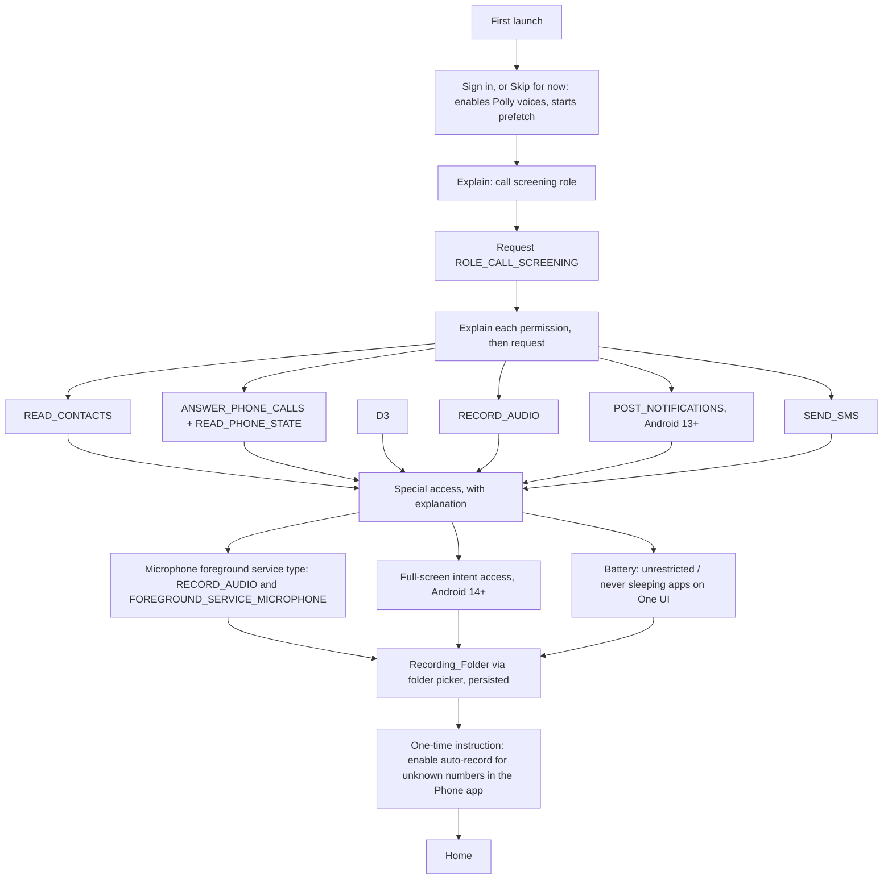
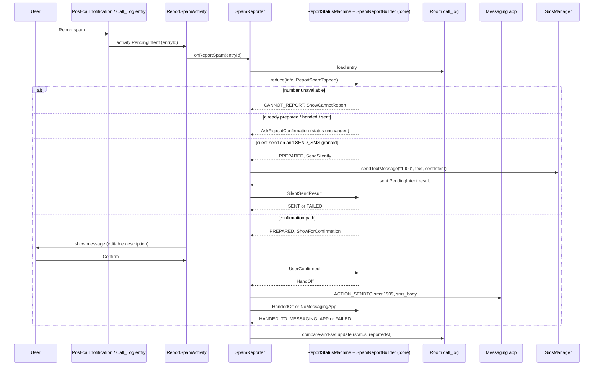

# Design Document: AI Call Screening Agent

## Overview

The App is a native Android application (Kotlin, Jetpack Compose with Material 3) for one User on one phone, a Samsung Galaxy M34 5G (India model, One UI). It screens calls from numbers that are not in the User's contacts. An Agent answers on the speakerphone, greets the Caller, classifies the Caller's intent (delivery, door not opened, solicitation, unknown), and responds in Hindi or English. The User can hear the call and take over at any time.

All recognition, language detection, classification, gate selection and speech synthesis run on the device. A cloud LLM is an optional enhancement for solicitation stalling only, behind a timeout and a PII guard.

### Decisions at a glance

| # | Decision | Choice | Validated by |
|---|---|---|---|
| D1 | Audio path | Speakerphone + microphone. Agent TTS plays on the loudspeaker; the Caller's voice is captured from the loudspeaker by the microphone. Capture is a plain `AudioRecord` owned by a foreground service (types `mediaPlayback` and `microphone`). The `AudioRecord` is owned by the App's own accessibility service while a call is handled, and that service is on only during calls (see "Decision: accessibility only during calls"). Spike S2c proved this on the phone; the plain foreground service alone returned silence. | Spike S1 to S4 |
| D2 | Answering | `CallScreeningService` (role) supplies the number. `TelecomManager.acceptRingingCall()` (`ANSWER_PHONE_CALLS`) answers. | S1 |
| D3 | Transfer | Takeover_Alert only (accepted by the User as a valid transfer): a full-screen high-importance alert with sound, vibration and an App-played tone on the speaker, with a "Take over" action. There is no second-call and merge path: it needs UI automation, and the accessibility service reads no screen content. | S6 |
| D4 | Recording | Samsung Phone app auto-record. The App only links files from a SAF folder and plays them with Media3. | S5 |
| D5 | On-device AI | Silero VAD; ASR chosen on the device: Whisper base int8 (2 threads) if it meets the latency budget at p90 in S7, otherwise Vosk small `hi`/`en-in` streaming as primary; text-based language detector, rule-based intent classifier, templates for responses, bundled Piper voices via sherpa-onnx for TTS. | S7 |
| D6 | Spam reporting (Requirement 14) | Pure `SpamReportBuilder` in `:core` builds "<Brief_Description>, <Sender_Number>, <DD/MM/YY>". Default path: `ACTION_SENDTO` `sms:1909` with `sms_body`, sent by the User from the messaging app. Direct `SmsManager` send only when Silent_Send_Setting is on and `SEND_SMS` is granted. | S8 |

### Assumptions

- The App is installed for personal use (sideloaded or internal testing), not distributed on Google Play. UPI and banking apps refuse to work while any accessibility service is enabled on the phone, so the App's accessibility service is on only while a call is handled.
- The target device is a Samsung Galaxy M34 5G, India model: Exynos 1280 (2x Cortex-A78 and 6x Cortex-A55 CPU cores, Mali-G68 GPU), 6 GB or 8 GB RAM. It launched in July 2023 with Android 13 / One UI 5.1 and has a promise of 4 OS upgrades. The Android and One UI version currently installed is not assumed; spike S0 reads it from the phone, together with the RAM variant and the security patch level. Platform rules that differ between Android versions (for example the Android 14 foreground-service and full-screen-intent rules) are designed for the strictest case and checked against the version found in S0.
- The Samsung Phone app's call-recording option is expected on the India model. Spike S0 confirms that it is present on the User's phone.
- The User accepts that a call to the Transfer_Target is not placed by the App; the Takeover_Alert is the transfer.
- The User keeps the Samsung Phone app as the default dialer. This is required for Requirement 12, because the Samsung recorder lives inside that app.
- The User accepts the Takeover_Alert as the only transfer mechanism (D3).
- The central `@myelly/ui` steering rule does not apply to this project. The App uses one shared set of reusable Compose components (`ui/components`) on Material 3 with a single theme (`ui/theme`).

## Architecture

### 1. Platform decisions

#### Decision: accessibility only during calls
**Evidence (spike S2c, Galaxy M34 5G, Wi-Fi calling, audio mode `MODE_IN_COMMUNICATION`).** The App enabled its accessibility service through `Settings.Secure` at OFFHOOK. `onServiceConnected` followed 409 ms later. With speakerphone on, an `AudioRecord` (`VOICE_RECOGNITION`) owned by the accessibility service captured the Caller: rms 1512 (-26.7 dBFS), rmsFirst2s 2272, peak 15880. Every earlier path without an accessibility service (plain foreground service, default assistant role) returned rms 0. At call IDLE the App disabled the service; `enabled_accessibility_services` was empty and `accessibility_enabled` was 0 afterwards. The per-second rms fell to about 0 after 6 s (the Caller may have stopped talking, or the platform silenced the record late), so late silencing is handled (rule 6).

**Decision.** The App declares a minimal `CallAudioA11yService` and uses it only as the owner of the call's `AudioRecord`. UPI and banking apps refuse to run while any accessibility service is enabled, and the User needs both, so the service is enabled only while the App handles a call. The App toggles its own service with `WRITE_SECURE_SETTINGS`, granted once over adb (`adb shell pm grant com.callanswer.app android.permission.WRITE_SECURE_SETTINGS`). The User is never asked to enable accessibility in system settings.

**Safety rules.**
1. The service config has `canRetrieveWindowContent=false`, one event type, `packageNames` limited to the App, and a large `notificationTimeout`. It reads no screen content and its description says it runs only during calls.
2. Enable when the call becomes active (`CallActiveGate`); wait up to 3 s for `onServiceConnected`; then apply the speaker route and start capture inside the service. The greeting is not delayed. If the service is not bound within 5 s, the App logs it, switches to assisted mode and shows the "Allow restricted settings" hint on Home.
3. Disable at call end (`finishSession`, `CallEnded`, IDLE), on any exception path, in `onDestroy`, after a 15-minute hard timeout, at app start (`CallAnswerApp.onCreate`, unless a call is active) and on `BOOT_COMPLETED`. An unreadable call state counts as "no call" (fail safe).
4. Only the App's entry in `ENABLED_ACCESSIBILITY_SERVICES` is added or removed; other enabled services are preserved. `ACCESSIBILITY_ENABLED` is set to 0 only when no service remains.
5. Without the grant, capture stays in the foreground service, the App is in assisted mode (F1), and Home shows the setup item "Let the Agent hear callers" with the copyable adb command and a live status ("granted", "accessibility currently off").
6. Late silencing: if the accessibility-owned `AudioRecord` returns zeros or is silenced after at least 2 s of audio while the call is active, it is recreated once (logged). If it stays silent for 10 s, the App switches to assisted mode (no hang-up).
7. The foreground service types stay `mediaPlayback|microphone`. The capture source order starts with `VOICE_RECOGNITION`.

Remaining fallbacks if the accessibility path stops working: assisted mode F1, then F2 (VoIP number). The default assistant role was tried in S2b and did not deliver audio.
#### D1. How the Agent hears the Caller and speaks into the call

**What Android allows.** Android does not give a third-party app the call's uplink or downlink (`VOICE_UPLINK`, `VOICE_DOWNLINK` and `AudioDeviceInfo.TYPE_TELEPHONY` need the privileged `CAPTURE_AUDIO_OUTPUT`). The Android 10+ input-sharing rules say: while the audio mode is `MODE_IN_CALL` or `MODE_IN_COMMUNICATION`, the call always receives audio, and an ordinary app's `AudioRecord` can be silenced, unless the app is an accessibility service, a privileged app with `CAPTURE_AUDIO_OUTPUT`, or holds the default assistant or dialer role. Source: [Sharing audio input](https://developer.android.com/media/platform/sharing-audio-input). Earlier spike runs on the M34 5G saw `MIC` and `UNPROCESSED` silenced in-call and `VOICE_RECOGNITION` not silenced, but that run used an accessibility service as the owner. The plain foreground service alone returned silence (S2), so the accessibility service is the owner during calls.

This changed the plan. A plain `AudioRecord` in a foreground service is silenced during the call (S2). Spike S2c proved capture owned by an accessibility service that is on only during the call. See "Decision: accessibility only during calls".

**Primary approach (P-AUDIO).**

1. `CallAudioCaptureOwner` holds the `AudioRecord`, created with the context of `CallAudioA11yService` while it is connected, otherwise with the `CallForegroundService` context. `CallForegroundService` is declared with `foregroundServiceType="mediaPlayback|microphone"` and the `FOREGROUND_SERVICE_MICROPHONE` permission, and requests the `microphone` type only when `RECORD_AUDIO` is granted. The accessibility service reads no screen content and is on only during calls.
2. Capture: `AudioRecord`, 16 kHz, mono, PCM16. Source order tried at runtime and fixed by spike S2: `VOICE_RECOGNITION`, then `MIC`, then `UNPROCESSED`, then `VOICE_COMMUNICATION`. Notes:
   - `VOICE_COMMUNICATION` is privacy-sensitive, so it has priority over ordinary capture, but it also applies the platform's call processing (AEC and noise suppression) tuned for a headset use case, which can degrade a voice coming from the loudspeaker. It is tried last.
   - `UNPROCESSED` has no AEC or noise suppression, which suits our own echo handling, but gain is low on some Samsung devices. Our AGC compensates.
   - An `AudioManager.AudioRecordingCallback` reports `isClientSilenced()`. If capture is silenced, the App switches to the fallback (below) and tells the User.
3. Output: the Agent never uses the Android TTS audio path directly. Every TTS engine produces PCM, and one `AgentAudioPlayer` plays it with an `AudioTrack`. Usage is tried in this order: `USAGE_VOICE_COMMUNICATION`, `USAGE_ASSISTANT`, `USAGE_MEDIA` (fixed by S3). The loudspeaker output reaches the Caller through the microphone's uplink path. Owning the PCM gives us exact start and end times, a stop within 500 ms (`pause` and `flush`), and a reference signal for echo removal.
4. Mode and route: the App does not set `AudioManager.mode` during a telephony call (the system holds `MODE_IN_CALL`). Speaker route is attempted in this order: `AudioManager.setSpeakerphoneOn(true)` (deprecated since API 31, but still the call-route switch on many builds), and `setCommunicationDevice(speaker)` (API 31+). If neither works, the App notifies the User (Requirement 13.17) and continues.
5. Volume: the App raises `STREAM_VOICE_CALL` to a configured level (default 80%) so the microphone picks up the TTS clearly. It restores the previous volume when the call ends.

**Echo and Caller/Agent/User separation.** The microphone hears three loudspeaker/room sources: the Caller (downlink), the Agent TTS, and the User when they speak. Three layers keep the Agent's own voice out of the Caller transcript (Requirement 13.15). Layers 1 and 3 are always on. Layer 2 is enabled only if spike S4 shows a benefit.

| Layer | Mechanism | Purpose |
|---|---|---|
| 1. Gate | `EchoGate` marks every audio frame inside `[ttsStart - 50 ms, ttsEnd + 600 ms]` as an "Agent window". Segments that lie fully inside an Agent window are not sent to ASR. Agent speech is split into short chunks (at most about 8 s each) with 400 ms listening gaps, so the Caller can still be heard and can ask to repeat. | Removes most echo and keeps ASR cheap. |
| 2. Reference echo removal | WebRTC AEC3 (or speexdsp AEC) with the TTS PCM as the render reference. Delay comes from `AudioTrack.getTimestamp()` and a cross-correlation search. The reference is the Agent's own signal, so the Caller's voice, which comes out of the loudspeaker as a different signal, is not cancelled. The call's own AEC is not used for this. | Lets the Caller's reply be heard while the Agent speaks (optional). |
| 3. Text filter | `EchoTextFilter` removes any ASR segment that overlaps an Agent window and whose normalized text has token similarity of at least 0.7 to an Agent utterance spoken in the last 15 s. | Guarantees that echo that slipped through is not in the transcript. |

The Agent does not stop talking because of microphone voice activity (Requirement 13.7). It stops only on Take over or Mute Agent.

**User versus Caller in the transcript.** There is no on-device diarization in the first version. Segments are labelled `CALLER` while the Agent is active (the User is expected to be quiet or to press Take over). While in Take_Over, speech from either person is labelled `LIVE` ("User or Caller"). A later option is a speaker-embedding model enrolled on the User's voice (sherpa-onnx speaker embedding), which fits the same `SpeakerLabeler` interface.

**Risk that the Caller cannot hear the TTS reliably.** The Caller hears the TTS only through the acoustic path (loudspeaker, then microphone, then call uplink). The phone's uplink noise suppression may treat the loudspeaker voice as noise and attenuate it, and the call AEC may cancel part of it because the downlink is the AEC reference. Mitigations: raise call volume, use short sentences, avoid long pauses, and add the Samsung in-call "Noise reduction" check to S3. If S3 fails (below 90% word intelligibility on 10 Hindi and 10 English test sentences at the Caller's end), the fallback applies.

**Fallback (F-AUDIO).**

- F1: if capture is silenced or unusable but TTS is audible to the Caller, the Agent works in "speak-only assisted mode". It greets, says a fixed prompt, and immediately alerts the User with a high-priority notification (full-screen intent) to Take over. This is a degraded behavior and is shown clearly in the UI.
- F2: if neither direction works, the project pivots to a VoIP/SIP number with a telephony provider (clean two-way audio streams). This is a different product: the Caller dials a provider number (or the User forwards to it), and Requirement 12 (Samsung recorder) no longer applies. This decision is taken after S1 to S4, not before.

**Alternatives considered.**

| Option | Hears Caller | Speaks to Caller | Samsung recorder still works | Effort | Verdict |
|---|---|---|---|---|---|
| A. Speakerphone + microphone, capture by a plain foreground service (chosen) | Via loudspeaker, then microphone, if S2 shows it is not silenced | Via loudspeaker, then microphone | Yes (stock dialer unchanged) | Medium | Chosen. Needs S2 and S3 to pass. |
| B. Make the App the default dialer (`InCallService`) | No. `InCallService` gives call control and audio routing (`setAudioRoute`), not call PCM. | No | No. The Samsung Phone app is replaced, so its recorder is lost. | High | Rejected. It does not solve audio and breaks Requirement 12. It would, however, give a clean `Call.conference()` for transfer. |
| C. VoIP/SIP number with a provider (cloud media streams) | Yes, clean | Yes, clean | No (provider records) | High, plus recurring cost and telecom compliance | Pivot option if S2 or S3 fails. |
| D. Conditional call forwarding to a cloud IVR | Yes | Yes | No | Medium | Rejected. Carrier forwarding cannot filter by "not in contacts". |

Speakerphone was already the User's decision, and it fits the requirements (Requirement 13). Option A keeps the stock dialer, recorder and call stack untouched, which is why it is chosen.

#### D2. How the App answers, and number matching

- **Screening role.** `CallScreeningService` (role `ROLE_CALL_SCREENING`, requested through `RoleManager.createRequestRoleIntent`) receives `onScreenCall(Call.Details)`. It supplies the number through `details.handle` and `details.handlePresentation`. A screening service can only allow, reject, silence or skip a call. It cannot answer.
- **Answering.** After the screening service responds with "allow" (`CallResponse.Builder().build()`), the App calls `TelecomManager.acceptRingingCall()`. This needs the `ANSWER_PHONE_CALLS` runtime permission and does not need the default-dialer role. Because the call can be in the screening state at the first moment, the answer is retried every 100 ms until the call state is `RINGING` or 2 s have passed (call state comes from `TelephonyCallback.CallStateListener`, which needs `READ_PHONE_STATE`). Spike S1 measures the arrival-to-answer time against the 3 s requirement.
- **Ending the call.** `TelecomManager.endCall()` (`ANSWER_PHONE_CALLS`). It may be deprecated on newer API levels, so S1 checks it on the phone. If it fails, the App asks the User with a notification.
- **Hidden numbers.** `details.handle == null` or `handlePresentation != PRESENTATION_ALLOWED` is treated as Unknown_Caller (Requirement 1.5).
- **Matching.** `PhoneNumberMatcher.matchKey(raw)` strips every non-digit character, then removes trunk or country prefixes by keeping the last 10 digits when there are more than 10 digits, and otherwise the digits as given. The `ContactIndex` is an in-memory `Set<String>` of keys built from `ContactsContract.CommonDataKinds.Phone`, refreshed by a `ContentObserver`. The set is loaded at App start and when the screening role is granted, so the lookup is a hash lookup (well within 1 s). If the contacts cannot be read (permission revoked or query error), the screener leaves the call ringing and posts a notification within 5 s (Requirement 1.6).
- **Foreground start from a screening callback.** A foreground service with type `microphone` created while the App is in the background fails on Android 14 and later, because `RECORD_AUDIO` is a while-in-use permission and the system throws `SecurityException` ([Restrictions on starting a foreground service from the background](https://developer.android.com/develop/background-work/services/fgs/restrictions-bg-start)). The documented exemptions for while-in-use access include a service started by interacting with a notification, started from a visible app, started by the default `VoiceInteractionService` app, or by a system component. `onScreenCall` is none of these, so the design is: `CallForegroundService` first enters the foreground as `mediaPlayback` only (allowed from the screening callback, or from the full-screen-intent path if the system refuses), and tries `mediaPlayback|microphone` first when the permission is granted, falling back on `SecurityException`. The `microphone` type is added later (`ACTION_UPGRADE_MICROPHONE`) when the Live_Call_Screen becomes visible, which happens through the full-screen intent or when the User taps the notification or the alert. Residual risk: until that happens the `AudioRecord` can be silenced, so capture runs in assisted mode F1 with the User notified; a User who never opens the screen on a locked phone gets no Caller transcript. This has not been run on the phone. Which combination works is decided in S1 and S2 (Risks R1 and R5).

#### D3. How the transfer to a real person works

Android has no call-transfer API for a third-party app. Candidate options:

| Option | How | Works without default-dialer role | Result for Caller | Verdict |
|---|---|---|---|---|
| T1. Second call and merge | `TelecomManager.placeCall(tel:Transfer_Target)` puts the active call on hold and dials the target. When the target answers, tap Merge to create a 3-way conference. | Placing the call: yes (`CALL_PHONE`). Merge: no public API outside `InCallService`; only an accessibility click on Samsung's Merge button. | 3-way conference. | Removed (no accessibility service). |
| T2. Takeover_Alert | Full-screen-intent notification on a high-importance channel with sound and vibration, plus an alert tone played by the App on the speaker, and a "Take over" action. The Agent keeps the Caller on the line with "please wait" phrases. | Yes | The User talks to the Caller directly. | The only path. The User accepted it as a valid transfer (Requirement 4, criteria 2, 5, 7 to 10). |
| T3. Conditional forwarding codes (`**21*`, `**61*` and similar) | Carrier MMI codes set forwarding for future calls. | Yes (dial codes) | Not per-call. Affects later calls. Cannot move a call already answered. | Rejected. |
| T4. Call the Transfer_Target and bridge audio through the phone | Phone holds two calls. | Android cannot mix two calls' audio without a merge. | Not possible. | Rejected. |
| T5. Explicit call transfer (carrier MMI "4") | Join two calls and drop out. | Carrier-dependent MMI | True transfer. | Not in scope. Possible follow-up experiment in S6. |

**Chosen:** the Takeover_Alert (T2) for every transfer. The earlier Path A (T1, second call and merge by accessibility click) was removed: the accessibility service only owns the audio capture. This meets Requirement 4.2 as now written.

**The Takeover_Alert.**

- Notification on channel `takeover_alert` (`IMPORTANCE_HIGH`, sound and vibration on, category `CALL`, lock-screen visibility public), with a full-screen intent to the Live_Call_Screen and one action, **Take over**. Full-screen intent access on Android 14+ is requested during onboarding (already in the permission flow). Without it, the notification still shows as a heads-up notification with the same action.
- Alert tone. Notification sounds are often muted or reduced to a short beep while a call is active, so the App also plays its own short alert tone through `AgentAudioPlayer` on the speaker. `TakeoverAlertPresenter` (`:app`) repeats the tone every 10 s, offset by 5 s from the Agent's "please wait" phrases, until the User takes over or 30 s have passed. The Caller hears the tone through the microphone path; it is short and quieter than speech. `EchoGate` marks each tone as an Agent window, so the tone is never transcribed.
- **Take over** action: a `PendingIntent` to `CallForegroundService` that feeds the engine the same `UserTakeOver` event as the Live_Call_Screen control, so the effects are identical (Requirement 13.21). When the take over happens while the Agent is waiting for it, the engine also logs "transfer completed by User" (4.8).
- The alert is cancelled when the User takes over or when the call ends. If the User does not take over, the alert stays visible until the call ends (4.9).

**Transfer sequence.**

1. The Agent says the transfer notice in the Caller's language (Requirement 4.1).
2. When the notice ends (`AgentSpeechFinished`), the engine raises the Takeover_Alert immediately (`RaiseTakeoverAlert`); the effects run within 2 s (4.2). It also emits the "Caller is waiting" notification with the Caller's number (4.6). When no Transfer_Target is configured, the App also notifies the User within 10 s with the Caller's number (4.5); the Transfer_Target is never dialled.
3. **Waiting for take over** (phase `AWAITING_TAKEOVER`): the Agent says a short "please wait" phrase (`SpeechSpec.PleaseWait`) in the Caller's language immediately and then every 10 s, so the interval is never more than 15 s (4.7, 4.11). The Agent says nothing else in this phase. Caller utterances are transcribed but get no reply.
4. **User takes over** (from the alert or from the Live_Call_Screen): Take_Over as in Requirement 13, and the Call_Log records "transfer completed by User" with outcome `TAKEN_OVER_BY_USER` (4.8, 13.21).
5. **No take over within 30 s of the alert**: the Agent says once "nobody is available, please call again shortly" (`SpeechSpec.NobodyAvailable`) in the Caller's language, the phase returns to `LISTENING` so the Caller stays connected to the Agent, the outcome is `NO_TAKEOVER_30S`, and the alert stays visible until the call ends (4.3, 4.9). A later take over from the still-visible alert is a normal Take_Over.
6. **No network** (Requirement 8.10): the Takeover_Alert needs no network, so the transfer works unchanged with data off.

**Controls during a transfer** (Requirement 13.20). Mute, Resume and Quick_Replies do not change the transfer: the 30 s timers, the alert and the logged outcome are the same as without them. Mute still silences the Agent (13.10), so no "please wait" phrase is spoken while muted. If the 30 s point passes while muted, the outcome becomes `NO_TAKEOVER_30S` on time and `NobodyAvailable` is spoken right after the Bridging_Phrase when the User resumes. The User confirmed this reading of 13.10 versus 4.9 (open question 5). Take over is the only control that completes the transfer.

**Honest assumption:** the User may not notice the alert (phone in another room); S6 checks the alert on the M34 5G.

#### D4. Recording

The Samsung Phone app records the call (User enables auto-record for unknown numbers in Phone settings; the App cannot start or stop it). The App never records audio itself and never copies files. It only does the following.

- Links a finished file from the Recording_Folder (Storage Access Framework tree URI from `ACTION_OPEN_DOCUMENT_TREE`, persisted with `takePersistableUriPermission`). The App never asks for broad storage access.
- Plays it with Media3 `ExoPlayer` from the `content://` URI (pause, resume, stop).
- Deletes a file with `DocumentsContract.deleteDocument` only after the User confirms.

Samsung stores call recordings in a "Recordings/Call" folder on recent One UI builds and names files like `Call recording <name or number>_<yymmdd>_<hhmmss>`; the exact folder and name pattern are read from the actual phone in spike S5 and are parsed leniently. Spike S5 validates: (1) auto-record starts for a call that the App answered through the screening role, (2) whether the recording captures the Caller, the Agent TTS (it should, through the microphone), and the User, (3) the delay between call end and file appearance (sets the retry spacing), and (4) the timestamp semantics (file start versus file modified).

#### D5. On-device AI stack

| Stage | Primary | Fallback | Approx. size | Notes |
|---|---|---|---|---|
| VAD | Silero VAD (via sherpa-onnx) | Energy VAD | about 2 MB | Endpoint hangover 400 ms; drops silence and noise before ASR so Whisper does not hallucinate on silence. |
| ASR | Chosen on the M34 5G in S7 (device-driven). Candidate 1: Whisper multilingual `base` int8 (about 80 to 150 MB) via sherpa-onnx or whisper.cpp, per-utterance decode after the VAD endpoint, 2 threads to match the 2 Cortex-A78 cores (big-core affinity set from native code where the kernel allows it). Candidate 2: Vosk small `hi` (about 40 MB) and `en-in` (about 36 MB), streaming, so most decoding happens while the Caller is still speaking. Whisper `small` is not planned on this phone (speed and memory). | If Whisper base misses the latency budget at p90 in S7, Vosk streaming becomes primary and Whisper is not bundled. Last resort: Android `SpeechRecognizer` with offline packs fed through `EXTRA_AUDIO_SOURCE` (Android 13+). | see left | S7 benchmarks WER, intent accuracy and latency on recorded loudspeaker audio in Hindi, English and Hinglish on the M34 5G and fixes the choice. Sizes are approximate and are measured in S7. |
| Language identification | Text-based `ScriptLanguageDetector` (Devanagari tokens count as Hindi; Roman tokens are classified by a Hinglish lexicon) applying the majority rule of Requirement 7.5. | The ASR's language tag, used only when the text rule cannot decide. | less than 1 MB | Costs microseconds, so the 500 ms limit is met easily. |
| Intent | Rule engine: normalized phrase patterns in Devanagari, Roman-script Hinglish and English, with earliest-match-wins. Gate_Query patterns are a separate list. | Optional small fastText-style classifier (under 5 MB), consulted only when rules return UNKNOWN and off by default. | under 1 MB | Pure Kotlin, fully unit and property testable. |
| Response generation | Templates for greeting, delivery, transfer, clarify, gate and fallbacks. Stalling: fictitious-reply template library (offline). | Cloud LLM (optional) for stalling when the network is AVAILABLE, with a strict prompt, a PII guard and a hard deadline. | templates: under 1 MB | The cloud LLM is never required. |
| TTS | Bundled Piper voices through sherpa-onnx (`vits-piper-hi_IN-priyamvada-medium` female; `hi_IN-pratham` or `hi_IN-rohan` male; English male and female Piper voices). Each medium voice is about 60 MB. | Android `TextToSpeech` (Samsung or Google engine) with voice enumeration through `getVoices()` for substitutions (Requirement 7.12, 7.13). | about 250 MB for 4 voices | [sherpa-onnx lists Hindi Piper voices](https://k2-fsa.github.io/sherpa/onnx/tts/all/Hindi/vits-piper-hi_IN-priyamvada-medium.html). Voice licences are checked per voice before bundling. Requirement 7.15 requires bundled voices, so Android TTS is only a fallback. |
| Pre-recorded fallback phrases (Requirement 8.9, 7.14) | Generated at build time with the bundled voices and shipped as WAV files (male and female, Hindi and English). | none | about 2 MB | Used when synthesis fails, so they need no runtime TTS. |
| On-device translation (Requirement 9.19) | ML Kit on-device Translate when its model is already present (optional download the User starts in Settings). | Speak the provided text as is. | 30 MB per pair (optional) | Not bundled, because it is optional by the requirement. |

Total bundled model size is about 300 to 700 MB, depending on which ASR models pass S7 (the low end is Vosk only, the high end is Whisper base plus Vosk). Only the smallest set of models that passes S7 is bundled. It ships inside the APK or an install-time asset pack, uncompressed (`noCompress "onnx", "bin"`) and memory-mapped, so Offline_Mode works immediately after install (Requirement 8.11).

**Memory on the M34 5G (6 or 8 GB RAM).** One UI, the Samsung Phone app and the in-call UI run at the same time as the App, so the App keeps its resident model memory well below the RAM. The design target is to keep the resident model memory for a call at a few hundred MB, and well under 1 GB, on the 6 GB variant (an estimate, measured in S7). Rules: load only one ASR engine per call (the one chosen in S7); load only the two Piper voices of the call's frozen gender (Hindi and English), not all four; memory-map model files so pages can be dropped under pressure; and release the models when the call ends. S7 records the peak resident memory (PSS) during a 10-minute call, and checks that the App is not killed by the low-memory killer.

**Thermal note.** The 2 big cores carry ASR and TTS. A long stalling call can heat the phone and lower clock speeds, so S7 also measures latency at the end of a 10-minute sustained call, not only on a cold start.

Mixed-script text (for example a Hindi sentence containing an English landmark) is split by `ScriptSplitter` into runs. Each run is spoken by the voice of its script and the same gender.

### 2. Latency budget

Requirement 8.6 and 2.1: the Agent starts speaking within 3 s after the Caller stops, in Offline_Mode. The Exynos 1280 has only 2 big cores (Cortex-A78) and 6 efficiency cores (Cortex-A55), so the earlier budget, which assumed a chip with 4 big cores, no longer holds. All numbers below are estimates given as ranges, not benchmarks. Every row is re-measured on the M34 5G in S7.

| Stage | Whisper base int8 path (estimate) | Vosk small streaming path (estimate) | Notes |
|---|---|---|---|
| VAD endpoint hangover | 400 ms | 400 ms | Fixed by the VAD tail. |
| ASR final result (5 s utterance) | about 1.2 to 3 s | about 0.1 to 0.4 s | Whisper decodes the whole utterance after the endpoint on 2 threads. Vosk decodes while the Caller speaks, so only the final step remains. |
| Language detection + intent + gate query | under 50 ms | under 50 ms | Pure text. |
| Response generation (template) | under 50 ms | under 50 ms | Cloud LLM, when used, is capped by the deadline rule below. |
| TTS to first audio | about 0.4 to 1 s | about 0.4 to 1 s | Piper first chunk; the first sentence is kept short, and later sentences are synthesized while the first one plays. |
| Audio output buffer | about 100 ms | about 100 ms | `AudioTrack` low-latency mode. |
| **Total** | **about 2.2 to 4.6 s: at risk** | **about 1.1 to 2 s** | Limit 3 s; S7 pass mark 2.5 s at p90. |

**ASR decision rule (device-driven).** S7 runs both candidates on the M34 5G with the same 30-utterance test set. Whisper base int8 stays primary only if the end-to-end response latency is at most 2.5 s at p90 (cold and after the 10-minute sustained run) and intent accuracy is at least 90%. Otherwise Vosk small streaming becomes primary. If Vosk is primary and its intent accuracy is lower, the phrase tables are tuned on its real output. If neither passes, the team stops and decides with the User (Risk R7).

**Cloud deadline rule.** Requirement 8.4 fixes a 1.5 s cloud timeout. For the stalling LLM the effective deadline is `min(1500 ms, 2400 ms - elapsedSinceEndOfSpeech)`, so a slow cloud reply can never push the response past the 3 s limit. The local template reply is generated first (about 20 ms) and is used whenever the cloud misses the deadline.

### 3. Component diagram



### 4. Call-flow state machine

`Phase` (what the Agent is doing) and `Mode` (who controls the Agent) are two independent dimensions. The diagram shows the phase machine and the override modes.



`AwaitingTakeover` is the waiting phase. Take over from the Takeover_Alert or from the Live_Call_Screen moves the mode to `TakeOver` and records the transfer as completed by the User; the phase is then frozen like any other phase in `TakeOver`. In `AwaitingTakeover` the only speech is "please wait"; Caller utterances are transcribed and not answered.

Rules that cross the diagram: gate queries never change the phase (the engine speaks the gate info and then follows the phase's next step); User "End call" goes to `Ended` from every state within 2 s; in `TakeOver` no phase transition is produced by timers, silence or max-duration events; in `AgentMuted` the Agent produces no speech but the transcript keeps growing; Resume Agent speaks a Bridging_Phrase and continues from the stored phase and Intent_Category.

### 5. Sequence diagram: incoming call



### 6. Module and package structure

Two Gradle modules keep the logic testable on the JVM without an emulator.

```
:core  (pure Kotlin/JVM, no Android imports; Kotest, kotlinx-serialization)
  model/        Settings, DeliveryStep, Gate*, CallLogEntry, Utterance, enums
  phone/        PhoneNumberMatcher, ScreeningDecision
  gate/         GateSelector, GateInfoRenderer
  intent/       RuleIntentClassifier, PhraseTables, TextNormalizer
  language/     ScriptLanguageDetector, ResponseLanguageResolver
  delivery/     DeliveryDirectionsRenderer, StepListValidator
  conversation/ ConversationEngine, ConversationState, ConversationEvent, Effect, SpeechSpec
  stalling/     FictitiousReplyLibrary, FictitiousGate, PiiGuard, PromptBuilder
  echo/         EchoTextFilter
  network/      NetworkClassifier, ProviderRouter
  recording/    RecordingMatcher, LinkPolicy
  settings/     SettingsValidator
  voice/        VoiceSelector, SpeakerPolicy
  report/       SpamReportBuilder, BriefDescriptionGenerator, SenderNumber, ReportStatusMachine, ReportFlowPolicy

:app  (Android)
  telecom/      CallScreenerService, CallAnswerer, ContactIndex
  audio/        CallAudioCaptureOwner, CallAudioCapture, AgentAudioPlayer, EchoGate, AudioRouteController (setSpeakerphoneOn, setCommunicationDevice)
  asr/          WhisperRecognizer, VoskRecognizer, SystemRecognizer, SileroVad
  tts/          SherpaPiperSynthesizer, AndroidTtsSynthesizer, ScriptSplitter, FallbackPhrases
  nlg/          CloudLlmClient, StallingResponder
  net/          NetworkMonitor (ConnectivityManager + probe)
  data/         Room (CallLogDao, OutboxDao), SettingsStore (DataStore), mappers
  recording/    RecordingFolderRepository (SAF), RecordingLinker, PlaybackController (Media3)
  service/      CallForegroundService, NotificationCenter, TakeoverAlertPresenter, OutboxWorker
  sms/          MapSmsSender, SpamReporter, SmsIntentLauncher, SmsGateway, SmsSentReceiver
  ui/           theme/, components/ (shared composables), screens/ (LiveCall, Home, Settings, DeliverySteps, CallLog, CallDetail, Onboarding)
```


## Components and Interfaces

All types below live in `:core` unless marked `:app`. Time is always injected (`java.time.Clock`, or `atMs` fields on events) so that tests are deterministic.

### Settings and core enums

```kotlin
enum class Language { HI, EN }
enum class VoiceGender { MALE, FEMALE }
enum class IntentCategory { DELIVERY, DOOR_NOT_OPENED, SOLICITATION, UNKNOWN }
enum class NetworkQuality { AVAILABLE, DEGRADED, UNAVAILABLE }

@Serializable
data class DeliveryStep(val id: String, val textEn: String, val textHi: String) // blank = missing

@Serializable
data class Gate(val number: String, val location: String, val landmark: String)

@Serializable
data class NightWindow(val start: LocalTimeHm, val end: LocalTimeHm) // start != end; start inclusive, end exclusive

@Serializable
data class GateConfig(val gate1: Gate, val gate3: Gate, val nightWindow: NightWindow)

@Serializable
data class Settings(
    val screeningEnabled: Boolean = true,                    // 1.7, 9.1
    val mapLocation: String? = null,
    val transferTarget: String? = null,                      // validated, 9.4
    val maxStallingSeconds: Int = 120,                       // 30..600, 9.1
    val gates: GateConfig = DefaultGates,                    // 9.8, 11.16
    val deliverySteps: List<DeliveryStep> = DefaultDeliverySteps, // 1..10, 9.16
    val voiceGender: VoiceGender = VoiceGender.FEMALE,       // 9.15
    val disclosureEnabled: Boolean = false,                  // 9.14
    val speakerEnabled: Boolean = true,                      // 9.25
    val silenceTimeoutSeconds: Int = 8,                      // Silence_Timeout
    val quickReplies: List<QuickReply> = DefaultQuickReplies, // 13.13
    val recordingFolderUri: String? = null,                  // 9.11
    val protectedTerms: List<String> = emptyList(),          // extra values for the PII guard (name, address, ...)
    val cloudLlmEnabled: Boolean = false,                    // optional enhancement
    val silentSendSpamReports: Boolean = false,              // Silent_Send_Setting, 9.26, 14.14 to 14.17
)

@Serializable
data class QuickReply(val textEn: String, val textHi: String = "")
```

`DefaultDeliverySteps` are the four steps of Requirement 3.2 in English and Hindi, where the first step uses the placeholder ("Go to {map_location}"). `DefaultGates` are Gate 1 (Press Enclave Road, near Punjab National Bank), Gate 3 (opposite Aurobindo College) and `22:30` to `05:30`.

`protectedTerms` is a design addition. The PII guard cannot know the User's real name, address or ID unless the User gives them. The guard also always protects `mapLocation`, `transferTarget`, the phone's own number (when readable), and the `Gate` values (for fictitious gate answers). These values stay on the device.

### Session and conversation model

```kotlin
enum class Speaker { CALLER, AGENT, USER, LIVE }      // LIVE = User and/or Caller during Take_Over

data class Utterance(
    val speaker: Speaker,
    val text: String,
    val language: Language?,
    val startMs: Long,            // ms since call start
    val endMs: Long,
)

enum class Phase { ANSWERING, GREETING, LISTENING, DELIVERY, AWAITING_TAKEOVER, TRANSFERRED /* unused, kept for the log */, STALLING, CLARIFYING, ENDED }
enum class Mode { AGENT_ACTIVE, AGENT_MUTED, TAKE_OVER }

data class CallSession(
    val id: String,
    val callerNumber: String?,            // null = hidden/unavailable
    val startedAt: Instant,
    val zone: ZoneId,
    val frozen: FrozenSettings,           // voice, steps, disclosure, gates... taken at call start (9.15, 9.22)
)

data class ConversationState(
    val phase: Phase = Phase.ANSWERING,
    val mode: Mode = Mode.AGENT_ACTIVE,
    val intent: IntentCategory = IntentCategory.UNKNOWN,
    val lastLanguage: Language? = null,         // last identified
    val clarifyPrompts: Int = 0,                // 6.2
    val greetingRepeated: Boolean = false,      // 6.4, 6.5
    val silencePrompts: Int = 0,                // 5.6
    val repeatsUsed: Int = 0,                   // 3.3
    val garbledAsks: Int = 0,                   // 8.7
    val stallStartMs: Long? = null,
    val takeoverStartMs: Long? = null,
    val takeovers: List<TakeoverRecord> = emptyList(),
    val gateStatements: List<GateStatement> = emptyList(),
    val spokenResponseIds: Set<String> = emptySet(),   // each response spoken at most once (8.5)
    val resumePhase: Phase? = null,
    val transfer: TransferState? = null,              // Requirement 4; null until a transfer starts
    val transcript: List<Utterance> = emptyList(),
)

data class TransferState(
    val path: TransferPath,                       // always PATH_B_ALERT (PATH_A_MERGE is kept in the enum, unused)
    val startedAtMs: Long,
    val alertReason: AlertReason? = null,         // why the Takeover_Alert was raised
    val alertRaisedAtMs: Long? = null,
    val lastPleaseWaitAtMs: Long? = null,         // start of the last PleaseWait (<= 15 s spacing, 4.7, 4.11)
    val nobodyAvailablePending: Boolean = false,  // 30 s passed while muted; spoken after the Bridging_Phrase
    val outcome: TransferOutcome? = null,         // final, written to the Call_Log
)
enum class TransferPath { PATH_A_MERGE /* unused, removed feature */, PATH_B_ALERT }
```

### ConversationEngine (pure reducer)

The engine has no I/O. It maps `(state, event)` to `(state, effects)`. Android components execute the effects and feed back events. This keeps the call flow, take-over and mute rules property-testable.

```kotlin
sealed interface ConversationEvent {
    val atMs: Long
    data class CallAnswered(override val atMs: Long) : ConversationEvent
    data class CallerUtterance(override val atMs: Long, val text: String, val asrLanguage: Language?, val localTime: LocalTimeHm?) : ConversationEvent
    data class CallerAudioUnusable(override val atMs: Long) : ConversationEvent          // garbled/interrupted, 8.7
    data class Tick(override val atMs: Long, val silentForMs: Long, val noAudioForMs: Long) : ConversationEvent
    data class AgentSpeechFinished(override val atMs: Long, val responseId: String) : ConversationEvent
    data class VoiceActivity(override val atMs: Long) : ConversationEvent                // must not stop the Agent (13.7)
    data class UserTakeOver(override val atMs: Long, val origin: TakeoverOrigin) : ConversationEvent  // origin is not used by the reducer (13.21)
    data class UserMute(override val atMs: Long) : ConversationEvent
    data class UserResume(override val atMs: Long) : ConversationEvent
    data class UserEndCall(override val atMs: Long) : ConversationEvent
    data class QuickReplySent(override val atMs: Long, val text: String) : ConversationEvent
    data class ResponseFailed(override val atMs: Long, val attempt: Int) : ConversationEvent
    data class SpeechSynthesisFailed(override val atMs: Long, val attempt: Int) : ConversationEvent
    data class CallEnded(override val atMs: Long, val by: EndedBy) : ConversationEvent
}

sealed interface Effect {
    data class Speak(val responseId: String, val spec: SpeechSpec, val language: Language) : Effect
    data object StopSpeaking : Effect
    data class RaiseTakeoverAlert(val callerNumber: String?, val reason: AlertReason) : Effect // Path B
    data object ClearTakeoverAlert : Effect                                                   // on take over or call end only
    data class SendMapSms(val number: String) : Effect
    data class Notify(val kind: NotificationKind) : Effect
    data class EndCall(val reason: EndReason) : Effect
    data class LogNote(val note: LogNoteKind) : Effect
}

sealed interface SpeechSpec {
    data object Greeting : SpeechSpec
    data object Disclosure : SpeechSpec
    data class DeliveryDirections(val repetition: Int, val proactiveGate: Boolean = true) : SpeechSpec
    data class GateInfo(val inResponseToQuery: Boolean) : SpeechSpec
    data object AskReason : SpeechSpec                  // UNKNOWN clarification
    data object AskRepeatRequest : SpeechSpec           // empty / garbled transcript
    data object TransferNotice : SpeechSpec
    data object PleaseWait : SpeechSpec                 // AWAITING_TAKEOVER, at most 15 s apart (4.7, 4.11)
    data object NobodyAvailable : SpeechSpec            // "nobody is available, please call again shortly" (4.3, 4.9)
    data object WillReturnCall : SpeechSpec
    data object NoFurtherRepetitions : SpeechSpec
    data class Stall(val callerText: String) : SpeechSpec   // StallingResponder fills the text
    data object StallFiller : SpeechSpec
    data object SilencePrompt : SpeechSpec
    data object BridgingPhrase : SpeechSpec
    data class QuickReply(val text: String) : SpeechSpec
    data object FallbackPhrase : SpeechSpec
    data object PoliteGoodbye : SpeechSpec
}

interface ConversationEngine {
    fun reduce(state: ConversationState, event: ConversationEvent, ctx: EngineContext): Transition
}
data class Transition(val state: ConversationState, val effects: List<Effect>)
data class EngineContext(val frozen: FrozenSettings, val callerKnownNumber: Boolean)
```

**Dispatch table** (Requirements 3.1, 4.1, 5.1, 6.1, 11.1, 11.8 to 11.11). Language is `ResponseLanguageResolver.resolve(detected, lastLanguage)`.

| Intent | Gate_Query flagged | First effects |
|---|---|---|
| DELIVERY | any | `Speak(DeliveryDirections)` (gate info always first, 3.10 and 11.8). A gate query answer is not counted as a repetition (3.11). |
| DOOR_NOT_OPENED | no | `Speak(TransferNotice)`; when it finishes, the first transfer effect (see Transfer below) |
| DOOR_NOT_OPENED | yes | `Speak(GateInfo)`, then `Speak(TransferNotice)`; when it finishes, the first transfer effect |
| SOLICITATION | any | `Speak(Stall)`. If gate query: the stalling reply carries fictitious gate information (11.11). |
| UNKNOWN | no | `Speak(AskReason)`; `clarifyPrompts + 1` |
| UNKNOWN | yes | `Speak(GateInfo)` then `Speak(AskReason)`; `clarifyPrompts` unchanged (11.10) |

Behavior notes:

- **Reclassification (2.8).** Each utterance is classified alone. A non-UNKNOWN category replaces the current category from the next response onward. An UNKNOWN result after a determined category (for example "ok" or "haan") does not reset the category. This is a design decision (Requirement 2.8 only speaks of "a different Intent_Category") and is stated in the property.
- **Empty or late transcript (2.10).** Treated as UNKNOWN once and the Agent asks the Caller to repeat (`AskRepeatRequest`). This does not count as a clarification prompt of Requirement 6.2 but is limited to one per utterance.
- **Delivery end (3.6).** After the directions, the call ends on acknowledgement, hang-up or 10 s silence. Repeat requests are served up to 3 times; the fourth request gets `NoFurtherRepetitions` and `EndCall` (3.9).
- **Map SMS (3.4, 3.5, 3.8).** After the directions end, `SendMapSms` is emitted if the Map_Location is configured and the Caller number is known; if not configured, `Notify(MAP_LOCATION_MISSING)`.
- **Silence (5.6, 6.4, 6.5).** Silence handling is driven by `Tick`: after the greeting, one silence timeout repeats the greeting, the second ends the call; in stalling, 3 consecutive silence prompts end the call and record "caller silence".
- **Audio problems (8.7, 8.8).** `CallerAudioUnusable` asks the Caller to repeat, at most 3 consecutive times. After more than 10 s without usable audio the call ends and the interruption (start, duration) is logged.
- **Maximum stalling (5.8).** The `Tick` handler ends the call politely when `now - stallStartMs >= maxStallingSeconds`.
- **Transfer (Requirement 4, 8.10, 13.20, 13.21).** Started on `AgentSpeechFinished` of the `TransferNotice`. The first transfer effect is always `RaiseTakeoverAlert` (reason `TAKEOVER_REQUIRED`, or `TARGET_NOT_CONFIGURED` without a target), followed by `Speak(PleaseWait)`, `Notify(TRANSFER_STARTED)` and, without a target, `Notify(TRANSFER_TARGET_MISSING)`; the phase is `AWAITING_TAKEOVER`. In `AWAITING_TAKEOVER`: a `Tick` with `now - lastPleaseWaitAtMs >= 10 000 ms` gives `Speak(PleaseWait)` (ticks are at most 1 s apart, so the start-to-start spacing is at most 11 s, below the 15 s limit); Caller utterances are added to the transcript and produce no `Speak`; the first `Tick` with `now - alertRaisedAtMs >= 30 000 ms` gives exactly one `Speak(NobodyAvailable)`, outcome `NO_TAKEOVER_30S` and phase `LISTENING`, without `ClearTakeoverAlert` (4.3, 4.9). `UserTakeOver` in `AWAITING_TAKEOVER` additionally gives `LogNote(TRANSFER_COMPLETED_BY_USER)` and outcome `TAKEN_OVER_BY_USER` (4.8). Mute suppresses PleaseWait and NobodyAvailable speech but not the timers or the outcome; if `NO_TAKEOVER_30S` was reached while muted, `nobodyAvailablePending` makes `UserResume` speak `NobodyAvailable` right after the `BridgingPhrase` (13.10, 13.20).
- **Take over (13.6, 13.8, 13.9, 13.21).** `UserTakeOver` produces `StopSpeaking`, `ClearTakeoverAlert` when an alert is shown, sets `mode = TAKE_OVER` and stores the start time. The reducer ignores `origin`, so a take over from the Takeover_Alert produces exactly the same transition as one from the Live_Call_Screen. In TAKE_OVER the reducer produces no `Speak`, no `EndCall` (except on `UserEndCall`/`CallEnded`), no `StartTransfer`, no `RaiseTakeoverAlert` and no silence or max-duration reaction. The transcript still grows.
- **Mute (13.10).** `UserMute` produces `StopSpeaking` and `mode = AGENT_MUTED`. No `Speak` effect is produced until resume. `QuickReplySent` is ignored while muted or in TAKE_OVER (the User is talking directly).
- **Resume (13.11).** `UserResume` from TAKE_OVER or AGENT_MUTED produces `Speak(BridgingPhrase)` in the Caller's language and restores `mode = AGENT_ACTIVE` with `phase` and `intent` unchanged.
- **VAD is not an interrupt (13.7).** `VoiceActivity` never produces `StopSpeaking`.
- **Speech output failure (7.9).** One retry, then a spoken message in the last language that worked (`FallbackPhrase`), and the call stays open.
- **Response failure (8.9, 5.10).** `ResponseFailed`: speak `FallbackPhrase` within 3 s. In stalling: speak `StallFiller`, retry once, then end politely and log the failure.

### Intent classification and language detection

```kotlin
data class IntentResult(val category: IntentCategory, val gateQuery: Boolean, val matchStart: Int?)

interface IntentClassifier { fun classify(utterance: String): IntentResult }

class RuleIntentClassifier(private val phrases: PhraseTables) : IntentClassifier
```

- `TextNormalizer`: NFKC, lower case, Devanagari nukta normalization (`ज़` to `ज`), strip punctuation, collapse spaces. Match positions are computed on the normalized text.
- `PhraseTables` contain, per category, regular expressions with word boundaries for Devanagari, Roman Hinglish (with spelling variants, for example `delivery|dilivery|डिलीवरी`) and English. The categories and the Gate_Query have separate tables.
- `classify`: find the first match of every category table; choose the category whose match starts at the lowest character index; ties on the same index go to the longer match, then to the order DELIVERY, DOOR_NOT_OPENED, SOLICITATION. No match gives UNKNOWN. `gateQuery` is true when any Gate_Query pattern matches, and it never contributes to the category choice (Gate_Query patterns are not in the category tables).

```kotlin
interface LanguageDetector { fun detect(utterance: String): Language? }   // null = cannot identify

class ScriptLanguageDetector(private val hinglishLexicon: Set<String>) : LanguageDetector
object ResponseLanguageResolver { fun resolve(detected: Language?, lastIdentified: Language?): Language } // 7.4, 7.6
```

`ScriptLanguageDetector` tokenizes the utterance. A token is Hindi if it has Devanagari characters or is a Roman token found in the Hinglish lexicon; English if it is a Roman token not in the lexicon and contains letters; digits and punctuation are not counted. The language with more than 50% of the counted tokens wins. On an exact 50/50 tie, the language of the first counted token wins. No counted tokens gives `null`. The resolver returns `detected ?: lastIdentified ?: EN`.

### Gate selection and rendering

```kotlin
sealed interface GateSelection {
    data class Single(val gate: Gate, val night: Boolean) : GateSelection
    data class Both(val gate1: Gate, val gate3: Gate, val window: NightWindow) : GateSelection   // time unreadable, 11.17
}

fun isInNightWindow(now: LocalTimeHm, w: NightWindow): Boolean =
    if (w.start < w.end) now >= w.start && now < w.end          // same-day window
    else now >= w.start || now < w.end                          // wraps past midnight

fun selectGate(now: LocalTimeHm?, cfg: GateConfig): GateSelection =
    if (now == null) GateSelection.Both(cfg.gate1, cfg.gate3, cfg.nightWindow)
    else if (isInNightWindow(now, cfg.nightWindow)) GateSelection.Single(cfg.gate3, night = true)
    else GateSelection.Single(cfg.gate1, night = false)
```

`LocalTimeHm` is hour and minute only (the time is truncated to the minute, Requirement 11.5). `GateInfoRenderer.render(selection, language, includeWindowTimes)` returns the text. It contains only gate number, location and landmark (plus Night_Window times when the Caller asked about timing, or when both gates are stated). It does not contain any other address or the Map_Location (11.12). The engine reads the clock at the moment each statement starts, so repeats and later statements use the time of their own start (11.5 to 11.7).

### Delivery directions

```kotlin
object DeliveryDirectionsRenderer {
    fun render(
        steps: List<DeliveryStep>, language: Language, mapLocation: String?,
        gateInfoText: String, translator: StepTranslator?,
    ): List<String>   // [gateInfoText, step1, step2, ...]
}
fun interface StepTranslator { fun translate(text: String, from: Language, to: Language): String? }
```

- The first element is the Colony_Gate_Info (3.10, 9.24), then the steps in configured order (3.2).
- For each step the text in the target language is used. If it is blank, the other language's text is translated with `translator` when available (9.19), otherwise spoken as is.
- `{map_location}` is replaced in every step by `mapLocation`. If no Map_Location is set, the placeholder is replaced by an empty string and surrounding whitespace is collapsed, so the step is spoken without a location reference (3.5). No `{map_location}` text remains in the output.
- Each element is spoken as its own audio chunk with a short listening gap, so a Caller who asks to repeat can be heard (see D1).

### Stalling, fictitious information and the PII guard

```kotlin
interface StallingResponder { suspend fun reply(ctx: StallContext): StallReply }
data class StallContext(val callerText: String, val language: Language, val gateQuery: Boolean, val history: List<Utterance>, val deadlineMs: Long)
data class StallReply(val text: String, val source: ReplySource)   // LOCAL_TEMPLATE | CLOUD

class FictitiousReplyLibrary(protectedValues: Set<String>)         // pools filtered against protected values
object FictitiousGate { fun answer(cfg: GateConfig, language: Language, seed: Long): String }

class PiiGuard(private val protectedValues: Set<String>) {
    fun containsProtected(text: String): Boolean            // normalized, digits-insensitive, token-level
    fun sanitizePrompt(callerText: String): String           // used by PromptBuilder
    fun acceptReply(text: String): Boolean                   // no protected value, 1 question, language ok
}
```

- `FictitiousReplyLibrary` has templates per solicitation topic (loan, property, insurance or credit card, generic) in Hindi and English. Each template ends with exactly one follow-up question and uses slot pools (fictional names, amounts, places, times). Pool entries equal to or containing a protected value are removed at construction. Replies contain no digit run of 6 or more characters, no email pattern, and no PAN, Aadhaar, card or IFSC-like pattern.
- `FictitiousGate.answer` picks gate numbers, locations, landmarks and times from pools that exclude the configured values (11.11).
- `PromptBuilder` accepts only the Caller's latest utterance (after `sanitizePrompt`), the language, and the last few Caller/Agent turns. It never takes `Settings` or `Gate` types, so real configuration cannot enter a prompt by construction. The system prompt tells the model to invent a fictional household, never reveal real data, answer in at most two sentences in the given language and end with exactly one question. After the call returns, `acceptReply` validates the output; any failure uses the local template.

### Network monitor and offline-first routing

```kotlin
data class ProbeSample(val atMs: Long, val rttMs: Long?)   // rttMs == null: timed out / failed

object NetworkClassifier {
    fun classify(samples: List<ProbeSample>, nowMs: Long, windowMs: Long = 2000): NetworkQuality
}
```

Definition (Requirement 8.1) over the samples in `[nowMs - 2000, nowMs]`:

- `UNAVAILABLE`: no sample has a successful round trip in the window (or there are no samples).
- `DEGRADED`: not unavailable, and (the worst successful round-trip time is above 1500 ms, or the failed share of samples is above 10%).
- `AVAILABLE`: otherwise.

`NetworkMonitor` (`:app`) sends a small HTTPS probe every 500 ms during a call (a `generate_204` style endpoint or the configured cloud health URL; no User data), listens to `ConnectivityManager.NetworkCallback` for immediate loss, and emits a `StateFlow<NetworkQuality>` at least every 2 s. It runs only while a call is in progress.

```kotlin
class ProviderRouter(private val quality: () -> NetworkQuality) {
    suspend fun <T> cloudOrLocal(
        deadlineMs: Long,
        cloud: (suspend () -> T)?,
        local: suspend () -> T,
    ): Routed<T>
}
data class Routed<T>(val value: T, val source: Source)  // LOCAL, CLOUD, LOCAL_AFTER_TIMEOUT, LOCAL_AFTER_ERROR
```

Behavior: if `quality() != AVAILABLE` or `cloud == null`, call only `local` (Offline_Mode, 8.2). Otherwise start `local` first (cheap), then `withTimeoutOrNull(deadlineMs) { cloud() }`. If the cloud returns in time, use it; if it times out or throws, use the local value and continue silently (8.4). The network quality is read once per request, so a change during a call takes effect on the next request within 2 s (8.5). Each response has a `responseId` and the engine's `spokenResponseIds` guarantees a completed response is never spoken twice after a provider switch.

### Audio, speech and telecom adapters (`:app`)

```kotlin
interface SpeechRecognizerPort { suspend fun transcribe(segment: PcmSegment, languageHint: Language?): AsrResult }
data class AsrResult(val text: String, val languageTag: Language?, val elapsedMs: Long)

interface SpeechSynthesizerPort {
    suspend fun synthesize(text: String, language: Language, gender: VoiceGender): SynthResult  // PCM + voice info
}
data class SynthResult(val pcm: ShortArray, val sampleRate: Int, val voice: VoiceInfo)
data class VoiceInfo(val id: String, val language: Language, val gender: VoiceGender?, val bundled: Boolean)

object VoiceSelector {   // pure
    fun select(want: VoiceGender, language: Language, available: List<VoiceInfo>): VoiceChoice?
}
data class VoiceChoice(val voice: VoiceInfo, val substituted: Boolean)   // logged, 7.12, 7.13

object SpeakerPolicy {   // pure
    fun decide(speakerSetting: Boolean, headsetConnected: Boolean): SpeakerDecision
}
sealed interface SpeakerDecision { data object TurnOn : SpeakerDecision; data object LeaveOff : SpeakerDecision; data object LeaveOffHeadset : SpeakerDecision }

interface AgentAudioPlayer { suspend fun play(pcm: ShortArray, rate: Int, id: String); fun stop(): Unit }  // stop within 500 ms
interface CallAudioCapture { val frames: Flow<PcmFrame>; val silenced: StateFlow<Boolean> }
interface AudioRouteController { suspend fun enableSpeaker(): Boolean }
```

`VoiceSelector` rules: prefer a voice of the requested gender and language, bundled first; if the best same-gender voice is not the preferred one it is a substitution; if no same-gender voice exists for the language use any voice for that language (substitution). The gender for a call is fixed at call start (7.11) and the same `VoiceSelector` is used for both languages.

```kotlin

interface TakeoverAlertPresenter {           // Path B (:app)
    fun raise(callerNumber: String?, reason: AlertReason)   // full-screen intent, high-importance channel, sound, vibration, tone
    fun stopTone()                                           // at 30 s; the notification stays until clear()
    fun clear()                                              // on take over or call end
}

// :core, used by the engine and stored in the Call_Log
enum class AlertReason { TAKEOVER_REQUIRED, TARGET_NOT_CONFIGURED, NO_ANSWER_30S, FAILED_THEN_ALERT }   // the last two are no longer produced
enum class TransferOutcome { MERGED /* unused */, TAKEN_OVER_BY_USER, NO_TAKEOVER_30S, CALL_ENDED_WHILE_WAITING }

interface CallAnswerer { suspend fun answer(): Boolean }
interface ContactIndex { fun isKnown(rawNumber: String): Boolean; val readable: Boolean }
```

```kotlin
object ScreeningDecision {   // pure, Requirement 1
    fun decide(screeningEnabled: Boolean, contactsReadable: Boolean, numberHidden: Boolean, knownContact: Boolean): Decision
}
enum class Decision { ANSWER, LEAVE_RINGING, LEAVE_RINGING_NOTIFY_NO_CONTACT_ACCESS }
```

`decide`: not enabled gives `LEAVE_RINGING`; contacts not readable gives `LEAVE_RINGING_NOTIFY_NO_CONTACT_ACCESS`; hidden number gives `ANSWER`; known contact gives `LEAVE_RINGING`; otherwise `ANSWER`.

### Foreground service, Live_Call_Screen and notification
- Decision: answer only after the service is in the foreground. Android 12+ blocks a foreground service start from the background (the screening binding is not an exemption on the tested Galaxy M34; logcat showed the start denied). `CallScreenerService` therefore (1) shows a small `TYPE_APPLICATION_OVERLAY` pill when `SYSTEM_ALERT_WINDOW` is granted (Android 15+ requires a visible overlay for the exemption), (2) starts `CallForegroundService`, (3) waits up to 1.5 s for `CallForegroundService.running`, and only then calls `TelecomCallAnswerer.answer()` (`StartThenAnswer`). If the start is refused or not confirmed, the call is left ringing, the overlay is removed and a full-screen alert "Tap to let the Agent answer" is posted; its tap or full-screen launch opens `LiveCallActivity`, which starts the service while visible and then answers if the call is still ringing. The `microphone` type is tried on every start and retried when an activity becomes visible. Channels are created in `Application.onCreate` and before every post. Log tag: `CallAnswer`.

- `CallForegroundService` owns the call session, wires capture to ASR to engine to TTS to player, and updates the notification and the Live_Call_Screen state (`StateFlow<LiveCallUiState>`). The service enters the foreground as `mediaPlayback` (plus `microphone` when permitted, see D1). It starts within the call-answer path and shows the notification within 2 s of answer (13.19).
- Notification (channel `live_call`, category `CALL`, ongoing, full-screen intent for the Live_Call_Screen): shows the number, intent and language, and three actions in this order: **Take over**, **Mute Agent** (becomes **Resume Agent** when muted or in Take_Over), **End call**. Android shows a maximum of three actions in the compact form, so Resume Agent replaces Mute Agent when applicable. The actions are `PendingIntent`s to the service.
- `Live_Call_Screen` (Compose): live transcript list (updated within 2 s of each utterance, 13.5), intent and language chips, the four controls, and Quick_Reply chips with a text field. Quick replies and typed replies are sent as `QuickReplySent`; the Agent speaks them in the Caller's language (translated when on-device translation is available, otherwise as is) in the call's voice gender (13.14).
- Take over: `StopSpeaking` within 500 ms (player `pause` plus `flush`), the service keeps capturing and transcribing, and the Live_Call_Screen shows "You are talking".
- Takeover_Alert (channel `takeover_alert`, `IMPORTANCE_HIGH`, sound and vibration, category `CALL`, full-screen intent to the Live_Call_Screen): "Caller at the door needs you: <number>" with one **Take over** action. The action is a `PendingIntent` to `CallForegroundService` that sends `UserTakeOver(origin = TAKEOVER_ALERT)`, the same event as the Live_Call_Screen control. `TakeoverAlertPresenter` plays the App's alert tone through `AgentAudioPlayer` (see D3), stops the tone after 30 s, and keeps the notification until `ClearTakeoverAlert` (take over) or call end.
- Post-call notification (channel `post_call`): when a call with final Intent_Category SOLICITATION ends, `NotificationCenter` posts "Spam call screened: <number>" with one **Report spam** action within 30 s of call end (14.2). See [Spam reporting](#spam-reporting-requirement-14).
- UI uses one shared set of composables in `ui/components` (`AppButton`, `AppCard`, `AppTextField`, `AppSwitchRow`, `AppDialog`, `ChipRow`, `TranscriptBubble`, `StatusBanner`) on a single Material 3 theme in `ui/theme`. Screens do not define their own one-off buttons or colors.

### Permissions and role flow



A denied permission disables only its dependent feature and shows a banner within 2 s that names the feature and the permission (9.3). Home lists denied items with "Request again" and "Open settings" (9.7). No broad storage permission is requested (9.2). The extra items (`READ_PHONE_STATE`, `CALL_PHONE`, accessibility, full-screen intent, battery) are consequences of D1 to D3 and are explained to the User with their purpose before each request.

**Permission notes for spam reporting (Requirement 14).**

- `SEND_SMS` is already requested at first launch (the `SEND_SMS` step in the flow above, also used by the map SMS of Requirement 3.4). Its purpose text names both uses. No new permission is added for spam reporting.
- The default report path (`ACTION_SENDTO` to the messaging app) needs no permission. Only the silent path needs `SEND_SMS`. If `SEND_SMS` is denied, only silent sending is disabled: the Silent_Send_Setting stays stored, and each report falls back to the confirmation path with the note of 14.17 (9.3).
- The no-signal check of the silent path reads `TelephonyManager.getServiceState()`, which needs `READ_PHONE_STATE`. That permission is already requested for D2. Without it, the App sends and relies on the `SmsManager` result code (`RESULT_ERROR_NO_SERVICE`, `RESULT_ERROR_RADIO_OFF`).
- Android 11+ package visibility: the manifest declares `<queries><intent><action android:name="android.intent.action.SENDTO"/><data android:scheme="sms"/></intent></queries>` so the App can check for a messaging app before handing off.
- **Risk R-SMS1 (Play policy).** Google Play allows the SMS permission group only for the default SMS handler or approved exception use cases ([Use of SMS or Call Log permission groups](https://support.google.com/googleplay/android-developer/answer/10208820)). The App is sideloaded (see Assumptions), so this is not a blocker now. A Play build would drop `SEND_SMS`, remove the Silent_Send_Setting, and keep only the `ACTION_SENDTO` path (which needs no permission), and the map SMS would also move to `ACTION_SENDTO`.
- **Risk R-SMS2 (1909 short code).** 1909 is a short code. Two behaviors are not verified on this phone: some devices prepend the country code to short codes when sending through `SmsManager` but not through the messaging app ([report on Stack Overflow](https://stackoverflow.com/questions/32578534/android-smsmanager-adding-country-code-to-sms-while-intent-to-launch-sms-apps-do)), and Android may show its own short-code confirmation prompt for an app that sends to a short code. Spike S8 checks both. If either occurs, the silent path is disabled in the build and every report uses `ACTION_SENDTO`.

### Recording linking

```kotlin
data class RecordingCandidate(val uri: String, val name: String, val lastModifiedMs: Long, val sizeBytes: Long, val startMsFromName: Long?)

object RecordingMatcher {  // pure
    fun choose(
        candidates: List<RecordingCandidate>, alreadyLinked: Set<String>,
        callerNumber: String?, callStartMs: Long, callEndMs: Long, windowMs: Long = 60_000,
    ): RecordingCandidate?
}
```

Algorithm:

1. Keep audio files (`audio/*` MIME or extension `m4a`, `mp3`, `aac`, `amr`, `3gp`, `wav`) not in `alreadyLinked` (uniqueness, 12.16).
2. A candidate is in the Link_Window if its start time (`startMsFromName`, else `lastModifiedMs - duration` when the duration is known, else `lastModifiedMs`) is within 60 s of `callStartMs`, or its `lastModifiedMs` is within 60 s of `callEndMs`.
3. If the Caller number is known and any in-window candidate's name contains the number's `matchKey` (digits compared after stripping formatting), only those candidates remain (12.2).
4. Pick the candidate whose start time is closest to `callStartMs`; ties go to the smaller distance of `lastModifiedMs` to `callEndMs`, then to the name (12.4).
5. `RecordingLinker.link(entryId, candidate)` runs in one Room transaction against a unique index on `recordingUri`, so repeating the same link is a no-op and linking the same file to a second entry is rejected (12.16).

Scheduling: after call end the linker searches at 0 s, then retries at 20, 40 and 60 s (12.5). The link is stored within 60 s of the call end when the file exists (12.3). No match after the retries gives status `NOT_FOUND` and one notification per call (12.6). No folder gives `NO_FOLDER` (12.7). A `SecurityException` or a missing persisted permission gives `FOLDER_ACCESS_LOST` plus a notification (12.11). At display time a linked file that no longer exists is shown as "recording unavailable" without changing the stored status (12.10). The same algorithm serves transferred calls (12.15). Searching and playing need no network (12.13). The App never writes to or uploads a recording (12.12, 12.14).

### Spam reporting (Requirement 14)

The User reports a spam Caller to TRAI by one SMS to 1909. The message is built on the device by pure `:core` code. `:app` only hands it to the messaging app or, when the User has opted in, sends it with `SmsManager`. Nothing is sent unless the User activates a "Report spam" action (14.3), and nothing about a report leaves the phone other than the SMS to 1909 (14.28).



#### SpamReportBuilder (`:core`, pure)

```kotlin
object TraiReport {
    const val NUMBER = "1909"          // fixed, not in Settings, no UI to edit (14.4, 14.30)
    const val MAX_LENGTH = 160         // 14.10
    const val SEPARATOR = ", "         // comma + single space
}

enum class SolicitationTopic { LOAN, PROPERTY, OTHER_SALES }

object BriefDescriptionGenerator {
    const val LOAN = "Unsolicited loan offer call"
    const val PROPERTY = "Unsolicited property sale call"
    const val SALES = "Unsolicited sales call"
    const val GENERIC = "Unsolicited call"
    fun generate(intent: IntentCategory, transcript: List<Utterance>, phrases: PhraseTables): String
}

sealed interface DescriptionCheck {
    data class Valid(val text: String) : DescriptionCheck
    data class Invalid(val reason: DescriptionError) : DescriptionCheck
}
enum class DescriptionError { EMPTY, NON_ASCII_OR_CONTROL, CONTAINS_COMMA, CONTAINS_PROTECTED_VALUE }

object SenderNumber {
    fun normalize(recorded: String?): String?     // null = number unavailable (14.11, 14.13)
}

data class SpamReportMessage(val text: String, val description: String, val sender: String, val date: String, val truncated: Boolean)
data class ParsedSpamReport(val description: String, val sender: String, val date: String)

object SpamReportBuilder {
    fun validateDescription(text: String, protectedValues: Set<String>): DescriptionCheck   // 14.8, 14.9
    fun reportDate(callStartEpochMs: Long, deviceZone: ZoneId): String                     // "dd/MM/yy", 14.12
    fun build(description: String, sender: String, date: String): SpamReportMessage        // 14.5, 14.10
    fun parse(message: String): ParsedSpamReport?                                          // inverse of build, used by tests and the confirm screen
}
```

Rules:

- **Brief_Description generation (14.6, 14.7).** If the final Intent_Category is not SOLICITATION, the result is `"Unsolicited call"`. Otherwise the generator runs the SOLICITATION phrase tables over the `CALLER` and `LIVE` utterances of the transcript. To support this, `PhraseTables` splits its SOLICITATION patterns by `SolicitationTopic` (loan, property, other sales); the Intent_Classifier still treats the union as one category, so classification is unchanged. Precedence: any LOAN match gives `"Unsolicited loan offer call"`, else any PROPERTY match gives `"Unsolicited property sale call"`, else `"Unsolicited sales call"`. Order of appearance in the transcript does not matter.
- **No transcript text (14.8).** The generator returns only one of the four constants. Transcript text is read for matching and is never copied into the output, so the generated description cannot contain transcript text, the User's name, number, Map_Location or Transfer_Target.
- **User edits (14.9).** `validateDescription` trims leading and trailing spaces and then requires: at least 1 character; every character in the printable ASCII range `0x20..0x7E`; no `,`; and `PiiGuard.containsProtected(text) == false` with the same protected values as stalling (`protectedTerms`, `mapLocation`, `transferTarget`, the phone's own number). An invalid edit returns the reason, the confirmation screen shows "Use letters, digits, spaces and punctuation other than commas (ASCII only)", and the previous description stays. Rejecting protected values in User edits is a design decision that enforces 14.8 for edited text too.
- **Sender_Number (14.11).** `SenderNumber.normalize` removes spaces, hyphens, parentheses and periods, keeps one leading `+` if the recorded number starts with it, and accepts the result only if it matches `^\+?\d{7,15}$`. A null recorded number, `"unknown"`, or a result that fails the pattern returns `null`, which the flow treats as "number unavailable" (14.13). The number is otherwise kept as recorded (no country code is added or removed).
- **Report_Date (14.12).** `DateTimeFormatter.ofPattern("dd/MM/yy")` applied to the call start instant in the phone's current zone (`ZoneId.systemDefault()` read at build time and injected). The zone stored with the Call_Log entry is not used, because the requirement asks for the zone set on the phone.
- **Length (14.10).** The fixed tail `", " + sender + ", " + date` is at most 2 + 16 + 2 + 8 = 28 characters, so the description always has at least 132 characters available. `build` computes `limit = 160 - (4 + sender.length + date.length)`. If the description is longer, it keeps the first `limit` characters and then removes trailing spaces, so the result is still a non-empty prefix of the original. Sender and date are never shortened.
- **Format.** `text = description + ", " + sender + ", " + date`. Because none of the three parts can contain a comma, the message contains exactly two `", "` separators. `parse` splits on `","`, requires exactly three parts, the separators to be `", "`, the first part to pass the character rules, the second to match the Sender_Number pattern, and the third to match `^\d{2}/\d{2}/\d{2}$` and be a real calendar date. Anything else returns `null`.
- **SMS encoding note.** Printable ASCII includes a few characters that are outside or in the extension table of the GSM 7-bit alphabet (for example `` ` ``, `[`, `]`, `{`, `}`, `|`, `~`, `^`, `\`). Such characters can push a 160-character message into more than one SMS segment. The silent path therefore calls `SmsManager.divideMessage` and uses `sendMultipartTextMessage` when there is more than one part; the report is `SENT` only when every part reports success. The generated descriptions use letters and spaces only, so this affects only User edits. Spike S8 checks whether 1909 accepts a multipart report.

#### ReportStatus and the report state machine (`:core`, pure)

```kotlin
enum class ReportStatus { NOT_REPORTED, PREPARED, HANDED_TO_MESSAGING_APP, SENT, FAILED, CANNOT_REPORT_NUMBER_UNAVAILABLE }

sealed interface ReportEvent {
    val atEpochMs: Long
    data class ReportSpamTapped(
        override val atEpochMs: Long, val zoneId: String, val newAttemptId: String,
        val senderAvailable: Boolean, val silentSend: Boolean, val sendSmsGranted: Boolean,
        val repeatConfirmed: Boolean = false,          // true only after the User confirms a repeat report (14.26)
    ) : ReportEvent
    data class UserConfirmed(override val atEpochMs: Long, val attemptId: String) : ReportEvent
    data class UserCancelled(override val atEpochMs: Long, val attemptId: String) : ReportEvent
    data class HandedOff(override val atEpochMs: Long, val attemptId: String) : ReportEvent
    data class NoMessagingApp(override val atEpochMs: Long, val attemptId: String) : ReportEvent
    data class NoSignal(override val atEpochMs: Long, val attemptId: String) : ReportEvent
    data class SilentSendResult(override val atEpochMs: Long, val attemptId: String, val success: Boolean) : ReportEvent
    data class SilentSendTimeout(override val atEpochMs: Long, val attemptId: String) : ReportEvent   // no result 60 s after send
}

sealed interface ReportAction {
    data object None : ReportAction
    data object AskRepeatConfirmation : ReportAction
    data object ShowCannotReport : ReportAction
    data class ShowForConfirmation(val permissionNote: Boolean) : ReportAction    // permissionNote: 14.17
    data object SendSilently : ReportAction
    data object HandOff : ReportAction
    data object ShowNoMessagingApp : ReportAction
    data object OfferRetry : ReportAction                                        // 14.24
}

data class ReportStep(val info: SpamReportInfo, val action: ReportAction)

object ReportStatusMachine { fun reduce(info: SpamReportInfo, event: ReportEvent): ReportStep }
```

Transitions (every change of status other than back to NOT_REPORTED stamps `reportedAtEpochMs` and `reportedZoneId`, 14.25):

| Current status | Event | New status | Action |
|---|---|---|---|
| any | `ReportSpamTapped`, `senderAvailable = false` | `CANNOT_REPORT_NUMBER_UNAVAILABLE` | `ShowCannotReport` (14.13) |
| `PREPARED`, `HANDED_TO_MESSAGING_APP`, `SENT` | `ReportSpamTapped`, `repeatConfirmed = false` | unchanged | `AskRepeatConfirmation` (14.26). Declining sends nothing and changes nothing. |
| `NOT_REPORTED`, `FAILED`, `CANNOT_REPORT...` (or any, with `repeatConfirmed = true`) | `ReportSpamTapped`, silent on, `SEND_SMS` granted | `PREPARED`, `dispatched = true`, new `attemptId` | `SendSilently` (14.16) |
| same as above | `ReportSpamTapped`, otherwise | `PREPARED`, `dispatched = false`, new `attemptId`, `pendingRestore` = previous stamp | `ShowForConfirmation(permissionNote = silent on and not granted)` (14.5, 14.17, 14.20) |
| `PREPARED`, `dispatched = false`, same `attemptId` | `UserConfirmed` | `PREPARED`, `dispatched = true` | `HandOff` (14.14) |
| `PREPARED`, `dispatched = false`, same `attemptId` | `UserCancelled` | `pendingRestore` (status and time before PREPARED) | `None` (14.20) |
| `PREPARED`, `dispatched = true`, same `attemptId` | `HandedOff` | `HANDED_TO_MESSAGING_APP` | `None`. Never becomes `SENT` (14.21). |
| `PREPARED`, `dispatched = true`, same `attemptId` | `NoMessagingApp` | `FAILED` | `ShowNoMessagingApp` (14.19) |
| `PREPARED`, `dispatched = true`, same `attemptId` | `NoSignal` | `FAILED` | `OfferRetry` (14.24) |
| `PREPARED`, `dispatched = true`, same `attemptId` | `SilentSendResult` | `SENT` or `FAILED` | `OfferRetry` on failure (14.18) |
| `PREPARED`, `dispatched = true`, same `attemptId` | `SilentSendTimeout` | `FAILED` | `OfferRetry` |
| any | any event whose `attemptId` is not the current one, or not allowed in the current status | unchanged | `None` |

The last row makes stale and duplicate callbacks harmless: a second confirm, a second hand-off, or a late send result for an old attempt changes nothing. `HandOff` and `SendSilently` are only ever produced on the transition that sets `dispatched = true`, so each attempt dispatches at most once, and a new attempt needs a tap from a status that does not ask for repeat confirmation, or an explicit repeat confirmation (14.27).

`ReportFlowPolicy` is the small pure helper that computes `senderAvailable` (`SenderNumber.normalize(entry.callerNumber) != null`) and the silent/permission flags from `Settings.silentSendSpamReports` and the permission state, so `SpamReporter` contains no decisions of its own.

#### SpamReporter (`:app`)

```kotlin
class SpamReporter(
    private val dao: CallLogDao,
    private val settings: SettingsStore,
    private val permissions: PermissionState,
    private val launcher: SmsIntentLauncher,
    private val gateway: SmsGateway,
    private val serviceState: CellServiceState,
    private val clock: Clock,
    private val zone: () -> ZoneId,
) {
    suspend fun onReportSpam(entryId: String, repeatConfirmed: Boolean = false): ReportUiState
    suspend fun updateDescription(entryId: String, attemptId: String, text: String): ReportUiState
    suspend fun confirm(entryId: String, attemptId: String): ReportUiState
    suspend fun cancel(entryId: String, attemptId: String)
    suspend fun onSentResult(entryId: String, attemptId: String, resultCode: Int)     // from SmsSentReceiver
}

interface SmsIntentLauncher { fun openComposer(body: String): Boolean }   // false = no messaging app
interface SmsGateway { fun sendToTrai(parts: List<String>, sent: List<PendingIntent>) }  // destination fixed inside
interface CellServiceState { fun inService(): Boolean? }                // null = unknown (no READ_PHONE_STATE)
```

- **Single flight and compare-and-set.** A per-entry `Mutex` serializes all calls for one entry. Every write is a conditional update in one Room transaction that checks the expected `reportStatus` and `reportAttemptId`, so two quick taps (notification and Call_Log at the same time, or a double tap) produce one attempt (14.27).
- **Settings read per report.** `silentSendSpamReports` is read from `SettingsStore` at each `onReportSpam`, not frozen per call, so a change applies from the next Spam_Report (9.26).
- **Confirmation path (default, 14.14, 14.15).** `ReportSpamActivity` (dialog theme, shared `AppDialog`, `AppTextField`, `AppButton`) shows the message within 2 s (14.5) with the description editable. On Confirm, `SmsIntentLauncher.openComposer` starts `Intent(ACTION_SENDTO, Uri.parse("sms:1909")).putExtra("sms_body", text)`. `ActivityNotFoundException` (or no resolvable activity) returns false and gives `NoMessagingApp` (14.19). On this path the App never calls `SmsManager` (14.15). The messaging app decides when the SMS goes out, which also covers no cellular signal: the App hands off anyway and the messaging app queues the SMS (14.23).
- **Silent path (14.16, 14.18, 14.24).** Used only when `silentSendSpamReports` is on and `SEND_SMS` is granted at tap time. Steps: if `serviceState.inService() == false`, raise `NoSignal` and do not send. Otherwise get `context.getSystemService(SmsManager::class.java)` for the default SMS subscription (`SmsManager.getDefaultSmsSubscriptionId()`), split with `divideMessage`, and send with one sent `PendingIntent` per part (explicit broadcast to `SmsSentReceiver`, `FLAG_IMMUTABLE`, extras `entryId`, `attemptId`, `partIndex`). The App shows "Sent to 1909: <text>" as a notification within 5 s of the tap. `SmsSentReceiver` maps `Activity.RESULT_OK` to success and `RESULT_ERROR_GENERIC_FAILURE`, `RESULT_ERROR_NO_SERVICE`, `RESULT_ERROR_RADIO_OFF`, `RESULT_ERROR_NULL_PDU` and any other code to failure. With several parts, the first failure gives `FAILED` and all successes give `SENT`. A one-time WorkManager job 60 s after sending raises `SilentSendTimeout` if no result arrived, so a result is always recorded within 60 s (14.18). The receiver works after process death because the `PendingIntent` restarts the App.
- **Unknown number (14.13).** No dialog is shown. A `StatusBanner`/toast "This call cannot be reported because the number is unavailable" appears within 2 s, and the status becomes `CANNOT_REPORT_NUMBER_UNAVAILABLE`.
- **Offline (14.22).** Neither path uses the data network. `SpamReporter` has no network dependency, and `ReportSpamActivity` makes no network calls.
- **No other destination (14.28).** The only destination is the constant `TraiReport.NUMBER`, used inside `SmsIntentLauncher` and `SmsGateway`; neither takes a destination parameter. The message text is not logged, not added to the Outbox, and not sent to the cloud LLM. Transcripts and recordings are not attached.

#### Entry points and UI

- **Post-call notification (14.2, 14.3).** On `CallEnded` with final Intent_Category SOLICITATION, `CallForegroundService` asks `NotificationCenter` to post the `post_call` notification within 30 s of call end. Its "Report spam" action is an activity `PendingIntent` to `ReportSpamActivity` with the `entryId`. An activity is used directly because Android 12+ blocks notification trampolines through a receiver or service. Posting the notification does not build or send anything; the flow starts only when the User taps the action.
- **Call_Log entry (14.1).** Every Call_Log row and the CallDetail screen show a "Report spam" `AppButton` and a status chip (Not reported, Prepared, Handed to messaging app, Sent, Failed, Cannot report: number unavailable). The button is shown for all entries, including non-SOLICITATION ones, which get "Unsolicited call". A `FAILED` entry also shows "Retry report".
- **Repeat confirmation (14.26).** `AppDialog` "This call was already reported (<status>, <date>). Report again?" with Report again and Cancel. Cancel sends nothing and leaves the status unchanged. Report again calls `onReportSpam(entryId, repeatConfirmed = true)`.
- **Settings (9.26).** Settings > Spam reporting has an `AppSwitchRow` "Send spam reports without confirmation" (default off) and a read-only line "Reports are sent to 1909 (TRAI)" with no edit control (14.30). If the switch is on while `SEND_SMS` is denied, the row shows "Needs SMS permission; reports will ask for confirmation" with a "Grant" control.

#### Spike S8: 1909 hand-off and send

Run on the User's phone and SIM(s) before building the silent path:

1. `ACTION_SENDTO` `sms:1909` with `sms_body` opens Samsung Messages and Google Messages with the recipient 1909 and the body prefilled, and the User can send it.
2. `SmsManager.sendTextMessage("1909", ...)` sends to `1909` without a country code being added (check the sent item in the messaging app and the operator's acknowledgement), and no system short-code prompt appears. If either fails, set the build flag that disables the silent path (Risk R-SMS2).
3. 1909 accepts the exact format `Unsolicited sales call, +919876543210, 05/03/25` (DD/MM/YY, here 5 March 2025; use a real spam number and its call date from the Call_Log) and replies with a complaint acknowledgement. Compare with the number written without `+91`.
4. Sent-result codes with airplane mode on and with no SIM signal.
5. On a dual-SIM phone, which SIM the default SMS subscription uses, and whether the report should use the SIM that received the call. The first version uses the default SMS subscription on the silent path and the User's choice in the messaging app on the confirmation path.

### Data storage

- **Room** (`CallLogDao`, `OutboxDao`): `call_log` table with scalar columns for the fields used in sorting and filtering (`startedAtEpochMs`, `zoneId`, `callerNumber`, `intent`, `language`, `durationSec`, `recordingStatus`, `recordingUri` (unique index), `recordingDurationMs`, `recordingSizeBytes`) and JSON columns (kotlinx.serialization) for lists (`transcript`, `gateStatements`, `takeovers`, `notes`). A `CallLogEntity <-> CallLogEntry` mapper is the unit under the round-trip property. Writes use 3 retries at 1 s spacing; if all fail, a "call not logged" notification is posted (10.3).
- **Spam report columns (10.13, 14.25).** `call_log` also has `reportStatus` (TEXT, enum name, NOT NULL, default `'NOT_REPORTED'`), `reportedAtEpochMs` (INTEGER, nullable), `reportedZoneId` (TEXT, nullable), `reportAttemptId` (TEXT, nullable), `reportDispatched` (INTEGER 0/1, default 0) and `reportPendingRestore` (TEXT, JSON `ReportStamp`, nullable). `CallLogDao.casReport(id, expectedStatus, expectedAttemptId, new: SpamReportInfo): Int` updates only when both expected values match and returns the number of updated rows (0 means another update won). The status write happens within 2 s of the status change (14.25). The design has no released schema version yet, so these columns are part of the first schema. If the database has already shipped when this is built, the change is one additive Room `Migration(n, n + 1)` with `ALTER TABLE call_log ADD COLUMN ...` statements and the defaults above, so existing entries read as `NOT_REPORTED`.
- **Outbox** table: items that could not be completed (a notification that failed to post, a map SMS result, entries not yet written). `OutboxWorker` (WorkManager, `NetworkType.NOT_REQUIRED` with an extra run triggered by `ConnectivityManager.NetworkCallback.onAvailable`) flushes them within 60 s of connectivity returning and keeps them until delivered (8.12). Normal notifications and Call_Log writes are local and do not wait for the network.
- **DataStore** (typed, JSON serializer for `Settings`): settings survive restarts (1.7, 9.5). `SettingsStore.update(candidate)` runs `SettingsValidator` first; a rejected candidate returns the validation errors and leaves the stored value unchanged. A call takes a `FrozenSettings` snapshot at call start, so changes apply from the next call (9.14, 9.15, 9.22, 9.25).
- The transcript and Call_Log stay in app-private storage only (10.6). Deleting an entry removes the row within 2 s and then asks whether to delete the linked recording (default "no", 10.5).

### Settings validation

```kotlin
object SettingsValidator {
    fun validateTransferTarget(s: String): Result                 // regex ^\+?\d{7,15}$ (9.4)
    fun validateMaxStalling(s: String): Result                    // whole seconds 30..600 (9.6)
    fun validateNightWindow(start: String, end: String): Result   // HH:MM 24 h, start != end (9.9, 9.10)
    fun validateGate(g: Gate): Result                             // each field 1..100 chars (9.9)
    fun validateSteps(steps: List<DeliveryStep>): StepListResult  // 1..10, each has text, each <= 200 chars (9.16, 9.20), missing-language warning (9.18)
}
```

## Data Models

```kotlin
@Serializable
data class CallLogEntry(
    val id: String,
    val callerNumber: String?,                  // null stored as "unknown" in the UI (10.2)
    val startedAtEpochMs: Long,
    val zoneId: String,                         // date and time with timezone (10.1)
    val durationSec: Int,                       // 0..86_400
    val language: Language?,                    // detected language (last identified)
    val intent: IntentCategory,                 // final category
    val outcome: Outcome,
    val endReason: EndReason,
    val transcript: List<Utterance>,
    val gateStatements: List<GateStatement>,    // 10.9, 11.17 time-read failure is a note
    val voiceGender: VoiceGender,               // 10.12
    val voiceSubstitutions: List<VoiceSubstitution>, // 7.12, 7.13
    val stallingDurationSec: Int?,              // 5.9
    val takeovers: List<TakeoverRecord>,        // 13.18
    val interruption: InterruptionRecord?,      // 8.8
    val recording: RecordingInfo,               // 10.10, 12
    val notes: List<LogNoteKind>,               // failures: transfer, SMS, time read, processing errors; TRANSFER_COMPLETED_BY_USER
    val transfer: TransferRecord? = null,       // Requirement 4; null when no transfer happened
    val report: SpamReportInfo = SpamReportInfo(), // Report_Status and report date and time, 10.13, 14.25
)

@Serializable data class GateStatement(val gateNumber: String, val proactive: Boolean, val fictitious: Boolean, val atMs: Long)
@Serializable data class TakeoverRecord(val startedAtEpochMs: Long, val zoneId: String, val durationSec: Int)
@Serializable data class InterruptionRecord(val startedAtMs: Long, val durationMs: Long)
@Serializable data class VoiceSubstitution(val language: Language, val usedVoiceId: String)
@Serializable data class TransferRecord(
    val path: TransferPath,                     // last path used
    val alertReason: AlertReason?,              // null when no alert reason applies
    val outcome: TransferOutcome,               // TAKEN_OVER_BY_USER = "transfer completed by User" (4.8)
    val startedAtMs: Long,
    val alertRaisedAtMs: Long?,
)

enum class Outcome { DELIVERY_DIRECTIONS_GIVEN, TRANSFERRED, TRANSFER_FAILED, STALLED, UNKNOWN_CALLBACK, CALLER_SILENT, TAKEN_OVER, USER_ENDED, CALLER_HUNG_UP, INTERRUPTED, ERROR }
enum class EndReason { CALLER_HUNG_UP, USER_ENDED, CALLER_SILENCE, MAX_DURATION, UNKNOWN_AFTER_CLARIFY, REPEATS_EXHAUSTED, DELIVERY_DONE, AUDIO_INTERRUPTED, RESPONSE_FAILURE, TRANSFERRED_CALL_ENDED }

enum class RecordingStatus { PENDING, LINKED, NOT_FOUND, NO_FOLDER_SELECTED, DELETED, FOLDER_ACCESS_LOST }

@Serializable
data class RecordingInfo(
    val status: RecordingStatus,
    val uri: String? = null,                    // content:// document URI (only when LINKED)
    val durationMs: Long? = null,
    val sizeBytes: Long? = null,
)
```

```kotlin
enum class ReportStatus { NOT_REPORTED, PREPARED, HANDED_TO_MESSAGING_APP, SENT, FAILED, CANNOT_REPORT_NUMBER_UNAVAILABLE }

@Serializable
data class ReportStamp(val status: ReportStatus, val atEpochMs: Long?, val zoneId: String?)

@Serializable
data class SpamReportInfo(
    val status: ReportStatus = ReportStatus.NOT_REPORTED,   // default "not reported" (10.13)
    val reportedAtEpochMs: Long? = null,                    // set with every status other than NOT_REPORTED
    val reportedZoneId: String? = null,                     // date and time with timezone
    val attemptId: String? = null,                          // current report attempt; stale callbacks are ignored
    val dispatched: Boolean = false,                        // the current attempt was handed off or sent
    val pendingRestore: ReportStamp? = null,                // only while PREPARED on the confirmation path (14.20)
)
```

Report_Status display names map one to one to the glossary values: `NOT_REPORTED` "not reported", `PREPARED` "prepared", `HANDED_TO_MESSAGING_APP` "handed to messaging app", `SENT` "sent", `FAILED` "failed", `CANNOT_REPORT_NUMBER_UNAVAILABLE` "cannot report - number unavailable". The message text itself is not stored; it is rebuilt from the entry when needed.

`DefaultDeliverySteps` (English / Hindi):

| # | English | Hindi |
|---|---|---|
| 1 | Go to {map_location}. | {map_location} पर जाइए। |
| 2 | Take the stairs in the middle of the house. | घर के बीच में बनी सीढ़ियों से ऊपर जाइए। |
| 3 | Go to the second floor. | दूसरी मंज़िल पर जाइए। |
| 4 | Ring the bell. | घंटी बजाइए। |

Serialization rules: JSON (kotlinx.serialization) with `encodeDefaults = true` and `ignoreUnknownKeys = true`; `Language`, `IntentCategory` and other enums are stored by name so reordering enum entries never changes stored data; timestamps are stored as epoch milliseconds plus zone id. The round-trip (`decode(encode(x)) == x`) holds for every field including the recording status, URI, duration and size (10.8), and the `SpamReportInfo` fields (Report_Status, report date and time, zone, attempt, restore stamp) (10.13).

State transitions of `RecordingInfo.status`: `PENDING` (search running) to `LINKED` | `NOT_FOUND` | `NO_FOLDER_SELECTED`; `LINKED` to `DELETED` (User deleted the file in the App) or `FOLDER_ACCESS_LOST`; `NOT_FOUND` can become `LINKED` if the User later runs a manual "Search again".

State transitions of `SpamReportInfo.status` are given by the `ReportStatusMachine` table in [Spam reporting](#spam-reporting-requirement-14). In short: `NOT_REPORTED`, `FAILED` or `CANNOT_REPORT_NUMBER_UNAVAILABLE` to `PREPARED` on "Report spam"; `PREPARED` to `HANDED_TO_MESSAGING_APP`, `SENT` or `FAILED`, or back to the previous stamp on cancel; any status to `CANNOT_REPORT_NUMBER_UNAVAILABLE` when the number is unavailable; `PREPARED`, `HANDED_TO_MESSAGING_APP` and `SENT` to a new `PREPARED` only after the User confirms a repeat report.

`TransferRecord.outcome` is set once per transfer: `TAKEN_OVER_BY_USER` (take over from the Takeover_Alert or the Live_Call_Screen while the transfer was running; logged as "transfer completed by User"), `NO_TAKEOVER_30S` (30 s after the alert without take over), or `CALL_ENDED_WHILE_WAITING` (the call ended before any of these). A take over after `NO_TAKEOVER_30S` is recorded as a normal take over in `takeovers` and does not change the outcome.


## Correctness Properties

*A property is a characteristic or behavior that should hold true across all valid executions of a system-essentially, a formal statement about what the system should do. Properties serve as the bridge between human-readable specifications and machine-verifiable correctness guarantees.*

The properties apply to the pure `:core` logic (decision functions, classifier, renderers, validators, the conversation reducer, matchers, serializers). Timing limits (1 s, 2 s, 3 s, 500 ms), audio, telephony and SAF behavior are covered by instrumented tests and the spike, not by properties.

**Reflection notes.** The prework produced about 90 property-level checks. They were merged where one check implies another: all screening branches form one decision property; the three-script category criteria (2.3 to 2.6, 7.7) form one classifier property; all dispatch criteria (3.1, 4.1, 5.1, 6.1, 11.1, 11.8 to 11.10) form one dispatch property; all rendering criteria of the Delivery_Directions form one property; every settings persistence criterion is one round-trip property; the Call_Log fields (10.1, 10.2, 10.10) are covered by the Call_Log round trip; gate boundary, minute truncation and unreadable-time cases are part of the gate partition property; the PII checks on the reply (5.4, 5.7) and on the outbound prompt (10.7) are one guard property. For the reworked transfer, 4.3 and 4.9 form one "nobody available" property, 4.7 and 4.11 one "please wait" property, 4.2 (path choice), 4.5 and 4.10 one first-effect property, and 4.8 and 13.21 one take-over equivalence property; 4.4, 4.6, 8.10 and 13.20 are example tests.

Properties 1 to 37 cover call handling, Properties 38 to 47 cover spam reporting, and Properties 48 to 51 cover the transfer.

### Property 1: Screening decision

*For any* combination of screening enabled, contacts readable, number hidden and number known: the decision is `LEAVE_RINGING` when screening is disabled; otherwise `LEAVE_RINGING_NOTIFY_NO_CONTACT_ACCESS` when contacts are not readable; otherwise `ANSWER` when the number is hidden or not a known contact; otherwise `LEAVE_RINGING`. The Agent never answers a known contact.

**Validates: Requirements 1.2, 1.3, 1.5, 1.6, 1.9**

### Property 2: Phone number normalization equivalence

*For any* Indian national number of 10 digits and *any* formatting of it (inserted spaces, hyphens, parentheses, periods, an optional leading `+`, and an optional country code `91` or trunk prefix `0`), `matchKey(formatted) == matchKey(plain)`, and a contact index containing either form reports the other form as known. *For any* two numbers whose last 10 digits differ, the keys differ.

**Validates: Requirements 1.8**

### Property 3: Classifier recognizes every category in all scripts

*For any* utterance built as `filler + phrase + filler`, where `phrase` is drawn from the category phrase table of category C in Devanagari, Roman Hinglish or English, and filler is drawn from a neutral vocabulary with no category or gate phrases, `classify(utterance).category == C`. *For any* utterance built only from the neutral vocabulary (including empty and whitespace-only strings), the category is UNKNOWN. The classifier always returns exactly one category.

**Validates: Requirements 2.2, 2.3, 2.4, 2.5, 2.6, 2.10, 7.7**

### Property 4: Earliest matching phrase wins

*For any* two phrases `p1` and `p2` from different category tables and *any* neutral fillers, the utterance `f0 + p1 + f1 + p2 + f2` is classified as the category of `p1`, and the utterance `f0 + p2 + f1 + p1 + f2` as the category of `p2`.

**Validates: Requirements 2.7**

### Property 5: Gate_Query is flagged and does not change the category

*For any* utterance `u` and *any* Gate_Query phrase `g` (English, Devanagari, Hinglish, or mixed) inserted at a word boundary of `u`, `classify(u + g).gateQuery` is true and `classify(u + g).category == classify(u).category`. *For any* utterance from the neutral vocabulary, `gateQuery` is false.

**Validates: Requirements 2.11, 2.12, 11.13**

### Property 6: Reclassification follows the latest determined utterance

*For any* sequence of Caller utterances processed by the engine (no override mode), after each utterance the engine's Intent_Category equals the category of the most recent utterance whose own classification is not UNKNOWN, or UNKNOWN if there is none, and the next Speak effect follows that category's behavior.

**Validates: Requirements 2.8**

### Property 7: Response dispatch by category and Gate_Query

*For any* conversation state in `AGENT_ACTIVE` mode and *any* Caller utterance with classification `(C, gateQuery)`, the first new speech effects match the dispatch table: DELIVERY gives DeliveryDirections (whose first element is the gate info); DOOR_NOT_OPENED gives [GateInfo if gateQuery] then TransferNotice (the transfer effects that follow are covered by Properties 48 to 51); SOLICITATION gives Stall; UNKNOWN gives [GateInfo if gateQuery] then AskReason. Every Speak effect uses the language returned by `ResponseLanguageResolver`.

**Validates: Requirements 3.1, 4.1, 5.1, 6.1, 11.1, 11.8, 11.9, 11.10**

### Property 8: Delivery_Directions rendering

*For any* valid Delivery_Step list, *any* language, *any* Map_Location (including none), *any* gate info text and with the translator present or absent, the rendered list has length `steps + 1`, the first element equals the gate info text, element `i + 1` is derived from step `i` (order preserved), no element contains `{map_location}`, every placeholder is replaced by the Map_Location when one is configured, and a step with blank text in the target language is rendered from the other language's text (translated when the translator returns a value, unchanged otherwise). Rendering at two different times uses the gate selected for each time.

**Validates: Requirements 3.2, 3.5, 3.10, 9.19, 9.23, 9.24, 11.6, 11.7**

### Property 9: Repetition limit

*For any* sequence of repeat requests and Gate_Queries after the Delivery_Directions, the engine speaks the full Delivery_Directions again at most 3 times; the first repeat request after 3 repetitions yields NoFurtherRepetitions followed by EndCall; and Gate_Query answers never increase the repetition count.

**Validates: Requirements 3.3, 3.9, 3.11**

### Property 10: Response language resolution

*For any* sequence of detection results (HI, EN or unidentified), the language of the response after utterance k equals the most recent identified language among utterances 1..k, or English if none has been identified.

**Validates: Requirements 3.7, 7.2, 7.3, 7.4, 7.6**

### Property 11: Mixed-language majority rule

*For any* utterance composed of h Hindi tokens (Devanagari or Hinglish lexicon) and e English tokens in any order, plus any number of digit and punctuation tokens, the detector returns HI if h > e, EN if e > h, the language of the first counted token if h == e > 0, and null if h == e == 0.

**Validates: Requirements 7.5**

### Property 12: Stalling reply shape

*For any* Caller utterance in Stalling_Mode, *any* language and *any* seed, the local stalling reply is in the utterance's language (as judged by the Language_Detector), and ends with exactly one question: the reply contains exactly one `?` and it is the last non-space character.

**Validates: Requirements 5.2, 5.5**

### Property 13: PII guard on replies and prompts

*For any* set of protected values (User name, phone numbers, address, email, date of birth, ID and account numbers, Map_Location, Transfer_Target, configured gate values) and *any* Caller utterance (including utterances that ask for personal or financial information or that contain a protected value), the stalling reply produced by the responder (local or an accepted cloud reply) contains no protected value after normalization, and the outbound cloud prompt contains no protected value and no data other than the sanitized latest utterance, the language and the recent turns.

**Validates: Requirements 5.4, 5.7, 10.7**

### Property 14: Fictitious gate information differs from real configuration

*For any* gate configuration and *any* seed, `FictitiousGate.answer` contains none of the configured gate numbers, location descriptions, landmarks or Night_Window times.

**Validates: Requirements 11.11**

### Property 15: Silence and clarification limits

*For any* sequence of silence ticks and unresolved utterances: after the greeting, the first Silence_Timeout repeats the greeting and the second ends the call with a silent-caller notification; in Stalling_Mode, the call ends after exactly 3 consecutive unanswered silence prompts with reason caller silence; with UNKNOWN, the call ends with WillReturnCall after exactly 2 consecutive clarification prompts, and a Gate_Query utterance does not count as a clarification prompt. Any Caller utterance resets the consecutive counter.

**Validates: Requirements 5.6, 6.2, 6.4, 6.5, 6.7, 11.10**

### Property 16: Audio interruption limits

*For any* sequence of unusable-audio events and ticks, the Agent asks the Caller to repeat at most 3 consecutive times, in the last detected language, and the engine ends the call with an interruption record (start and duration) as soon as no usable audio has arrived for more than 10 s, and not earlier.

**Validates: Requirements 8.7, 8.8**

### Property 17: Maximum stalling duration

*For any* maximum stalling duration in 30..600 s and *any* event sequence in Stalling_Mode without Take_Over, the engine emits EndCall with reason MAX_DURATION at the first tick with elapsed time at or above the maximum (ticks are at most 1 s apart, so within 10 s), and does not end the call for duration before that.

**Validates: Requirements 5.3, 5.8**

### Property 18: Network classification

*For any* list of probe samples and time `now`, the classifier returns UNAVAILABLE exactly when no sample in the last 2 s succeeded, DEGRADED exactly when at least one succeeded and (a successful round trip exceeded 1500 ms or more than 10% of samples failed), and AVAILABLE otherwise.

**Validates: Requirements 8.1**

### Property 19: Cloud-or-local routing

*For any* network quality, cloud latency, and cloud outcome (success, error), using virtual time: when the quality is not AVAILABLE the cloud function is never invoked and the local value is returned; when it is AVAILABLE, the cloud value is returned if and only if the cloud succeeds within the deadline (at most 1500 ms), and otherwise the local value is returned without an error being raised.

**Validates: Requirements 8.2, 8.4**

### Property 20: No completed response is repeated

*For any* event sequence, including network quality changes and duplicate or late provider results, each `responseId` appears in at most one Speak effect.

**Validates: Requirements 8.5**

### Property 21: Voice selection

*For any* list of available voices, requested gender and language: if a voice of that gender and language exists, the chosen voice has that gender and language, and `substituted` is false only when it is the preferred bundled voice; if none of that gender exists but one of that language exists, a voice of that language is chosen with `substituted` true; the chosen gender depends only on the call's frozen gender, so it is identical for HI and EN within one call.

**Validates: Requirements 7.10, 7.11, 7.12, 7.13**

### Property 22: Settings field validation

*For any* string s: `validateTransferTarget(s)` accepts exactly when s matches `^\+?[0-9]{7,15}$`; `validateMaxStalling(s)` accepts exactly when s is a whole number from 30 to 600; `validateNightWindow(a, b)` accepts exactly when both are valid 24-hour `HH:MM` values and a != b; `validateGate` accepts exactly when each field is 1 to 100 characters after trimming. A rejected update leaves the previously stored Settings unchanged.

**Validates: Requirements 9.4, 9.6, 9.9, 9.10**

### Property 23: Delivery_Step list validation

*For any* list of steps, `validateSteps` accepts exactly when the list has 1 to 10 steps and every step has at least one non-blank text and no text longer than 200 characters; for accepted lists it reports a missing-language warning for exactly the steps with one blank text; a rejected list leaves the stored list unchanged.

**Validates: Requirements 9.16, 9.18, 9.20**

### Property 24: Settings persistence round trip

*For any* valid Settings value, writing it with `SettingsStore` and reading it back (including after re-creating the store, which simulates an App restart) yields an equal value.

**Validates: Requirements 1.7, 9.1, 9.5, 9.14, 9.15, 9.22, 9.25, 13.13**

### Property 25: Call_Log serialization round trip

*For any* CallLogEntry (including a null caller number, empty and non-empty transcripts with Devanagari and emoji text, every RecordingStatus with and without file reference, duration and size, every Outcome and EndReason, a null or present TransferRecord with every TransferOutcome and AlertReason, and durations 0 to 86,400), mapping to the Room entity and back, and JSON encode then decode, both yield an entry equal to the original.

**Validates: Requirements 10.1, 10.2, 10.8, 10.10**

### Property 26: Call_Log order

*For any* set of entries, the list shown by the Call_Log is sorted by start time in descending order and contains every entry exactly once.

**Validates: Requirements 10.4**

### Property 27: Call_Log entry reflects the session

*For any* completed engine run (event sequence ending in CallEnded), the entry built from the final state records: every gate statement spoken, with gate number, proactive or query flag and fictitious flag; the voice gender and substitutions; the stalling duration equal to the time from entering Stalling_Mode to call end (when stalling occurred); and one takeover record per Take_Over period with its start and whole-second duration.

**Validates: Requirements 5.9, 10.9, 10.12, 13.18**

### Property 28: Disclosure only when enabled

*For any* frozen settings and first events of a call, the engine emits a Disclosure Speak effect (right after the greeting, before the first listening phase) if and only if the Disclosure_Setting is on, and at most once per call.

**Validates: Requirements 10.11**

### Property 29: Gate selection partition

*For any* Night_Window with start != end (including windows that wrap past midnight and windows that do not) and *any* time of day with seconds: `selectGate` returns exactly one gate; it is Gate_3 exactly when the minute-truncated time t satisfies `start <= t < end` (non-wrapping) or `t >= start || t < end` (wrapping); in particular t == start gives Gate_3 and t == end gives Gate_1. For an unreadable time, the selection is Both.

**Validates: Requirements 11.2, 11.3, 11.4, 11.5, 11.17, 11.18**

### Property 30: Colony_Gate_Info content

*For any* gate configuration, language and protected value set, the rendered real gate statement contains the selected gate's number, location and landmark, contains the Night_Window times only when the Caller asked about timing or both gates are stated, contains no protected value other than the gate fields, and is rendered in the requested language template.

**Validates: Requirements 11.12, 11.14**

### Property 31: Recording candidate selection

*For any* set of candidate files, call start and end times and caller number, the chosen candidate (if any) is within the Link_Window, is not already linked, contains the caller number in its name whenever any in-window candidate does, and has the minimum distance of its start time to the call start among the remaining candidates. If no candidate is within the window, none is chosen.

**Validates: Requirements 12.1, 12.2, 12.4**

### Property 32: Recording link idempotence and uniqueness

*For any* sequence of link operations over entries and files, linking the same file to the same entry twice leaves exactly one link, and no file is ever linked to more than one entry.

**Validates: Requirements 12.16**

### Property 33: Speaker policy

*For any* speaker setting and headset state, the decision is TurnOn exactly when the setting is on and no headset is connected, LeaveOffHeadset when the setting is on and a headset is connected (and the User is told), and LeaveOff when the setting is off.

**Validates: Requirements 13.1, 13.3, 13.16**

### Property 34: Take over invariants

*For any* event sequence that contains UserTakeOver and no later UserResume, every effect after the takeover is free of Speak, RaiseTakeoverAlert, and EndCall (except an EndCall caused by UserEndCall), StopSpeaking is emitted immediately on takeover, and Caller and live utterances are still appended to the transcript.

**Validates: Requirements 5.3, 13.6, 13.8, 13.9, 13.12**

### Property 35: Mute invariants and no voice-activity interruption

*For any* event sequence, a StopSpeaking effect is emitted only in response to UserTakeOver, UserMute or UserEndCall (never in response to VoiceActivity or Caller utterances); and while the mode is AGENT_MUTED no Speak effect is emitted while utterances keep being added to the transcript.

**Validates: Requirements 13.7, 13.10**

### Property 36: Resume restores the conversation

*For any* conversation state in AGENT_ACTIVE mode, applying UserMute or UserTakeOver followed by UserResume yields a state with the same phase and Intent_Category and AGENT_ACTIVE mode, and the first effect after resume is Speak(BridgingPhrase) in the Caller's language.

**Validates: Requirements 13.11**

### Property 37: Echo exclusion

*For any* set of Agent utterances with time windows and *any* Caller transcript segments built from a vocabulary disjoint from the Agent utterances, mixed with echo segments (an Agent utterance with random ASR noise: dropped, substituted or duplicated words up to 30%, shifted by up to 600 ms) inside the Agent windows: the filtered Caller transcript contains no echo segment and every genuine Caller segment is kept.

**Validates: Requirements 13.15**

### Spam reporting properties

These properties cover Requirement 14, 9.26 and 10.13. All of them test pure `:core` code (`SpamReportBuilder`, `BriefDescriptionGenerator`, `SenderNumber`, `ReportStatusMachine`, the `CallLogEntry` serializer and entity mapper), so they run on the JVM without a device.

### Property 38: Spam report message round trip

*For any* valid Brief_Description (1 to 300 printable ASCII characters without a comma, not starting or ending with a space), any valid Sender_Number (`^\+?\d{7,15}$`) and any valid Report_Date (`dd/MM/yy` of a real date), `build(description, sender, date)` produces a text of at most 160 characters that contains exactly two `", "` separators and no other comma, and `parse(text)` returns the same Sender_Number, the same Report_Date, and a Brief_Description that equals the original when the original fits, or otherwise is a non-empty prefix of the original whose length is at most `160 - 4 - sender.length - date.length`.

**Validates: Requirements 14.5, 14.10, 14.29**

### Property 39: Brief_Description generation follows the topic precedence

*For any* Intent_Category and any transcript built from random filler utterances with loan-offer phrases and property-sale phrases (English, Devanagari Hindi, Roman Hinglish) inserted or not at random positions, `BriefDescriptionGenerator.generate` returns "Unsolicited call" when the category is not SOLICITATION, and for SOLICITATION returns "Unsolicited loan offer call" if a loan phrase is present, else "Unsolicited property sale call" if a property phrase is present, else "Unsolicited sales call".

**Validates: Requirements 14.6, 14.7**

### Property 40: Accepted Brief_Descriptions never contain a comma, non-ASCII text or a protected value

*For any* transcript and set of protected values (User name terms, phone number, Map_Location, Transfer_Target), including transcripts that contain those values, the generated Brief_Description contains none of the protected values and no transcript text; and *for any* edited string, `validateDescription` accepts it if and only if, after trimming, it is non-empty, every character is in `0x20..0x7E`, it contains no comma and it contains no protected value. When an edit is rejected, the description held by the confirmation state is unchanged.

**Validates: Requirements 14.8, 14.9**

### Property 41: Sender_Number normalization

*For any* string of 7 to 15 digits, with or without a leading "+", into which spaces, hyphens, parentheses and periods are inserted at random positions, `SenderNumber.normalize` returns the digits in order with the leading "+" kept if present and no other characters; *for any* recorded value that is null, "unknown", or has fewer than 7 or more than 15 digits, it returns null.

**Validates: Requirements 14.11, 14.13**

### Property 42: Report_Date is the call-start date in the device zone

*For any* call start instant and any `ZoneId`, `reportDate(startMs, zone)` matches `^\d{2}/\d{2}/\d{2}$` and its day, month and two-digit year equal those of `Instant.ofEpochMilli(startMs).atZone(zone)`.

**Validates: Requirements 14.12**

### Property 43: Repeated "Report spam" dispatches at most one report

*For any* initial `SpamReportInfo` and any random sequence of `ReportEvent`s (taps from the notification and from the Call_Log, double confirms, duplicate and late `HandedOff` and `SilentSendResult` callbacks, cancels, events with stale attempt ids) in which no `ReportSpamTapped` has `repeatConfirmed = true`, the reducer produces at most one `HandOff` or `SendSilently` action in total, produces none if the sequence contains no `ReportSpamTapped`, and every tap that arrives while the status is `PREPARED`, `HANDED_TO_MESSAGING_APP` or `SENT` yields `AskRepeatConfirmation` with the state unchanged.

**Validates: Requirements 14.3, 14.26, 14.27**

### Property 44: Silent sending only when the setting is on and SEND_SMS is granted

*For any* initial `SpamReportInfo` and any event sequence, a `SendSilently` action is produced only by a `ReportSpamTapped` event with `silentSend = true` and `sendSmsGranted = true`; a tap with `silentSend = true` and `sendSmsGranted = false` yields `ShowForConfirmation(permissionNote = true)`.

**Validates: Requirements 14.15, 14.16, 14.17**

### Property 45: Report_Status invariants

*For any* initial `SpamReportInfo` and any event sequence, after every step (a) a status other than `NOT_REPORTED` has `reportedAtEpochMs` and `reportedZoneId` set, and a status change stamps the time of the causing event, and (b) an attempt that reached `HANDED_TO_MESSAGING_APP` never later becomes `SENT`.

**Validates: Requirements 14.21, 14.25**

### Property 46: Cancel restores the previous Report_Status

*For any* `SpamReportInfo` whose status is `NOT_REPORTED`, `FAILED` or `CANNOT_REPORT_NUMBER_UNAVAILABLE`, a `ReportSpamTapped` on the confirmation path followed by `UserCancelled` for the same attempt returns a state with the original status, `reportedAtEpochMs` and `reportedZoneId`, and produces no `HandOff` or `SendSilently` action.

**Validates: Requirements 14.20**

### Property 47: Call_Log round trip includes the Report_Status

*For any* `CallLogEntry`, including arbitrary `SpamReportInfo` values (every `ReportStatus`, null and non-null times, zones, attempt ids and restore stamps), JSON `decode(encode(entry)) == entry` and `toEntry(toEntity(entry)) == entry`.

**Validates: Requirements 10.8, 10.13**

### Transfer properties

These properties cover the reworked transfer (Requirement 4, 13.20, 13.21). They test the pure `ConversationEngine` reducer with generated event sequences in virtual time (ticks at most 1 s apart). The Android side of the Takeover_Alert (notification, tone) is covered by S6 and instrumented tests.

### Property 48: The first transfer effect is the Takeover_Alert

*For any* frozen settings (Transfer_Target configured or not) and *any* conversation that reaches the end of the TransferNotice in AGENT_ACTIVE mode, the first transfer effect is `RaiseTakeoverAlert`. With no Transfer_Target a `TRANSFER_TARGET_MISSING` notification is emitted; the Transfer_Target is never dialled.

**Validates: Requirements 4.2, 4.5, 4.10**

### Property 49: Only "please wait", at most 15 s apart, while awaiting take over

*For any* event sequence that raises the Takeover_Alert (any AlertReason) and then stays in AWAITING_TAKEOVER and AGENT_ACTIVE mode, with random ticks, Caller utterances (including Gate_Queries and every Intent_Category) and voice activity, every Speak effect emitted in AWAITING_TAKEOVER has spec PleaseWait; the first PleaseWait starts at the alert time; and the time between the alert and the first PleaseWait, and between consecutive PleaseWait starts, is at most 15 s for as long as the phase lasts.

**Validates: Requirements 4.7, 4.11**

### Property 50: Take over from the Takeover_Alert equals take over from the Live_Call_Screen

*For any* conversation state and *any* time, reducing `UserTakeOver(origin = TAKEOVER_ALERT)` and `UserTakeOver(origin = LIVE_CALL_SCREEN)` yields equal transitions (same next state and same effects, in order). When the phase is AWAITING_TAKEOVER, the effects contain `StopSpeaking` and `LogNote(TRANSFER_COMPLETED_BY_USER)`, the mode becomes TAKE_OVER, and the transfer outcome is `TAKEN_OVER_BY_USER`.

**Validates: Requirements 4.8, 13.20, 13.21**

### Property 51: Exactly one "nobody available" after 30 s without take over

*For any* event sequence that raises the Takeover_Alert at time `t0` and then contains no UserTakeOver, no UserMute and no call end, `Speak(NobodyAvailable)` is emitted exactly once, at the first tick at or after `t0 + 30 s` and not before; the outcome becomes `NO_TAKEOVER_30S`; and no `EndCall` and no `ClearTakeoverAlert` are emitted because of it, so the Caller stays connected and the alert stays visible.

**Validates: Requirements 4.3, 4.9**

## Error Handling

| Situation | Detection | Response | Requirement |
|---|---|---|---|
| Contacts unreadable | `SecurityException` or `ContactIndex.readable == false` | Leave ringing, notify within 5 s | 1.6 |
| Screening role or `ANSWER_PHONE_CALLS` missing | Role/permission check at start and on each call | Call not answered (system default); Home banner | 9.3, 9.7 |
| `acceptRingingCall` does not answer within 2 s | Call state not OFFHOOK | Notify the User "Agent could not answer", leave ringing | 1.2 |
| Microphone capture silenced | `AudioRecordingCallback.isClientSilenced()` | Fallback F1: assisted mode + high-priority Take over alert | D1 |
| Speakerphone cannot be enabled | All route methods return false or route check fails | Notify within 5 s, continue call | 13.17 |
| Headset connected | `AudioDeviceCallback` / `getDevices` | Do not force speaker, tell the User | 13.16 |
| ASR empty or slower than 3 s | Empty text or timeout | UNKNOWN, ask once to repeat | 2.10 |
| Garbled or interrupted audio | VAD speech present but ASR confidence below threshold or empty | Ask to repeat (max 3 consecutive), then interrupted rule | 8.7, 8.8 |
| No usable audio for more than 10 s | Tick `noAudioForMs > 10000` | End call, log interruption start and duration | 8.8 |
| TTS failure | Synth exception or empty PCM | Retry once; then fallback WAV in last working language, call stays open | 7.9 |
| Selected voice missing | `VoiceSelector` substitution | Use closest voice, log substitution | 7.12, 7.13 |
| Response or processing error | Exception in responder or engine pipeline | Pre-recorded fallback phrase within 3 s, call stays active | 8.9 |
| Stalling reply failure | Responder exception | Filler phrase, retry once, then polite end + log | 5.10 |
| Cloud timeout or error | `withTimeoutOrNull` null or exception | Local result, no Caller-facing message | 8.4 |
| Network degraded or lost | `NetworkMonitor` | Offline_Mode on next request within 2 s | 8.2, 8.5 |
| Transfer_Target not configured | `transferTarget == null` | Raise the Takeover_Alert within 2 s (no rejection), "please wait" at most every 15 s, notify within 10 s that no Transfer_Target is configured, with the Caller's number | 4.5, 4.10, 4.11 |
| No take over within 30 s of the alert | Engine tick `now - alertRaisedAtMs >= 30 s` | Agent says once "nobody is available, please call again shortly", Caller stays connected, alert stays until call end, outcome `NO_TAKEOVER_30S` | 4.3, 4.9 |
| Full-screen intent access not granted | `NotificationManager.canUseFullScreenIntent() == false` (Android 14+) | Alert shown as heads-up notification with the same Take over action, plus the App's alert tone; onboarding banner | 4.2 |
| Notification sound muted during the call | Always assumed | The App plays its own alert tone on the speaker | 4.2 |
| Map SMS not sent or not delivered within 30 s | `SmsManager` sent/delivered `PendingIntent` result or timeout | Notify within 60 s, call continues | 3.8 |
| Map_Location missing | `mapLocation == null` | Directions without location, notify within 60 s | 3.5 |
| Device time unreadable | Exception reading clock or zone | State both gates and times, log, continue | 11.17 |
| Call_Log save failure | Room exception | Retry 3 times at 1 s, then notify "call not logged" | 10.3 |
| Recording not found | No candidate after 3 retries | Status NOT_FOUND, notify once | 12.6 |
| Recording folder access lost | `SecurityException`, permission missing | Status FOLDER_ACCESS_LOST, notify | 12.11 |
| Linked recording removed outside the App | `DocumentFile.exists() == false` | Show "recording unavailable" | 12.10 |
| Notification while offline cannot be delivered | Post failure (rare; local) or deferred item | Keep in Outbox, flush within 60 s of connectivity | 8.12 |
| Foreground service start refused | `ForegroundServiceStartNotAllowedException` | Start from full-screen notification path (see D2) and log; covered by S1 | 13.19 |

All exceptions in the call pipeline are caught at the `CallForegroundService` boundary, converted to engine events, and never crash the service during a call.

### Spam reporting errors

The rows below cover spam reporting. Every report error is shown to the User and recorded in the entry's Report_Status; none of them affects a call in progress.

| Condition | Detection | Report_Status | User sees | Requirement |
|---|---|---|---|---|
| Caller number unknown or not 7 to 15 digits | `SenderNumber.normalize` returns null | `CANNOT_REPORT_NUMBER_UNAVAILABLE` | "This call cannot be reported because the number is unavailable" within 2 s. No dialog, nothing sent. | 14.13 |
| No messaging app can handle `sms:` | `ActivityNotFoundException` or no resolvable activity | `FAILED` | "No messaging app is available" within 2 s, with "Retry report" on the entry | 14.19 |
| Silent path, no cellular service at tap time | `ServiceState` not `STATE_IN_SERVICE` | `FAILED` | "No signal, report not sent" with a "Report spam" retry; `SmsManager` is not called | 14.24 |
| Silent path, send error | Sent `PendingIntent` result is not `RESULT_OK` (`RESULT_ERROR_NO_SERVICE`, `RESULT_ERROR_RADIO_OFF`, `RESULT_ERROR_GENERIC_FAILURE`, `RESULT_ERROR_NULL_PDU`, other) for any part | `FAILED` | "Report to 1909 failed" notification with retry | 14.18, 14.24 |
| Silent path, no result within 60 s | WorkManager timeout job finds the attempt still dispatched | `FAILED` (note "no send result") | "Report result unknown" with retry. The User is told the SMS may still have been sent. | 14.18 |
| Silent path, `SmsManager` throws (`SecurityException` after permission revoke, `IllegalArgumentException`) | Exception at send | `FAILED` | "Report to 1909 failed"; the next report uses the confirmation path if the permission is gone | 14.17, 14.18 |
| Silent setting on, `SEND_SMS` denied | Permission check at tap | `PREPARED` (confirmation path) | Message shown for confirmation with "Confirmation is needed because SMS permission is not granted" | 14.17 |
| Confirmation path, no cellular signal | Not checked | `HANDED_TO_MESSAGING_APP` | Messaging app opens; it queues the SMS | 14.23 |
| Delivery result of a handed-off SMS unknown | Always the case on this path | stays `HANDED_TO_MESSAGING_APP` | Status chip "Handed to messaging app" | 14.21 |
| Invalid edited Brief_Description | `validateDescription` returns `Invalid` | unchanged (`PREPARED`) | Validation message with the allowed characters; previous description kept | 14.9 |
| User cancels the confirmation dialog | `UserCancelled` | previous stamp restored | Dialog closes, nothing sent | 14.20 |
| Repeat report on a prepared, handed-off or sent entry | Status check in the reducer | unchanged | "Already reported. Report again?"; declining sends nothing | 14.26 |
| Duplicate or stale callback (double tap, late result for an old attempt) | `attemptId` or compare-and-set mismatch | unchanged | Nothing | 14.27 |
| Writing the Report_Status to Room fails | Exception from `casReport` | in-memory state kept | Retried 3 times at 1 s spacing like other Call_Log writes; then "Report status not saved" notification | 14.25, 10.3 |
| Short code rewritten with country code or system short-code prompt (found in S8) | Spike S8 | not applicable | Silent path disabled by build flag; every report uses the messaging app | Risk R-SMS2 |

## Security and Privacy

- **Data stays on the device.** Transcripts, Call_Log and settings are in app-private storage (Room, DataStore); `android:allowBackup="false"` and `dataExtractionRules` exclude them from cloud backup (10.6).
- **Only one optional network destination.** The cloud LLM client (off by default) is the only component that sends User-related data, and only for stalling. The probe endpoint receives no data. Network security config allows HTTPS only.
- **PII guard (Property 13).** Prompt input is limited by type to the sanitized Caller utterance and recent turns; protected values are masked; outputs with protected values, digit runs of 6 or more, email, PAN, Aadhaar, IFSC or card patterns are rejected. Provider settings request no retention where the provider supports it (10.7). The cloud API key is stored with the Android Keystore (encrypted DataStore entry), never in code or logs.
- **Recordings.** Access is only through the SAF folder the User selected. Files are opened read-only; the App never copies, uploads or modifies them (12.12, 12.14). Deletion happens only after explicit confirmation.
- **Logs.** Logcat output in release builds contains no numbers, transcripts or audio.
- **Disclosure.** Off by default as required (10.11). Legal note for the User: recording and automated handling of calls may need consent under local law; the App shows this in the recording settings.

## Testing Strategy

Testing uses two complementary layers: property-based tests for the universal properties above, and example-based unit, UI and on-device tests for specific behavior, Android wiring and integration points.

### Libraries

- Unit and property tests: Kotest (`kotest-runner-junit5`, `kotest-property`) on the JVM for `:core`. Each property test runs at least 100 iterations (`PropTestConfig(iterations = 100)` or more for the classifier and gate properties, which use 1,000).
- Coroutines and virtual time: `kotlinx-coroutines-test` (`runTest`, `advanceTimeBy`) for routing, retries and timers.
- Android instrumented tests: AndroidX Test, Room in-memory database, Compose UI test, Robolectric for DataStore and notifications where possible.
- Each property-based test implements exactly one Correctness Property and is tagged with a comment in this form:
  `// Feature: ai-call-screening-agent, Property 29: Gate selection partition`

### Generators (Kotest `Arb`)

- `Arb.localTimeHm()` with boundary bias (window start, end, start minus 1 minute, end minus 1 minute, 00:00, 23:59) and `Arb.nightWindow()` producing both wrapping and non-wrapping windows with start != end.
- `Arb.phoneFormatting()` for numbers; `Arb.utterance(category, script)` from the phrase tables with neutral fillers; `Arb.mixedLanguageTokens()`.
- `Arb.deliveryStepList()` covering 0 to 12 steps, blank fields, 199/200/201 character boundaries, Devanagari text and placeholders.
- `Arb.callLogEntry()` covering every enum value, null fields and Unicode text.
- `Arb.conversationEvents()` producing realistic event sequences with ticks, user controls and network changes for the engine properties.
- `Arb.echoScenario()` for Property 37.
- `Arb.transferScenario()` for Properties 48 to 51: frozen settings with and without a Transfer_Target, then a tick sequence (gaps 0.2 to 1 s, 0 to 60 s long) mixed with Caller utterances of every Intent_Category, Gate_Queries, voice activity and an optional `UserTakeOver` with a random origin.

### Unit tests (examples and edge cases)

Engine examples for transfer outcomes (4.6 notification, take over during `AWAITING_TAKEOVER`), Takeover_Alert notification and tone behavior with Robolectric (channel importance, full-screen intent, Take over action sends `UserTakeOver`, alert kept until call end), map SMS effects (3.4, 3.8), delivery end triggers (3.6), failure retries (5.10, 7.9, 8.9), quick replies (13.14), mute and resume during `AWAITING_TAKEOVER`, including the 30 s point passing while muted (13.20), unknown-call notification payload with and without number (6.3, 6.6), default gates and steps (9.8, 11.16), Call_Log save retry (10.3), recording retry schedule and statuses (12.5 to 12.7, 12.10), Outbox flush (8.12), permission-to-feature mapping (9.3). Unit tests stay focused on these; the property tests cover input variety.

### Instrumented tests

Room round trip with real SQLite; DataStore restart; SAF folder with a test `DocumentsProvider` (link, retry, revoke, delete); Media3 playback controls; Compose UI tests for onboarding, settings validation messages, Delivery_Steps editor (add, edit, delete, reorder, reset), Live_Call_Screen controls and transcript updates; airplane-mode tests for classification, gate info, synthesis with bundled voices and recording link and playback (2.9, 7.15, 8.11, 11.15, 12.13).

### Feasibility spike (do first, on the User's Galaxy M34 5G)

Build a throwaway "spike" app variant (`:spike`) with the minimal screening service, answer call, speaker route, foreground-service capture, AudioTrack TTS and a WAV dump. Use a second phone as the Caller. Every item has a pass criterion; results are written into this document before full development.

| ID | Check | Pass criterion |
|---|---|---|
| S0 | On the Galaxy M34 5G: read and record the model number, the installed One UI and Android version, security patch level, RAM variant (6 or 8 GB), carrier, VoLTE on/off. Confirm that the Samsung Phone app is the default dialer and that its call-recording option (auto-record for unknown numbers) is present on this India-model build. | Recorded; recording option present (if absent, Requirement 12 is revisited with the User) |
| S1 | `onScreenCall` gets the number; `acceptRingingCall` answers; time from ring to answer; foreground service start from the screening callback; notification within 2 s; `endCall` works | Answer within 3 s in 10 of 10 calls; service and notification start; end call works |
| S2 | Microphone capture during the call by the plain foreground service (type `microphone`, speakerphone on), for each audio source (VOICE_RECOGNITION, MIC, UNPROCESSED, VOICE_COMMUNICATION); check `isClientSilenced`; dump WAV. Answers: is the Caller audible without an accessibility service? | Caller's voice audible in the dump with at least one source; record which source works best |
| S3 | Caller hears the Agent's TTS through speaker and mic path: 10 Hindi + 10 English sentences, two `AudioTrack` usages, call volume 60 to 100%, Samsung "Noise reduction" on/off; player stop latency | At least 90% of words understood at the Caller's phone; stop within 500 ms |
| S4 | Echo: Agent TTS in the capture; run gate plus text filter, then AEC with TTS reference; Caller speaking during Agent speech | No Agent text in the Caller transcript in 20 test turns; decide whether AEC layer is needed |
| S5 | Samsung auto-record for unknown numbers with a call answered by the App: does a file appear, which folder, name pattern, timestamps, delay after call end; does it contain the Caller, Agent and User | File appears for 5 of 5 calls; patterns recorded; sides captured documented |
| S6 | Transfer on the M34 5G. Takeover_Alert while a call is active (full-screen intent with and without the access, notification sound during the call, App alert tone audible on the speaker, Take over action reaches the service from the lock screen). | Alert shown and Take over works in 5 of 5 tries (required) |
| S7 | On-device AI benchmark on the M34 5G with captured call audio: Whisper base int8 (2 threads, big-core affinity) vs Vosk small `hi`/`en-in` streaming (WER and intent accuracy on 30 Hindi, English, Hinglish utterances, latency); Piper voice first-audio latency; end-to-end response latency, cold and at the end of a 10-minute sustained call; peak resident memory (PSS) during the call | End-to-end at most 2.5 s at p90 in Offline_Mode and intent accuracy at least 90%. Whisper is primary only if it passes; otherwise Vosk streaming is primary (D5 decision rule). Resident model memory well below the RAM (target a few hundred MB on the 6 GB variant); no low-memory kill. Bundle only the smallest models that pass |
| S8 | 1909 hand-off and send (see [Spike S8](#spike-s8-1909-hand-off-and-send)) | Steps 1 to 5 recorded; silent path build flag decided |

Go/no-go: S1, S2 and S3 must pass for the primary approach. S6 must pass. If S2 or S3 fails, the team stops and decides with the User between fallback F1 (assisted mode), the default assistant role (see "Decision: accessibility only during calls") and pivot F2 (VoIP number).

### Manual test matrix (patchy network)

Run on the device with throttling from a laptop hotspot (Linux `tc netem`) or the Android developer option "Network speed" where present, plus airplane mode with Wi-Fi only and mobile data off:

| Network profile | Cloud LLM | Expected |
|---|---|---|
| Good (50 ms RTT, 0% loss) | On | Cloud stalling replies, response within 3 s |
| High latency (1,800 ms RTT) | On | DEGRADED; local replies only |
| Loss 15% | On | DEGRADED; local replies only |
| Flapping (good/none every 5 s) | On | Switch within 2 s, no repeated response, no dropped call |
| Data off (cellular voice only) | On | UNAVAILABLE; full call flow offline; transfer through cellular |
| Airplane mode + Wi-Fi off (no call possible) | n/a | Outbox entries flushed within 60 s after reconnect |

Each run covers the four intents in Hindi, English and Hinglish, Take over, Mute, Resume, End call, and quick replies.

### Property-based tests (spam reporting)

- Library: Kotest property testing (`io.kotest:kotest-property`) in `:core`, run on the JVM. Property testing is not implemented by hand.
- Each correctness property is implemented by one property test, configured with at least 100 iterations (`checkAll(PropTestConfig(iterations = 100), ...)` or more).
- Each test carries a comment tag in the form **Feature: ai-call-screening-agent, Property {number}: {property_text}**, for example `// Feature: ai-call-screening-agent, Property 38: Spam report message round trip`.
- Generators:
  - `Arb.briefDescription()`: printable ASCII without commas, lengths 1 to 300 (so truncation is exercised), with shrinking toward short strings. `Arb.anyText()` (arbitrary Unicode, commas, control characters, emoji, Devanagari) for Property 40.
  - `Arb.senderNumber()`: 7 to 15 digits with optional `+`; `Arb.formattedNumber()` inserts spaces, hyphens, parentheses and periods; invalid lengths and `"unknown"` for the null case.
  - `Arb.instant()` across 1970 to 2099 and `Arb.zoneId()` over all `ZoneId.getAvailableZoneIds()`, including zones with half-hour offsets (`Asia/Kolkata`) and date-line zones.
  - `Arb.solicitationTranscript()`: filler utterances plus optional loan and property phrases from the phrase tables, in English, Devanagari and Hinglish, with protected values injected for Property 40.
  - `Arb.reportEventSequence()`: 1 to 30 events mixing taps (both entry points), confirms, cancels, hand-off and send callbacks, timeouts, and stale attempt ids, with random `silentSend`, `sendSmsGranted` and `senderAvailable` flags. Property 43 forces `repeatConfirmed = false`.
  - `Arb.callLogEntry()` extended with `Arb.spamReportInfo()` for Property 47.

| Property | Test target |
|---|---|
| 38 Spam report message round trip | `SpamReportBuilder.build` and `parse` |
| 39 Brief_Description precedence | `BriefDescriptionGenerator.generate` |
| 40 Safe Brief_Descriptions | `BriefDescriptionGenerator.generate`, `SpamReportBuilder.validateDescription` |
| 41 Sender_Number normalization | `SenderNumber.normalize` |
| 42 Report_Date | `SpamReportBuilder.reportDate` |
| 43 At most one dispatch | `ReportStatusMachine.reduce` over sequences |
| 44 Silent only when on and granted | `ReportStatusMachine.reduce` over sequences |
| 45 Report_Status invariants | `ReportStatusMachine.reduce` over sequences |
| 46 Cancel restores status | `ReportStatusMachine.reduce` |
| 47 Call_Log round trip | `CallLogEntry` JSON serializer and `CallLogEntity` mapper |

### Unit and example tests (spam reporting)

- `:core` examples: the three generated descriptions in each language form; `"Unsolicited call"` for DELIVERY; a message at exactly 160 characters and at 161 characters; `parse` rejects a message with three commas, a bad date (`31/02/25`), or a missing separator space.
- `SpamReporter` (`:app`, JVM with fakes for `CallLogDao`, `SmsIntentLauncher`, `SmsGateway`, `CellServiceState`): confirmation path sets `HANDED_TO_MESSAGING_APP` and never calls the gateway (14.14, 14.15); silent path calls the gateway once and shows the sent text (14.16); permission missing gives the note (14.17); result-code mapping and the 60 s timeout (14.18); no messaging app (14.19); no signal on each path (14.23, 14.24); toggling `silentSendSpamReports` between two reports changes the second report's path (9.26); two concurrent `onReportSpam` calls produce one attempt (compare-and-set).
- Robolectric: the launched intent has action `ACTION_SENDTO`, data `sms:1909` and extra `sms_body` equal to the built text (14.4, 14.14); the sent `PendingIntent` targets `SmsSentReceiver` with `entryId` and `attemptId`.
- Notification: for each Intent_Category, a `post_call` notification with "Report spam" is requested only for SOLICITATION, and posting it changes no Report_Status (14.2, 14.3).
- Compose UI tests (shared `ui/components`): "Report spam" on every Call_Log row and on CallDetail with the status chip (14.1); repeat-confirmation dialog and decline (14.26); description validation message (14.9); the 1909 row in Settings has no edit control (14.30); the Silent_Send_Setting switch defaults to off and persists (9.26).
- Room migration test (`MigrationTestHelper`), only if the schema has shipped before this change: old rows read as `NOT_REPORTED`.
- Dependency check: `SpamReporter` and `ReportSpamActivity` have no network client in their dependency graph, and the message text is not written to logs or the Outbox (14.22, 14.28).

### On-device checks (spam reporting)

- Spike S8 steps 1 to 5 on the User's phone and SIM.
- With mobile data and Wi-Fi off, both paths still work (14.22).
- Airplane mode on the silent path gives `FAILED` and a retry offer (14.24).

## Risks and Open Questions

| ID | Risk | Impact | Mitigation | Spike |
|---|---|---|---|---|
| R1 | Microphone capture is silenced during calls on Android 10+ for ordinary apps, unless the accessibility-service exemption is used (only during calls, S2c) | Agent cannot hear the Caller; core feature fails | Test all sources with the plain foreground service (S2); fallback F1 assisted mode; default assistant role; pivot F2 VoIP | S2 |
| R2 | Caller cannot hear TTS clearly (uplink noise suppression and call AEC remove loudspeaker audio) | Agent speaks but Caller does not understand | Volume, short sentences, usage choice, Samsung noise reduction setting | S3 |
| R3 | Echo of Agent TTS in the Caller transcript, or Caller speech lost during Agent speech | Wrong intents, self-conversation | Three-layer echo handling; short speech chunks with gaps | S4 |
| R4 | The User does not notice the Takeover_Alert (phone in another room) | The Caller waits and then hears "nobody is available". | Full-screen intent, sound, vibration and the App's alert tone; "nobody available" after 30 s | S6 |
| R5 | `microphone` foreground type refused when started from the screening callback (Android 14+ while-in-use rule) | Capture silenced until the Live_Call_Screen is visible | `mediaPlayback` first, `microphone` added when the screen is visible or the notification is tapped; assisted mode F1 meanwhile; full-screen-intent path | S1, S2 |
| R6 | Samsung recorder does not start for App-answered calls, or the folder and name pattern differ | Requirement 12 not met | Lenient matching, documented User instruction, status NOT_FOUND | S5 |
| R7 | Whisper base int8 too slow on the Exynos 1280 (only 2 big cores), or ASR too poor for loudspeaker Hinglish audio; latency grows when the phone heats up in long calls | 3 s limit missed, wrong intents | Device-driven ASR choice in S7 (Vosk streaming becomes primary if Whisper misses the p90 budget), VAD trimming, short first sentence for TTS, phrase tables tuned on real captures, sustained-call measurement | S7 |
| R8 | Bundled model size (about 300 to 700 MB) and resident memory on a 6 GB phone | Large install; App killed during a call under memory pressure | Install-time asset pack; bundle only the smallest models that pass S7; one ASR engine and two voices loaded per call; memory-mapped models | S7 |
| R9 | Legal: automated handling and recording of calls in India | Compliance | Disclosure setting, User notice in settings | none (User decision) |

Open questions for the User:

1. Answered: the App's accessibility service is enabled only while a call is handled (UPI and banking apps refuse to work while one is enabled). Spike S2c passed on the M34 5G.
2. Answered: the User accepted the Takeover_Alert as the only transfer. Requirement 4, 8.10 and 13.20 to 13.21 were updated, and D3 no longer has a Path A.
3. Should the PII guard protect extra values such as the User's name and street address? The App can only protect what the User enters in `protectedTerms`.
4. Which cloud LLM provider, if any, should be used for stalling? The design works without one.
5. Answered: confirmed by the User. Mute during a transfer: Requirement 13.10 says a muted Agent does not speak, and 4.9 says the Agent tells the Caller that nobody is available after 30 s. The design keeps the Agent silent while muted and speaks "nobody is available" right after the Bridging_Phrase when the User resumes.
