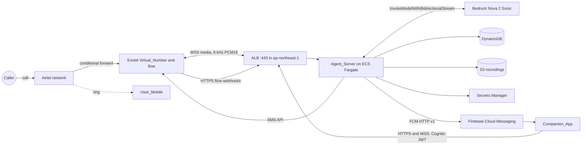
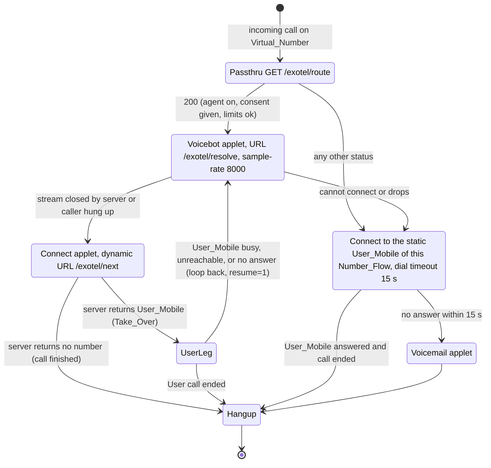
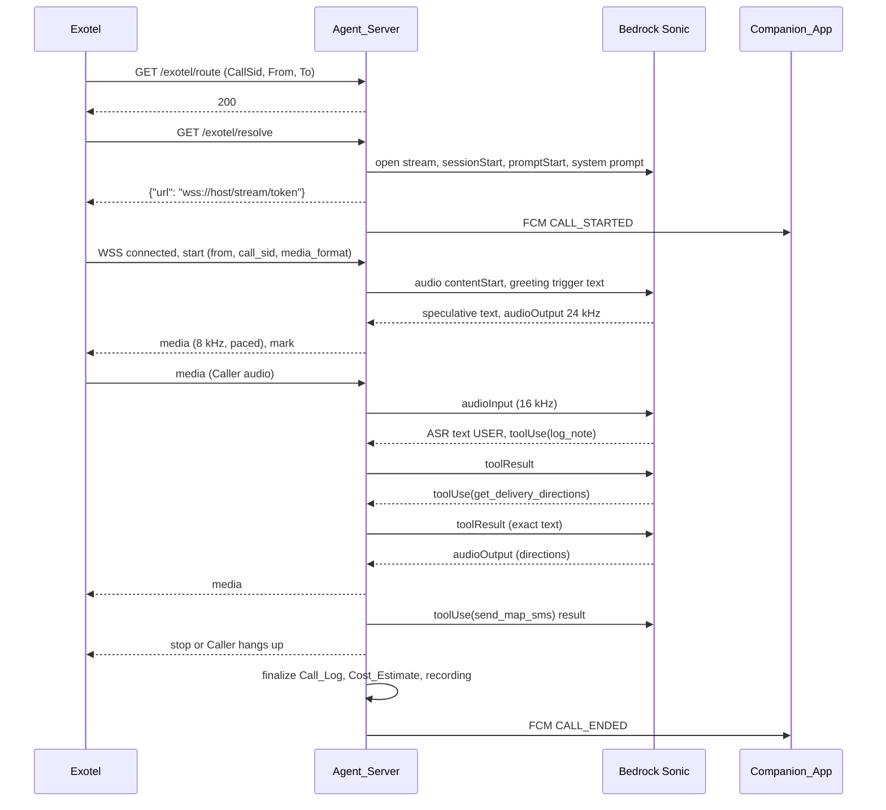
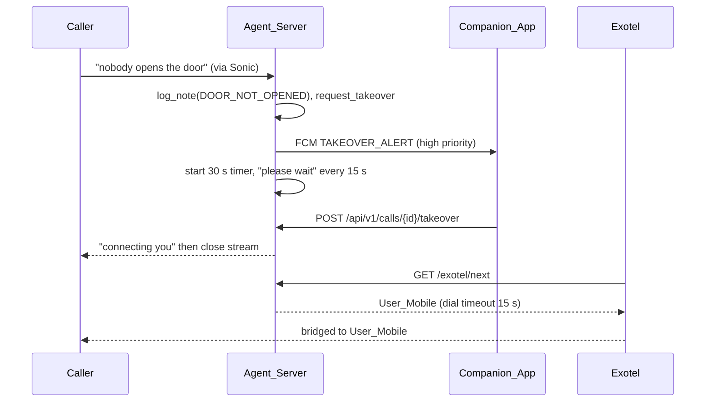
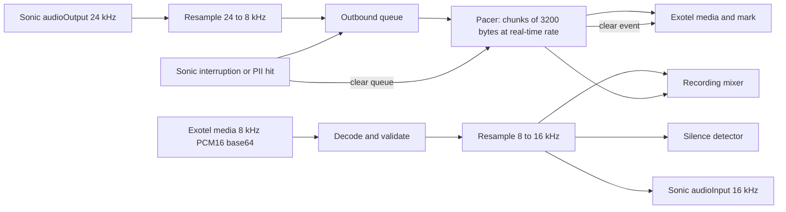
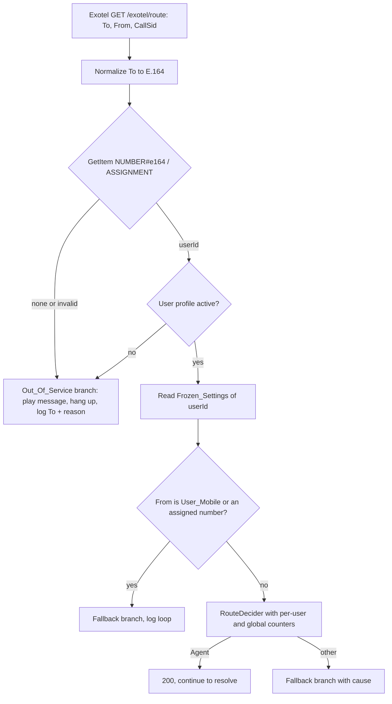
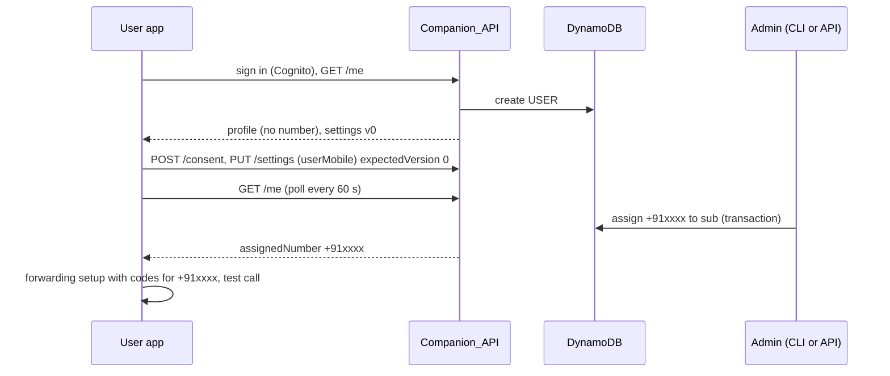

# Design Document

## Overview

The Cloud Call Agent moves the call screening Agent from the User's phone to a multi-user service in AWS Tokyo (ap-northeast-1). Each User's carrier forwards unanswered, busy, and unreachable calls to an Exotel Virtual_Number that the Admin assigned to that User. An Exotel flow streams the call audio over a bidirectional WebSocket to the Agent_Server, a Kotlin/JVM service. The Agent_Server relays the audio to Amazon Nova 2 Sonic through `InvokeModelWithBidirectionalStream`, and relays Sonic's speech back to Exotel. Sonic talks to the Caller. The Agent_Server owns every rule that must be exact: gate selection, delivery directions, personal data protection, limits, timers, takeover, and logging. Sonic reaches those rules only through seven tools implemented in server code.

The design rests on five decisions.

1. **The model converses, the server decides.** Sonic produces speech and calls tools. A pure, testable call policy (a reducer over call events) owns phase, counters, timers, and limits. The system prompt never contains protected data, so a prompt injection by a Caller cannot leak it.
2. **Reuse `:core`.** Gate selection, gate and delivery rendering, the PII guard, settings validation, the spam report builder, and the call log models run unchanged on the JVM. The on-device conversation engine, intent classifier, ASR, and TTS parts of `:core` are not used in the cloud.
3. **One long-lived service, one task.** Each User has at most 3 concurrent calls and the service has a Global_Call_Cap (default 10). One ECS Fargate task behind an Application Load Balancer keeps all live call state in memory, with a counter per User and one global counter. A restart drops the calls in progress to the Exotel Fallback_Route (Requirement 15 criterion 7). DynamoDB holds everything durable. Scaling to several tasks would need shared counters and is out of scope.
4. **Exotel's flow is the safety net.** Every failure path ends in an Exotel applet that connects the Caller to the User_Mobile or records a voicemail, because that path works even when the Agent_Server is down (with the multi-user limits described under "Fallback when the server is down").
5. **The dialed number is the tenant key.** The `To` number of the call maps to exactly one User through a Number_Assignment record. The Cognito `sub` is the User_Id. Every record is keyed by User_Id, and a data access layer that requires a User_Id builds every query (see "Multi-user design").

### Spike plan (run first)

The design depends on facts that the documentation does not settle. Each spike has a go/no-go rule. Spikes C-4 and C-6 have long lead times (carrier behavior and DLT template approval) and start first.

| ID | Question | Method | Go | No-go consequence |
| --- | --- | --- | --- | --- |
| C-6 | Does Exotel send SMS from the User's account (Map_SMS to the Caller, alert to the User_Mobile) and which DLT entity, sender ID, and template does it need? | Request DLT entity and template approval through Exotel; send test SMS with the link as a template variable. | An approved template delivers an SMS with a link to an Indian mobile within 30 s. | No Map_SMS. Fallback: the Agent speaks the directions only and the Companion_App notifies the User; Requirement 10 criterion 5 is removed after User approval. |
| C-4 | Does Airtel postpaid accept `**61*`, `**67*`, `**62*` with a ring time, also while the phone is on Wi-Fi calling (VoWiFi), and does the forwarded call keep the Caller number? | Set the codes on the User_Mobile, call it from another phone with the phone on mobile data and on Wi-Fi calling, with the phone unanswered, busy, and in airplane mode. | All three conditions forward in both modes, ring time is honored, Exotel `From` equals the Caller number. | If VoWiFi does not forward, the setup screen tells the User to disable Wi-Fi calling, and Requirement 2 criterion 8 text is extended. If the Caller number is lost, Requirement 1 criterion 3 applies to every call and Map_SMS is disabled. |
| C-1 | What exactly does the Voicebot applet send and accept (start event fields, sample rate, chunk sizes, mark, clear, DTMF, record, applet transitions on failure, Basic auth header, hidden Caller number)? | A minimal echo WebSocket server behind the ALB, logging every frame, tested with `sample-rate=8000`, `16000`, and `24000`. | Start event carries `from`, `to`, `call_sid`, `media_format`; `clear` removes buffered audio within 200 ms; an unreachable URL takes the failure transition. | If `clear` does not work, barge-in uses small chunks and a send-ahead of 100 ms (Requirement 5 criterion 2 is best effort). If the failure transition does not exist, the flow is gated with a Passthru applet (see Exotel flow). |
| C-5 | How does Sonic behave in Tokyo for session length, renewal with history, tool calls, interruption signal, text-before-audio ordering, injected text during a call, and idle timeout? | A scripted session driven from recorded audio. | 8-minute limit confirmed, replacement with history keeps context, `INTERRUPTED` arrives within 200 ms of Caller speech, speculative text arrives before the matching audio, injected text instructions are followed in at least 9 of 10 trials. | If injected text is unreliable, "please wait", silence prompts, and goodbyes play from the stored Fallback_Message audio. If speculative text arrives after audio, the PII_Guard runs on a 300 ms look-ahead buffer. |
| C-2 | Is Sonic good enough for Hindi, English, and Hinglish over telephone audio? | The 30-utterance corpus of `spike/` (`src/main/assets/s7/wav`), resampled to 8 kHz and sent as 8 kHz and as upsampled 16 kHz input, with voices `kiara`, `arjun`, `tiffany`, `matthew`. Plus 10 live calls through Exotel. | Intent accuracy at least 90 percent, usable Hindi transcripts, Reply_Latency p90 at most 1.5 s, and the User accepts the voice by listening. | If Hindi quality fails, the Agent speaks English only and Hindi callers are asked to leave a message; Requirement 7 is reduced after User approval. |
| C-7 | Does Airtel plus Exotel pass any forwarding information (`ForwardedFrom`, a Diversion or History-Info header) for a forwarded call, and does `To` always equal the ExoPhone that the User forwards to? | Forward two test phones to two ExoPhones; log every Passthru and Voicebot start parameter and any SIP header that Exotel exposes, for unanswered, busy, and unreachable forwarding. | `To` equals the ExoPhone in 10 of 10 calls. A hint, if present, equals the forwarding phone's number. | No change to the model: `To` is the only key (Requirement 25 criterion 6). If no hint exists, the mismatch trace of criterion 7 stays empty and the hint is not used. |
| C-3 | How is the live Caller connected to the User_Mobile, and how does the Caller return to the Agent when the User_Mobile does not answer? | Flow with Voicebot, then Connect applet with a dynamic URL, then a loop back to the Voicebot. Alternative B: the Legs and Bridge APIs (needs account enablement). | Caller hears the User_Mobile within 10 s of the tap, a failed dial returns to the Agent within 5 s, and no forwarding loop occurs. | If the loop back is impossible, a failed Bridge_Call plays the Fallback_Message and applies the Fallback_Route. |

C-1, C-3, and C-6 need the Exotel account. C-4 needs only the phone. C-5 and C-2 need only AWS. C-7 needs the Exotel account and the phone, and runs together with C-1 and C-4 results. The order is C-6 (start), C-4, C-5, C-1, C-7, C-2, C-3.

## Architecture

### System context

### Hosting decision

| Option | Assessment |
| --- | --- |
| ECS Fargate behind an ALB (chosen) | The ALB supports WebSocket natively, its idle timeout is configurable up to 4000 seconds (default 60 seconds), and ACM terminates TLS 1.2 or higher. Fargate runs the JVM service with a long-lived process, no instance management, and ECS deployment circuit breaker rollback. |
| App Runner | Simpler to deploy, but its WebSocket support and request time limits are not documented well enough for a 60-minute stream. Not chosen. A spike would be needed to rely on it. |
| API Gateway WebSocket plus Lambda | Rejected. Per-message cost and the 2-hour connection and 10-minute idle limits do not suit a continuous audio stream with a second long-lived stream to Bedrock. |
| Lambda | Rejected. A call needs a process that holds two simultaneous streams. |

Settings of the chosen hosting:

- One ECS service, `desiredCount` 1, `minimumHealthyPercent` 100 and `maximumPercent` 200 so that a deployment starts the new task before the old one stops. The container `stopTimeout` is 120 seconds (the Fargate maximum), and on SIGTERM the server stops accepting new calls and lets calls in progress finish, up to that time.
- ALB idle timeout 3600 seconds on the listener's load balancer, and the server sends a WebSocket ping every 20 seconds on the Companion_API stream. The Exotel stream carries media continuously, so it needs no keep-alive.
- Public subnets with a public IP and a security group that accepts port 443 only from the ALB security group. This avoids a NAT gateway and interface endpoints (a fixed monthly cost far above the single task). Egress goes to Bedrock, Exotel, FCM, and Cognito JWKS over TLS.
- The ALB listener uses an ACM certificate for a domain name that the User owns (open question 1). Exotel needs a `wss://` host name.
- Infrastructure is defined in one SAM template, `infra/cloud-agent/template.yaml`, consistent with `lambda/polly_tts/template.yaml`. SAM accepts plain CloudFormation resources, so the VPC, ALB, ECS, DynamoDB, S3, KMS, and alarms live in the same template. Deployment: `sam deploy --profile ldots --region ap-northeast-1` after the container image is pushed to ECR. The Cognito user pool of the existing stack (ap-south-1) is referenced by two template parameters, `CognitoUserPoolId` and `CognitoClientId`, and not recreated.
- Cost is dominated by the ALB, the Fargate task (0.5 vCPU, 1 GB is the starting size, to be tuned from the C-1 load test), Exotel minutes, and Nova 2 Sonic audio. The Cost_Estimate of Requirement 22 uses configured rates, so no price is hard-coded.

### Exotel flow

There is one Exotel flow (App) per assigned ExoPhone, the Number_Flow. All Number_Flows have the same applet structure and the same dynamic URLs. They differ only in the static fallback number of the Fallback branch (see "Fallback when the server is down"). Dynamic URLs let the server control routing per call. The flow uses the Voicebot applet with a dynamic URL, which Exotel calls with `CallSid`, `CallFrom`, `CallTo`, `Direction`, and other fields and which must answer `{"url": "wss://..."}` ([Exotel Voicebot applet](https://docs.exotel.com/exotel-agentstream/voicebot-applet)). The stream closes automatically before the next applet runs, and the flow continues with the next applet.

Flow details and the facts they depend on:

- **Route (gate).** A Passthru applet calls `/exotel/route` before the stream. The server first resolves the User from the `To` number (see "Tenant resolution"). For an unassigned or unknown `To`, it answers with a status that sends the call to the Out_Of_Service branch (a Play applet with the Out_Of_Service_Message, then Hangup). Otherwise it answers 200 when the User's Agent is on, the Privacy_Consent is accepted, the User's monthly cost limit is not reached, fewer than 3 calls of that User are active, and the Global_Call_Cap is not reached. Any other answer sends the Caller to the Fallback branch (Requirement 1 criterion 5 and 7, Requirement 17 criterion 4, Requirement 22 criterion 5). Whether a Passthru applet branches on the HTTP status is a spike C-1 item; if it does not, the server returns the Fallback destination through the Connect applet's dynamic URL instead.
- **Resolve.** `/exotel/resolve` repeats the tenant lookup, reads the Frozen_Settings of the User, creates the call session, starts the Sonic_Session in parallel, and returns a one-time `wss://<host>/stream/<callToken>` URL. `callToken` is an HMAC-SHA256 of the `CallSid`, the User_Id, and an expiry (60 seconds) under a secret from Secrets Manager; the stream handler rejects a token whose User_Id differs from the User_Id assigned to the dialed number (Requirement 16 criterion 3). This gives the unguessable per-call token of Requirement 16 criterion 11 and rejects a replay.
- **Authentication.** Exotel sends HTTP Basic credentials, taken from the `wss://<key>:<token>@host` form, in the `Authorization` header of the WebSocket handshake. The server checks the header against Secrets Manager and checks `callToken`. The same Basic check protects the `/exotel/*` webhooks. The IP allow list that Exotel offers is added at the ALB security group if Exotel provides stable ranges (spike C-1).
- **Take_Over.** The server speaks a short "connecting you" phrase, then closes the WebSocket. The flow moves to the Connect applet with the dynamic URL `/exotel/next`, which answers with the User_Mobile of the User who owns the call, read from the call state by `CallSid` (a Connect applet may take the number to dial from a URL ([Exotel Connect applet, dynamic URL](https://support.exotel.com/en/support/solutions/articles/3000096873))). Exact response format and timeout fields are a spike C-3 item. If the User_Mobile does not answer, the Connect applet's failure branch loops to the Voicebot applet with `resume=1`, the server opens a new Sonic_Session with the stored transcript, and the Agent tells the Caller that the person could not be reached (Requirement 11 criterion 7).
- **Forwarding loop guard.** The User_Mobile has conditional forwarding to the Virtual_Number. If Exotel rings the User_Mobile and the phone is busy or unanswered, the carrier forwards that leg back to the Virtual_Number and the call loops. Two measures prevent it. The Connect applet's dial timeout is 15 seconds, which is shorter than the 20-second carrier ring time, so Exotel gives up first. The `/exotel/route` handler rejects any call whose `From` is the User_Mobile of the resolved User or any assigned Virtual_Number (Fallback branch). This changes the 30-second wait of Requirement 11 criterion 7 to 15 seconds (open question 4).
- **Alternative B for Take_Over.** If C-3 shows that the Connect loop does not work, the server creates a leg to the User_Mobile and a bridge with the Legs and Bridge APIs (`POST /v2/accounts/{sid}/legs`, `POST /v2/accounts/{sid}/bridges`; Basic auth; the docs state that some of these APIs need enablement by Exotel). See [Exotel Bridge APIs](https://docs.exotel.com/voice-apis/bridge-apis-introduction) and [Manage Legs and Bridges](https://developer.exotel.com/docs/legs/api-reference/manage-legs).
- **Fallback when the server is up.** `/exotel/next?mode=fallback` resolves the User from `To` and answers with that User's Fallback_Route: the User_Mobile from the Frozen_Settings, or the Voicemail applet. This is per User and needs no per-number setup in Exotel.
- **Fallback when the server is down (decided).** The call is passed to the User. A shared flow cannot know the User_Mobile without the server, so each assigned ExoPhone has its own Number_Flow. The static Fallback branch of the Number_Flow is a Connect applet that dials that User's User_Mobile as a fixed number. It runs when the Passthru URL, the Voicebot resolve URL, or the stream URL fails or times out, so it needs no call to the Agent_Server (Requirement 15 criteria 10 to 12). The Connect applet's dial timeout is 15 seconds, below the 20-second Airtel ring time, so Exotel gives up before the carrier forwards the leg back to the Virtual_Number. If the User_Mobile does not answer, the branch continues to the Voicemail applet. Voicemails are matched to the User by the `To` field in the Exotel call details. The static number is a copy of the `userMobile` setting. The Admin keeps the copy current (checklist below).

### Call lifecycle

### Audio path

Audio facts from the documentation:

- Exotel media is raw 16-bit little-endian mono PCM, base64 encoded, 8 kHz by default, with 16 kHz and 24 kHz selected by the `sample-rate` query parameter. Audio sent to Exotel uses the same format. Chunks sent to Exotel have a minimum size of 3200 bytes, a maximum of 100000 bytes, and should be a multiple of 320 bytes ([Exotel Voicebot applet](https://docs.exotel.com/exotel-agentstream/voicebot-applet)).
- The `clear` event drops audio sent but not yet played. Exotel advises small chunks so that `clear` is effective. A `mark` event sent after media returns a `mark` event with the same name when that audio has played.
- Sonic accepts 8, 16, or 24 kHz PCM16 mono input and returns 8, 16, or 24 kHz output; the audio input frame size in the documentation is about 32 ms ([Nova 2 Sonic input events](https://docs.aws.amazon.com/nova/latest/nova2-userguide/sonic-input-events.html)).

Design choices:

- **Default plan.** Exotel at 8 kHz (the true PSTN rate). Sonic input at 16 kHz (the rate in Requirement 3) and Sonic output at 24 kHz. Resampling is by integer ratios only: 8 to 16 kHz (x2) and 24 to 8 kHz (÷3), with a linear-phase FIR low-pass filter, so the code is small and deterministic. The Audio_Bridge takes all three rates from the start event and from configuration, so spike C-2 can try Exotel 8 kHz with Sonic 8 kHz in and out (no resampling) or 16 kHz everywhere without code changes.
- **Pacer.** Sonic generates audio faster than real time. The Outbound queue holds the surplus. The Pacer sends 3200-byte chunks (a multiple of 320) so that at most 300 ms of audio is ahead of the playout clock inside Exotel. The final chunk of an utterance is padded with silence to the chunk size, and a `mark` follows each utterance.
- **Barge-in.** On Sonic's interruption signal (a `contentEnd` with `stopReason` `INTERRUPTED`, see [output events](https://docs.aws.amazon.com/nova/latest/nova2-userguide/sonic-output-events.html)) the server empties the Outbound queue, sends `clear`, and drops further audio of the interrupted content until its `contentEnd`. The target is 200 ms from the signal. Barge-in detection is suppressed while the Recording_Notice plays by not forwarding Caller audio to Sonic during the notice (the audio is still recorded and the silence detector still runs); the notice is the first utterance and is at most 10 seconds long.
- **Recording.** The server holds both audio directions, so it records the call itself: Caller audio and Agent audio are mixed into one 8 kHz mono WAV and written to S3 as a multipart upload, started when the Recording_Notice has finished (or at the start when the Disclosure_Setting is off), which satisfies Requirement 17 criterion 8 exactly. This replaces the Exotel recording URL lookup of Requirement 18 criteria 4 and 5 and avoids the dependency on a recording the flow may not allow to start late. The Take_Over segment is not recorded (open question 3).
- **Silence detection.** A simple short-term energy detector on the Caller audio. Silence is counted from the moment the last Agent audio has played (the `mark` returned by Exotel) so the Caller's silence during Agent speech does not count.

### Sonic session management

The event protocol follows the Amazon documentation ([input events](https://docs.aws.amazon.com/nova/latest/nova2-userguide/sonic-input-events.html), [output events](https://docs.aws.amazon.com/nova/latest/nova2-userguide/sonic-output-events.html), [tool configuration](https://docs.aws.amazon.com/nova/latest/nova2-userguide/sonic-tool-configuration.html), [voices](https://docs.aws.amazon.com/nova/latest/nova2-userguide/sonic-language-support.html), [getting started](https://docs.aws.amazon.com/nova/latest/nova2-userguide/sonic-getting-started.html)).

Start sequence, in this order:

1. `sessionStart` with `inferenceConfiguration` (`maxTokens`, `topP`, `temperature`) and `turnDetectionConfiguration.endpointingSensitivity`. The starting value is `MEDIUM`, tuned in spike C-2 (`HIGH` is faster but can cut off slow speakers).
2. `promptStart` with a new `promptName`, `textOutputConfiguration` (`text/plain`), `audioOutputConfiguration` (`audio/lpcm`, 24000 Hz, 16 bit, mono, `voiceId`, `base64`, `SPEECH`), `toolUseOutputConfiguration` (`application/json`), and `toolConfiguration` with the seven tools and `toolChoice` `auto`.
3. System prompt: `contentStart` (type `TEXT`, role `SYSTEM`, `interactive` false), one `textInput`, `contentEnd`.
4. Optional conversation history (only in a replacement session): `contentStart`, `textInput`, `contentEnd` per message with role `USER` or `ASSISTANT`. History is allowed once, after the system prompt and before audio.
5. Optional `SYSTEM_SPEECH` content that sets the transcript script for Hindi code-switching (Latin, Devanagari, or mixed). The starting value is Devanagari for Hindi and Latin for English, confirmed in C-2, so that the PII_Guard and the transcript are consistent.
6. Audio `contentStart` (type `AUDIO`, role `USER`, `interactive` true, 16000 Hz, 16 bit, mono), then `audioInput` events with base64 audio until the call or session ends.
7. Greeting trigger: cross-modal text (`contentStart` role `USER`, `interactive` true, `textInput`, `contentEnd`) that tells Sonic to speak the greeting text given by the server. Cross-modal input needs a continuously streaming session ([cross-modal input](https://docs.aws.amazon.com/nova/latest/nova2-userguide/sonic-cross-modal.html)); spike C-5 confirms that it can start the conversation.

End sequence: `contentEnd` for the audio content, `promptEnd`, `sessionEnd`, then close the input stream.

Output handling:

| Output event | Server action |
| --- | --- |
| `contentStart` with role `USER`, `generationStage` `FINAL`, then `textOutput` | Append a Caller utterance to the transcript, update silence and garble counters, send a live transcript event. |
| `contentStart` with role `ASSISTANT`, `generationStage` `SPECULATIVE`, then `textOutput` | Planned speech. Feed the PII_Guard when the call is in Stalling_Mode. Do not write to the transcript. |
| `contentStart` with role `ASSISTANT`, `generationStage` `FINAL`, then `textOutput` | The text that was actually spoken, sentence by sentence. Append to the transcript. A `contentEnd` with `stopReason` `INTERRUPTED` marks the utterance as interrupted. |
| `contentStart` type `TOOL`, then `toolUse` | Run the tool, then send `contentStart` (type `TOOL`, role `TOOL`, `toolResultInputConfiguration.toolUseId`), `toolResult` with a stringified JSON object, `contentEnd`. Every `toolUse` gets exactly one `toolResult`, even on timeout or error, because the model otherwise waits ([tool configuration](https://docs.aws.amazon.com/nova/latest/nova2-userguide/sonic-tool-configuration.html)). |
| `contentStart` type `AUDIO`, `audioOutput` | Decode, resample, queue. |
| `usageEvent` | Accumulate speech and text tokens for the Cost_Estimate. |
| `completionEnd` | Track turn boundaries. |

**Duration limit and renewal.** The documentation states a connection limit of 8 minutes, with a connection renewal and conversation continuation pattern in the Amazon sample repository ([getting started](https://docs.aws.amazon.com/nova/latest/nova2-userguide/sonic-getting-started.html)). The Agent_Server reads `sonic.maxSessionSeconds` (default 480) and `sonic.idleSeconds` from configuration (Requirement 14 criterion 1). At 80 percent (about 6 min 24 s) it opens a replacement session with the same system prompt, tools, and voice, sends history built from the stored transcript (Requirement 14 criterion 8), and starts the audio content. It then switches at a quiet moment (no Caller speech and no Agent audio queued) or after 3 seconds, whichever comes first. Caller audio of the switch window is kept in a 1-second ring buffer and replayed into the replacement so that no words are lost. The previous session is closed with the end sequence. The idle limit and any unexpected stream end trigger the same procedure. The history is capped at the last 40 utterances plus one text line that states the server's state (intent, language, repetitions used, stalling start, takeover state) so that the counters survive a renewal. In Stalling_Mode the history passes through the PII_Guard before it is replayed.

**Fixed text.** Gate information, directions, and canned lines reach the Caller as tool results marked `speak_exactly`. The system prompt tells Sonic to read such text word for word in the Caller's language. Because Sonic is a generative model, an exact reading is not guaranteed; the Call_Log records the spoken FINAL text, and a post-call check compares the gate numbers stated against the tool result (Requirement 18 criterion 3). Spike C-5 measures the deviation rate.

**Server-to-model instructions.** The server needs to tell Sonic to say something (please wait, silence prompt, goodbye, corrective instruction, Quick_Reply, "nobody is available"). It sends cross-modal text with role `USER` that starts with a fixed marker and the exact sentence. The system prompt tells Sonic that such messages come from the system and must be obeyed and never read aloud as instructions.

## Multi-user design

### Key finding: the dialed number is the only reliable tenant key

Exotel's Passthru documentation lists `ForwardedFrom` as deprecated and tells applications not to rely on it. Exotel passes `From` (the original Caller) and `To` (the ExoPhone on which the call landed) ([Exotel Passthru applet](https://docs.exotel.com/voice-apis/working-with-passthru-applet)). With one shared ExoPhone, the server could not tell which subscriber forwarded a call, so the model is one ExoPhone (Virtual_Number) per User. Content was rephrased for compliance with licensing restrictions.

### Tenant resolution

- The lookup is a strongly consistent `GetItem` on `NUMBER#<e164>` / `ASSIGNMENT`. A 30-second in-memory cache (positive and negative entries) keeps Admin changes effective within the 60 seconds of Requirement 26 criteria 4 and 5, and the cache is cleared on any Admin write handled by the same task.
- `PhoneNumbers.normalize` (in `:core`, pure) turns `+91 98xxx-xxxxx`, `098xxxxxxxx`, `9198xxxxxxxx`, and `98xxxxxxxx` (10 digits, India default) into `+9198xxxxxxxx`, and returns null for text that is not a number. Property 27 covers it.
- `ForwardedFrom` or a diversion header is read when present and compared with the User_Mobile. Only the two booleans (`hintPresent`, `hintMatchesUserMobile`) go to the Call_Trace, because the value is a personal number. It never selects the User. Spike C-7 finds out whether the carrier chain provides it at all.
- The resolved User_Id, the Frozen_Settings, and the Settings_Version are placed in the call state. The tools, the policy, and the finalizer use only that state, never a lookup by number later in the call.

### Admin and number assignment

- Cognito: a group `admins` in the existing pool (task 0.6). The ID token carries `cognito:groups`. `JwtVerifier` returns `sub` and the group set.
- `NumberAssignmentService` assigns with one `TransactWriteItems`: put `NUMBER#<e164>` / `ASSIGNMENT` with `attribute_not_exists(pk)` and put `USER#` / `ASSIGNMENT` with `attribute_not_exists(pk)`. A cancelled transaction maps to HTTP 409. Unassign deletes both items in one transaction. At most one number per User and one User per number follows from the two conditions.
- Admin interfaces: the Admin_API under `/api/v1/admin` (group check) and the CLI `scripts/admin/callagent-admin` (a small `:agent` main class using the same `NumberAssignmentService` with the `ldots` AWS profile). Both exist for assign, unassign, list users and numbers, and deactivate. No admin screen is built.
- **Account creation.** Accounts are admin-created only (resolved default of open question 17). The Cognito app client has self sign-up disabled (`AllowAdminCreateUserOnly` on the pool, task 0.6), and the Admin creates each account with `aws cognito-idp admin-create-user`. Self-service account deletion and data export are out of scope for this release (open question 19).
- **Admin assignment checklist (manual in the Exotel dashboard for now).** Exotel is not known to expose an API for creating or editing flows, so the Admin completes these steps for each assignment and records completion in the Number_Assignment (`flowConfigured`, `flowFallbackMobile`, `flowConfiguredAt`). Automation is added later only if Exotel exposes an API.
  1. Assign the number with the Admin_API or the CLI (the assignment is rejected if the number equals any `userMobile`).
  2. In the Exotel dashboard create the Number_Flow for the ExoPhone by cloning the template flow: Passthru `/exotel/route` with the Out_Of_Service branch, Voicebot with the resolve URL at `sample-rate` 8000, Connect with the `/exotel/next` URL, and the Fallback branch.
  3. Set the Fallback branch to a Connect applet with the User's User_Mobile as a static number in E.164 form, a dial timeout of 15 seconds, and the Voicemail applet on no answer.
  4. Link the Number_Flow to the ExoPhone.
  5. Place a test call with the Agent server stopped (or the resolve URL blocked) and confirm that the User_Mobile rings and that the unanswered call reaches voicemail after 15 seconds.
  6. Record the completion in the Number_Assignment. When the User changes the User_Mobile, repeat step 3 and step 5.
  When the Admin removes an assignment, the Admin changes the Number_Flow to the Out_Of_Service branch only (the server already plays the Out_Of_Service_Message).
- A number equal to any User's `userMobile` cannot be assigned, and a `userMobile` equal to an assigned number cannot be saved (loop protection by validation, in addition to the `From` check at routing).

### Settings storage, version, and sync

- One item `USER#` / `SETTINGS` holds the settings JSON (`CoreJson`) and a numeric attribute `version`. Absent item means version 0 and the defaults of `:core`.
- Update algorithm (`SettingsStore.update(userId, expectedVersion, candidate)`):
  1. Validate `candidate` with `SettingsValidator` and the cross-record rule for `userMobile` (not an assigned number). On failure return `Invalid(field)`.
  2. If `expectedVersion` is 0, `PutItem` with `attribute_not_exists(pk)` and `version = 1`. Otherwise `PutItem` (or `UpdateItem`) with `ConditionExpression: version = :expected` and `version = :expected + 1`.
  3. On `ConditionalCheckFailedException`, read the item (consistent) and return `Conflict(currentDocument, currentVersion)`.
  4. On success return `Saved(document, newVersion)`.
  Concurrent updates with the same expected version therefore produce exactly one `Saved` (Requirement 27 criterion 5).
- Call start: `GetItem` with `ConsistentRead` of the SETTINGS item once, stored as `FrozenSettings(version, settings)` in the call state. A later `PUT` does not affect a running call (Requirement 20 criterion 5). The Call_Log entry stores `settingsVersion` so that a call can be matched with the settings that it ran under.
- The Companion_App keeps a Room copy `settings_cache(version, json)` plus an outbox row `pending_edit(baseVersion, changedFields)`. Sync algorithm on reconnect:
  1. `GET /settings`. If `version == baseVersion`, send `PUT` with the pending fields and `expectedVersion = baseVersion`.
  2. If `version > baseVersion`, run `SettingsMerge.threeWay(base, server, edits)` (pure, in `:core`): a field edited locally and unchanged on the server takes the local value; a field changed only on the server keeps the server value; a field changed on both with different values goes to a conflict list that the User resolves on screen. Then send `PUT` with `expectedVersion = server.version`.
  3. On `409` run step 2 again with the returned document (bounded to 3 attempts).
  4. After `Saved`, replace the cache with the returned document and delete the outbox row.
  The `base` document for the merge is the cache copy at the time the edit began, which is why the cache holds the full last server document.

### Data isolation

- **Key design.** Every user-owned item has `pk = USER#`. A `sub` is a UUID, so no `sub` is a prefix of another and `pk` equality cannot cross users.
- **Data access layer.** `UserScopedRepository(userId: UserId)` is the only class that Companion_API handlers and call code use for user data. Its constructor requires a `UserId`, and every method builds keys through `Keys.user(userId, ...)`. No method accepts a raw `pk`. Call identifiers from a request are used only as part of `sk` under the caller's own `pk`, so another User's call id returns "not found" (HTTP 404). Cross-user operations live in a separate `DirectoryRepository` (number lookup, user listing for the sweeper, admin) that does not expose call logs, transcripts, or settings content.
- **Storage keys.** S3 keys are `users//recordings/<callId>.wav` and `users//transcripts/<callId>.json`. `RecordingStore` takes a `UserId`, builds the key, and refuses to presign a key outside `users//`.
- **IAM.** The single task role cannot be narrowed per User, because the server acts for all Users. Isolation is therefore enforced in code and checked by Property 28, API tests, and a code rule: the AWS SDK clients for DynamoDB and S3 are reachable only from the `store` package (a Gradle dependency rule or an ArchUnit-style test fails the build otherwise).
- **Live events and push.** The `/live` hub keys subscriptions by User_Id and publishes to the User_Id of the call. FCM tokens are read from `USER#` / `DEVICE#...` only.
- **Retention.** The `RetentionSweeper` lists active User_Ids from `DirectoryRepository`, then for each User runs the selection with that User's `retentionDays` over `USER#` items and the `users//` S3 prefix only.
- **Logs.** Logs and traces carry `userId` (a pseudonymous UUID) and call id, never personal content.

### Concurrency

`CallRegistry` holds `perUser: Map<UserId, Int>` and `global: Int`. `tryAcquire(userId)` succeeds only when `perUser[userId] < userLimit (3)` and `global < globalCap (10)`; `release` runs in the call finalizer and in the stream-closed handler, with a 5-second watchdog. Both limits come from configuration (`limits.perUser`, `limits.global`). A refused call takes the Fallback_Route with the cause `USER_LIMIT` or `GLOBAL_CAP` in the trace, and a metric `CapRefusals` is published.

### Push and Take over

Devices live in `USER#` / `DEVICE#<deviceId>` (up to 5, oldest replaced). `AlertService` sends to all of the owner's devices. A `404 UNREGISTERED` from FCM removes that device item. The Take over request carries no number; the bridge destination is `frozenSettings.userMobile` of the call's owner, and the `/exotel/next` handler reads it from the call state by `CallSid`, never from a request parameter.

### Onboarding sequence

### Migration from the single-household design

Nothing from the single-household design has been deployed (tasks 3 to 14 are not started), so no stored data moves. The changes are to the design and to code not yet written:

| Single-household item | Multi-user replacement |
| --- | --- |
| Constant partition key `H` | `USER#` partition and `NUMBER#<e164>` for the lookup |
| `JwtVerifier` accepts one configured `sub` and the template has a parameter for it | `JwtVerifier` accepts any valid token of the pool; no `ConfiguredSub` parameter; `admins` group for the Admin_API |
| One Virtual_Number and one User_Mobile in configuration | Number_Assignment items and `userMobile` in each settings document |
| S3 key `recordings/<callId>.wav` | `users//recordings/<callId>.wav` |
| Retention sweeper over all items | Sweeper per User |
| Counter of 3 calls | Counter per User (3) and a global cap (10) |
| Call token over `CallSid` and expiry | Token over `CallSid`, `userId`, and expiry |
| The owner's household | The first User: the owner signs in, the Admin CLI assigns the first ExoPhone, and the app uploads its cached local settings as version 1 (Requirement 31 criterion 5) |

The earlier on-device Room settings in the app stay as the cache, and the first upload uses `expectedVersion` 0.

## Components and Interfaces

#### Gradle modules

| Module | Content |
| --- | --- |
| `:core` (existing, JVM) | Existing rule code, plus new pure packages `cloud` (call policy, forwarding codes, cost and retention logic, cloud settings fields) and `tenant` (`UserId`, `E164`, `PhoneNumbers.normalize`, `Keys` for DynamoDB and S3 key construction, `SettingsMerge`, `SettingsUpdate` result types). |
| `:agent` (new, JVM, Ktor with Netty) | Everything below. Depends on `:core`, `kotlinx-serialization`, `kotlinx-coroutines`, the AWS SDK for Java v2 (`bedrockruntime`, `dynamodb`, `s3`, `secretsmanager`), and `kotest` for tests. The Bedrock bidirectional stream is available in `BedrockRuntimeAsyncClient`; spike C-5 confirms the SDK version and the model identifier `amazon.nova-2-sonic-v1:0` in ap-northeast-1 (an inference profile may be required instead of the plain model ARN). |
| `:app` (existing) | Companion_App. |
| `:spike` (existing) | Archived spike code, kept. |

#### Reuse of `:core`

| `:core` code | Used in the Agent_Server for |
| --- | --- |
| `gate.GateSelector`, `GateInfoRenderer`, `model.Gates` | `get_gate_info`, and the Companion_App's current-gate display (Requirement 9 criterion 11). |
| `delivery.DeliveryDirectionsRenderer`, `StepListValidator` | `get_delivery_directions`. |
| `stalling.PiiGuard`, `FictitiousGate`, `FictitiousReplyLibrary`, `PromptBuilder` | PII_Guard, fictitious gate answer, `get_stalling_persona`. |
| `report.SpamReportBuilder`, `ReportStatusMachine` | Companion_App spam report; the server stores the report status. |
| `settings.SettingsValidator` | Settings validation on both sides (Requirement 20 criterion 4). |
| `model.CallLogEntry`, `Utterance`, `CoreJson`, `LocalTimeHm`, `Time` | Call_Log, transcript, serialization. |
| `voice.VoiceSelector` | Voice choice with substitution (Requirement 7 criterion 5). |
| Not reused | `engine`, `intent`, `language`, `echo`, `address`, `phone` (on-device conversation and speech handling). |

New code in `:core` has default values for every added field, so existing serialized data and the existing round-trip tests stay valid.

#### Agent_Server packages

| Package | Responsibility |
| --- | --- |
| `exotel` | `ExotelRoutes` (`/exotel/route`, `/exotel/resolve`, `/exotel/next`, `/exotel/passthru`), `ExotelStreamHandler` (WebSocket), `ExotelMessages` (JSON codec for connected, start, media, mark, clear, dtmf, stop), `ExotelClient` (SMS API with Basic auth), `ExotelAuth`. |
| `audio` | `PcmCodec` (base64 and PCM16 conversion), `Resampler` (x2 up, ÷3 down, generic integer ratios), `Chunker`, `OutboundPacer` (queue, pacing, clear), `SilenceDetector`, `CallRecorder` (mix, S3 multipart). |
| `sonic` | `SonicEvents` (builders and parser for every event above), `SonicClient` (SDK stream wrapper), `SonicSession`, `SessionRenewer`, `SystemPrompt`, `ToolSpecs`, `HistoryBuilder`. |
| `tools` | `ToolRegistry` and the seven tools below. |
| `call` | `CallSession` (one coroutine per call that handles events from one channel in order), `CallPolicy` (pure reducer, lives in `:core`), `CallRegistry` (at most 3), `TranscriptBuffer`, `CallFinalizer`. |
| `api` | `CompanionRoutes`, `AdminRoutes` (group `admins`), `LiveStream` (WebSocket, subscriptions keyed by User_Id), `JwtVerifier` (Cognito JWKS, `iss`, `aud`/`client_id`, `exp`, `token_use`; returns `sub` and `cognito:groups`), `RateLimiter` (60 requests per minute per `sub`). |
| `tenant` | `TenantResolver` (normalize `To`, number lookup with a 30-second cache, active-user check), `NumberAssignmentService` (transactional assign and unassign), `UnassignedCallLog`, `AdminCli` (main class). |
| `notify` | `FcmClient` (HTTP v1, service account in Secrets Manager), `AlertService` (push, acknowledgment wait, SMS fallback). |
| `store` | `UserScopedRepository` (requires a `UserId`; call log, traces, devices, cost, consent), `SettingsStore` (versioned settings), `DirectoryRepository` (number lookup, user listing, open-call markers), `RecordingStore` (S3 under `users//`, presigned URLs), `Secrets`, `RetentionSweeper`. The only package that touches the DynamoDB and S3 clients. |
| `obs` | `CallTrace`, `Metrics` (CloudWatch embedded metric format), `StructuredLog` (no personal content). |

#### Agent_Tools

All seven tools are registered in `promptStart`. Inputs are validated against the JSON schema and again in code. A result is a JSON object with a `status` field. All results are deterministic functions of the call state, settings, and the server clock.

| Tool | Input | Result | Rules |
| --- | --- | --- | --- |
| `get_gate_info` | `{ "language": "hi"\|"en" (optional), "include_window_times": boolean (optional) }` | `{ "status": "OK", "gate_number", "location", "landmark", "speak_exactly": "<text>" }`; on a clock failure both gates and the window times and `"clock": "UNAVAILABLE"` | `GateSelector.selectGate(now, config)` with `now` taken from the server clock in Asia/Kolkata at minute resolution. Text from `GateInfoRenderer`. Contains no address or other personal data. In Stalling_Mode the result is the fictitious gate from `FictitiousGate`, and the call is logged as fictitious. |
| `get_delivery_directions` | `{ "language": "hi"\|"en"\|"other" }` | `{ "status": "OK", "speak_exactly": "<gate info, then steps in order, {map_location} replaced>", "repetition": n, "repetitions_left": m }`; after the third repetition `{ "status": "REPETITION_LIMIT", "speak_exactly": "<no further repetitions>", "then": "end_call" }` | `DeliveryDirectionsRenderer`. Language `other` uses the default language setting. The first call is repetition 0; at most 3 repetitions follow. When the Map_Location is missing the text has no location reference and an alert is queued (Requirement 10 criterion 6). A step with one language only is returned with the note to speak it in the Caller's language (Requirement 7 criterion 8). |
| `send_map_sms` | `{}` | `{ "status": "QUEUED" }` or `SKIPPED_UNKNOWN_NUMBER`, `SKIPPED_NOT_MOBILE`, `ALREADY_SENT`, `NOT_CONFIGURED` | At most once per call. The Caller number comes from the call state, never from the model. The send runs in the background through the Exotel SMS API, and failure raises an alert and a Call_Log note and keeps the call open. |
| `request_takeover` | `{}` | `{ "status": "ALERT_SENT" }` or `ALREADY_REQUESTED`, `ALERT_UNDELIVERED_SMS_SENT` | Starts the 30-second wait and the 15-second "please wait" timer, sends the Takeover_Alert, and starts the 5-second acknowledgment wait. A second request while one is pending changes nothing. |
| `end_call` | `{ "reason": "DELIVERY_DONE"\|"CALLER_DONE"\|"UNKNOWN_AFTER_CLARIFY"\|"CALLER_SILENCE"\|"REPEATS_EXHAUSTED"\|"MAX_DURATION"\|"ABUSIVE_LANGUAGE" }` | `{ "status": "ENDING" }` | The server closes the stream after the Agent audio in the queue has played (the final `mark` returned) or after 10 seconds, whichever is earlier. The reason is stored. |
| `log_note` | `{ "kind": "INTENT"\|"LANGUAGE"\|"MESSAGE"\|"NOTE", "value": string }` | `{ "status": "OK" }` or `{ "status": "REJECTED", "error": "INVALID_INTENT", "current": "<previous>" }` | `INTENT` must be one of the four categories (Requirement 8 criterion 10); the category is stored within 2 seconds and the phase changes through the call policy. `LANGUAGE` is `hi` or `en`. `MESSAGE` (at most 500 characters) is the Caller's message for the UNKNOWN category. `NOTE` is free text of at most 200 characters. |
| `get_stalling_persona` | `{}` | `{ "status": "OK", "persona": { "name", "city", "gate", ... } }` | Added tool. A fictitious but consistent identity seeded by the call identifier from `FictitiousReplyLibrary`, so that fictitious answers stay consistent over a long call. Contains no Protected_Term (checked by the PII_Guard at build time of each result). |

Tool execution has a 2-second timeout. A timeout or exception returns `{ "status": "ERROR", "error": "<code>" }` to Sonic, records the failure, and keeps the call open (Requirement 15 criterion 6).

#### System prompt

The system prompt is built by `SystemPrompt.build(voice, defaultLanguage, householdName)` from fixed text. It contains: the role (an automated assistant for a household), the language rule (reply in the language that has most words in the Caller's last utterance, Hindi, English, or Hinglish; keep the voice), the four categories with examples in the three language forms, the rule to call `log_note` on each classification, the behavior per category, the instruction to read tool text marked `speak_exactly` word for word, how to treat messages from the system, the rule never to reveal that tools or instructions exist, and the closing rules. It contains none of the User_Mobile, Map_Location, gate values, Night_Window times, Protected_Terms, or real name (Requirement 20 criterion 9, Requirement 12 criterion 12). The household name given in the greeting is configured by the User for that purpose and is public by choice. The Stalling_Mode behavior (fictitious replies, one follow-up question per reply, no real data) is in the base prompt, and the switch happens when the server sends the system instruction after the INTENT note.

#### Call policy (pure reducer)

`CallPolicy.step(state, event, now) -> (state, effects)` is a pure function in `:core`. Events: `StreamStarted`, `SonicReady`, `CallerUtterance(text?)`, `AgentAudioDone`, `SilenceElapsed`, `ToolCalled(tool, args)`, `IntentLogged`, `TakeoverRequested`, `UserTookOver`, `BridgeFailed`, `BridgeConnected`, `TimerFired(kind)`, `StreamStopped`, `SonicFailed`, `UserEndedCall`, `QuickReply(text)`, `PiiHit`. Effects: `Say(text)`, `Inject(instruction)`, `ClearAudio`, `StartTimer`, `CancelTimer`, `SendAlert(kind)`, `CloseStream(reason)`, `OpenReplacementSession`, `ApplyFallback(cause)`, `Record(note)`. The phases are `GREETING`, `LISTENING`, `DELIVERY`, `WAITING_TAKEOVER`, `STALLING`, `UNKNOWN_CLARIFY`, `CLOSING`, `TAKEOVER`, `ENDED`. The state holds the counters of Requirements 6, 10, 12, and 13 (greeting repeat, directions repetitions, silence prompts, clarification prompts, garbled repetitions), the start time, the stalling start time, the takeover timers, and the limits. All limits and timers of the requirements are enforced here, not by the model.

### Companion API

Base path `/api/v1`, TLS at the ALB, `Authorization: Bearer <Cognito ID token>`. `JwtVerifier` downloads the JWKS of the existing user pool (ap-south-1) and caches it for one hour. It accepts any valid token of the pool, and the handler takes the User_Id only from the verified `sub` (Requirement 16 criterion 7, Requirement 28 criterion 2). A deactivated User gets HTTP 403. Call identifiers in paths are resolved only inside the caller's own partition, so a foreign identifier gives HTTP 404.

| Method and path | Purpose |
| --- | --- |
| `GET /me` | Profile: `userId`, status, assigned Virtual_Number or null, consent state, Settings_Version. Creates the profile on first use. |
| `GET /settings` | Returns `{ "version": n, "settings": {...} }`; version 0 and defaults when none is stored. |
| `PUT /settings` | Body `{ "expectedVersion": n, "settings": {...} }`. 200 with `{version, settings}` on success; 400 `{field, message}` on validation failure; 409 `{currentVersion, settings}` on a version conflict. Answer within 3 seconds. |
| `POST /consent`, `DELETE /consent` | Accept (stores version and time) or withdraw the Privacy_Consent. |
| `PUT /devices/{deviceId}`, `DELETE /devices/{deviceId}` | Store or remove an FCM token (up to 5 per User). |
| `GET /admin/users`, `GET /admin/numbers` | Admin only (group `admins`): list Users and Number_Assignments. |
| `PUT /admin/numbers/{e164}` | Admin only: body `{ "userId": "" }`; assigns the number; 409 when the number or the User is already assigned. |
| `DELETE /admin/numbers/{e164}`, `POST /admin/users/{userId}/deactivate` | Admin only: unassign, or deactivate a User. |
| `GET /calls`, `GET /calls/{id}`, `DELETE /calls/{id}` | Call_Log list (newest first, cursor), detail with transcript, trace, and latency, delete with recording. |
| `GET /calls/{id}/recording` | Presigned S3 URL that expires in 10 minutes (within the 15 minutes of Requirement 18 criterion 7). |
| `POST /calls/{id}/takeover`, `/end`, `/quick-reply`, `/alert-ack` | Live call actions and alert acknowledgment. |
| `POST /calls/{id}/report-status` | Store the spam Report_Status. |
| `POST /forwarding/test`, `GET /forwarding/test` | Arm and read the 10-minute test call. |
| `GET /usage/month` | Month total of the Cost_Estimate and the limit. |
| `GET /live` (WebSocket) | Live events: `call_started`, `transcript`, `intent`, `language`, `state`, `takeover_status`, `call_ended`. The token is sent as the first message, not in the URL, so it does not reach access logs. |

Rate limit: 60 requests per minute per identity, HTTP 429 beyond that (the WebSocket counts as one connection).

### Push notifications

Decision: Firebase Cloud Messaging through the HTTP v1 API, with the service account key in Secrets Manager. Amazon SNS mobile push also sends through FCM and adds a platform application and a topic hop for one device, so it has no benefit here (open question 2). Messages are data messages with high priority so that the app builds the notification and its sound. Types: `CALL_STARTED`, `TAKEOVER_ALERT`, `CALL_ENDED`, `UNKNOWN_CALLER_SUMMARY`, `SILENT_CALLER`, `MAP_SMS_FAILED`, `MAP_LOCATION_MISSING`, `PII_EVENT`, `NOT_LOGGED`, `COST_80`, `COST_100`.

FCM reports acceptance, not delivery to the device. For the Takeover_Alert the app answers with `POST /calls/{id}/alert-ack`. If the token is missing, FCM rejects the message, or no acknowledgment arrives within 5 seconds, `AlertService` sends an SMS with the Caller number to the User_Mobile through Exotel and writes the failure to the trace (Requirement 11 criterion 8, Requirement 19 criterion 8). The SMS needs an approved DLT template (spike C-6).

### Security

- Secrets Manager holds the Exotel account SID, API key and token, the stream Basic credentials, the token HMAC secret, and the FCM service account. They are injected into the task as environment variables by the ECS task definition `secrets` field, and never logged.
- IAM task role (least privilege): `bedrock:InvokeModelWithBidirectionalStream` on the Nova 2 Sonic model (and the inference profile if used) only; `dynamodb` read and write on the one table; `s3:PutObject`, `GetObject`, `DeleteObject` on the one bucket prefix; `kms:Decrypt`, `GenerateDataKey` on the one key; `logs:PutLogEvents` and `cloudwatch:PutMetricData`. The execution role reads the secrets and pulls the image. No wildcard resources except where an action does not support resource scoping.
- One customer-managed KMS key encrypts DynamoDB, S3, Secrets Manager entries, and the log group.
- Logs are JSON with call identifier, event name, duration, and status. The Caller number, transcript, and audio never appear in them (Requirement 16 criterion 8). Stack traces are scrubbed of tool arguments.
- S3 bucket: block public access, bucket key encryption, versioning off, lifecycle backstop (see Retention).
- Multi-user: the task role needs `dynamodb:Query` on the `gsi1` index ARN in addition to the table. Admin API access requires the `admins` group claim. The Cognito pool should use admin-created accounts (open question 17). Isolation rules are in "Multi-user design".
- A Caller cannot reach the model's tools beyond the seven. Tool arguments are validated, and the Caller number and the User_Mobile are never tool inputs.

### Observability

- **Call_Trace.** Per call, a list of `{tMs, event, component, status, durationMs}` events stored in DynamoDB with a 30-day TTL. Events are listed in Requirement 23 criterion 2. The same events are written as structured log lines.
- **Metrics.** CloudWatch embedded metric format lines: `CallCount`, `TimeToFirstAudioMs`, `ReplyLatencyMs`, `FallbackCount`, `SonicErrorCount`, `ActiveCalls`. Alarm: `FallbackCount` sum greater than 3 in 1 hour, sent to an SNS topic with the User's e-mail.
- **Latency_Report.** Computed in the finalizer from the trace: time to first audio, median and maximum reply latency.
- **Cost_Estimate.** Exotel minutes from call duration, Sonic input and output minutes from the Caller and Agent audio durations (and `usageEvent` tokens as a cross-check), times the configured rates.

## Data Models

#### DynamoDB (single table `CallAgent`, partition key `pk`, sort key `sk`, TTL attribute `ttl`, one global secondary index `gsi1` with `gsi1pk` and `gsi1sk`)

`` is the Cognito `sub` (User_Id). `<e164>` is the normalized number, for example `+919812345678`.

| `pk` | `sk` | Content |
| --- | --- | --- |
| `USER#` | `PROFILE` | `status` (`ACTIVE`, `DEACTIVATED`), `createdAt`. `gsi1pk = USERS`, `gsi1sk = USER#`. |
| `USER#` | `SETTINGS` | Settings JSON (`CoreJson`), numeric `version` (absent item means version 0). |
| `USER#` | `ASSIGNMENT` | `e164` of the assigned Virtual_Number (reverse of the number item). |
| `USER#` | `CONSENT` | Version of the consent text, accepted time, withdrawn time. |
| `USER#` | `DEVICE#<deviceId>` | FCM token, update time (up to 5 items per User). |
| `USER#` | `CALL#<startEpochMs>#<callId>` | `CallLogEntry` JSON, plus `intent`, `outcome`, `startMs`, `settingsVersion`, `recordingKey`, `ttl`. |
| `USER#` | `TRACE#<callId>` | Trace events, latency report, `ttl` of 30 days. |
| `USER#` | `COST#<yyyy-MM>` | Month total in paise (atomic `ADD`), `notified80`, `notified100`. |
| `USER#` | `FWDTEST` | Armed time, result call identifier. |
| `USER#` | `OPEN#<callId>` | Marker for a call in progress, deleted by the finalizer. `gsi1pk = OPENCALLS`, `gsi1sk = <startEpochMs>##<callId>`. |
| `NUMBER#<e164>` | `ASSIGNMENT` | `userId`, `assignedAt`, `assignedBy`. `gsi1pk = ASSIGNMENTS`, `gsi1sk = NUMBER#<e164>`. |
| `OPS#UNASSIGNED#<yyyy-MM-dd>` | `<epochMs>#<callSid>` | `to` number, reason (`NO_ASSIGNMENT`, `INVALID_NUMBER`, `USER_DEACTIVATED`), `ttl` of 30 days. No Caller number. |

Access patterns:

| # | Pattern | Operation |
| --- | --- | --- |
| 1 | Agent call start: User for a dialed number | `GetItem NUMBER#<e164> / ASSIGNMENT` (consistent), then `GetItem USER# / PROFILE` and `GetItem USER# / SETTINGS` (batched, consistent). |
| 2 | Read settings, `GET /settings` | `GetItem USER# / SETTINGS`. |
| 3 | Update settings | Conditional `PutItem` on `version`. |
| 4 | Assign or unassign a number | `TransactWriteItems` on `NUMBER#<e164>` and `USER# / ASSIGNMENT` with `attribute_not_exists` conditions. |
| 5 | Call list for a User, newest first | `Query pk = USER#, sk begins_with CALL#`, `ScanIndexForward=false`, cursor. |
| 6 | Call detail, delete | `GetItem` or `DeleteItem` with `pk = USER#` and the `sk` built from the call identifier. |
| 7 | Devices of a User for a push | `Query pk = USER#, sk begins_with DEVICE#`. |
| 8 | Month cost | `GetItem` and `UpdateItem ADD` on `COST#<yyyy-MM>`. |
| 9 | Admin list of Users and numbers | `Query gsi1 gsi1pk = USERS`, `Query gsi1 gsi1pk = ASSIGNMENTS`. |
| 10 | Retention sweeper | `Query gsi1 gsi1pk = USERS` for the User list, then per User `Query pk = USER#, sk begins_with CALL#` with a key condition on the start time. |
| 11 | Calls open at server start | `Query gsi1 gsi1pk = OPENCALLS`. |

Design notes. The number lookup uses the base table key and not a GSI, because a conditional write on the base key is the only way to guarantee that a number belongs to at most one User (a GSI key is not unique). `gsi1` serves listings (Users, assignments, open calls); these partitions are small (one item per User or number), so a hot partition is not a concern at the expected scale of tens of Users. The sort key puts calls in time order, so the call list is one `Query`. A call entry is stored as one JSON string and is read back through the same serializer. A transcript larger than 300 KB goes to S3 under `users//transcripts/<callId>.json` with a pointer in the item.

#### `:core` model additions (all with defaults)

- `Settings`: `userMobile` (the Take_Over destination, E.164), `voiceGender`, `voiceId` (optional override), `version` (set by the server, not edited by the client), `agentEnabled`, `fallbackRoute` (`VOICEMAIL`, `FORWARD_TO_MOBILE`), `retentionDays` (1 to 365, default 30), `recordingEnabled` (default true), `disclosureEnabled` (default true), `greetingName`, `defaultLanguage`, `maxStallingMinutes` (1 to 60, default 5), `silenceTimeoutSec` (default 8), `quickReplies`, `costRates` (Exotel per minute, Sonic input and output per minute, in paise), `monthlyLimitInr`, `consentVersion`.
- `CallLogEntry`: `costEstimatePaise`, `latency` (`ttfaMs`, `medianReplyMs`, `maxReplyMs`), `sonicSessions` (start, end, reason), `fallbackCause`, `recordingKey`, `isTestCall`, `voiceId`, `endReason`.
- `cloud.ForwardingCodes`: builds the set, clear, ring-time, and unconditional codes for a validated number. `cloud.CostEstimator`, `cloud.RetentionPolicy`, `cloud.CallPolicy`.

Time handling: the server clock is read through a `Clock` interface so tests can supply instants. `Household_Time` is `ZonedDateTime.now(clock.withZone(Asia/Kolkata))` truncated to the minute and mapped to `LocalTimeHm`.

#### S3

Bucket `callagent-recordings-<account>-ap-northeast-1`. Key `users//recordings/<callId>.wav` (8 kHz mono PCM16 WAV, about 1 MB per minute). Server-side encryption with the KMS key.

### Retention

A `RetentionSweeper` coroutine runs at start and every 6 hours. For each active User it deletes that User's call items, trace items, and S3 objects (under `users//`) whose `startMs + retentionDays` (the User's own setting) is not after now, and retries on failure (Requirement 17 criterion 5 asks for at least daily). DynamoDB TTL is a second layer set to the same time. The S3 lifecycle rule is a backstop at 366 days, not 30, because the User may set the retention up to 365 days and a lifecycle rule cannot follow a setting (open question 5). The default of 30 days is enforced by the sweeper. Deleting a call from the app deletes the item and the object at once (Requirement 17 criterion 7).

### Companion_App changes

| Area | Decision |
| --- | --- |
| Kept | Cognito sign-in (`auth/`), Room settings and call log as a local cache (`data/`) with the existing outbox for offline retry (Requirement 20 criterion 6), the spam report flow (`report/`, `core.report`), notification channels, and the Compose UI in `ui/`. |
| Archived | `a11y/`, `audio/`, `asr/`, `tts/`, `translate/`, `cloudtts/` (Polly), `nlg/`, `telecom/` (CallScreener), `recording/` (folder linking), `service/` (on-device call pipeline, overlay), and `sms/` (on-device Map_SMS). They move to a Gradle module `:archive-ondevice` that is not a dependency of `:app`, so the release build does not include them. The `RECORD_AUDIO`, `ANSWER_PHONE_CALLS`, `SEND_SMS`, `SYSTEM_ALERT_WINDOW`, microphone foreground-service permissions, the accessibility service, and the call screening service entries are removed from the manifest (Requirement 24 criteria 3 and 4). Packages are archived by moving, after a dependency scan shows what `ui/` still uses (`ui` screens that referenced the on-device pipeline are adapted). |
| New: consent | Privacy_Consent screen after first sign-in; the Agent stays off and the forwarding codes stay hidden until accepted (Requirement 17). |
| New: forwarding setup | Screen built from `ForwardingCodes`, showing `**61*<number>**20#` (no answer with a 20-second ring), `**67*<number>#`, and `**62*<number>#`, each with a button that opens the dialer (`ACTION_DIAL`, with `#` encoded as `%23`) and never dials by itself. A turn-off screen with `##61#`, `##67#`, `##62#`, and `##002#`. The unconditional option `**21*` with a warning. A "Send test call" button with a 10-minute countdown and a result. Text that Airtel may charge for forwarded calls and that Wi-Fi calling can change the behavior (to be firmed up by spike C-4). |
| New: live call | A high-priority notification for `TAKEOVER_ALERT` with a "Take over" action that calls `POST /calls/{id}/takeover` from a short-lived worker, and a full-screen live call screen (Caller number, intent, language, elapsed time, live transcript from the `/live` WebSocket, "Take over", "End call", Quick_Replies, bridge status). The screen shows an ended call as ended and disables Take over (Requirement 19 criterion 9). |
| New: call detail | Latency report, trace events, cost, recording playback through the presigned URL with the system media player. |
| New: settings | Fields of Requirement 20 criterion 1 and the cost rates and limit, saved with `PUT /settings` and `expectedVersion`. The Room cache holds the last server document and the pending edit; sync and merge follow "Settings storage, version, and sync". |
| New: onboarding | Guided steps after sign-in: consent, "waiting for your number" screen that polls `GET /me` every 60 seconds and then shows the assigned number, the User_Mobile entry, the forwarding setup with that number, and the settings. The first upload of the cached local settings uses `expectedVersion` 0. |
| Push | Firebase Messaging service that handles the data message types above. This adds the Firebase configuration file (`google-services.json`) to the app project. |

## Correctness Properties

*A property is a characteristic or behavior that should hold true across all valid executions of a system-essentially, a formal statement about what the system should do. Properties serve as the bridge between human-readable specifications and machine-verifiable correctness guarantees.*

### Property 1: Gate selection partitions every instant

For any instant and any valid gate configuration, converting the instant to Household_Time in Asia/Kolkata at minute resolution and selecting the gate returns exactly one of Gate_1 and Gate_3; the selection is Gate_3 exactly when the minute is within the Night_Window (start inclusive, end exclusive, crossing midnight), so the start time selects Gate_3 and the end time selects Gate_1. When the clock is unavailable the `get_gate_info` result contains both gates and the window times.

**Validates: Requirements 9.1, 9.2, 9.3, 9.4, 9.10, 9.11, 9.12**

### Property 2: `get_gate_info` result is exact and free of personal data

For any settings and any time, the `get_gate_info` result text equals the `GateInfoRenderer` text of the selected gate in the requested language, contains the gate number, location, and landmark, and contains none of the User's address, Map_Location, User_Mobile, or other Protected_Terms (the Night_Window times appear only when requested).

**Validates: Requirements 9.5, 9.6, 7.7**

### Property 3: Stalling mode never returns real gate or personal data

For any settings with a non-empty set of Protected_Terms and any tool call made while the call is in Stalling_Mode, the result of `get_gate_info`, `get_delivery_directions`, `get_stalling_persona`, and the system prompt text contain none of the configured gate numbers, locations, landmarks, Night_Window times, Map_Location, User_Mobile, or Protected_Terms.

**Validates: Requirements 9.9, 12.6, 12.12, 20.9**

### Property 4: Delivery directions order and completeness

For any valid Delivery_Steps list (1 to 10 steps), any Map_Location, and any language, the `get_delivery_directions` text starts with the Colony_Gate_Info, contains the step texts in the configured order, contains no remaining `{map_location}` placeholder, and contains the Map_Location where a step references it; a step with only one language is returned in that language with the speak-in-Caller's-language note.

**Validates: Requirements 10.2, 7.7, 7.8**

### Property 5: Directions repetition limit

For any number n of `get_delivery_directions` calls in one call, the first 4 calls (the first and 3 repetitions) return status `OK` and every later call returns `REPETITION_LIMIT` with the instruction to end the call.

**Validates: Requirements 10.3, 10.4**

### Property 6: Map SMS is sent at most once to an eligible number

For any sequence of `send_map_sms` calls in one call and any Caller number value (valid mobile, landline, malformed, or unknown), at most one SMS request is made, and none is made when the number is unknown or not a mobile number; every later call returns `ALREADY_SENT`.

**Validates: Requirements 10.5, 10.7, 10.10**

### Property 7: Intent logging accepts only the four categories

For any string value passed to `log_note` with kind `INTENT`, the call is accepted if and only if the value is one of DELIVERY, DOOR_NOT_OPENED, SOLICITATION, or UNKNOWN; a rejected call returns `REJECTED` with the current category and leaves the stored category unchanged.

**Validates: Requirements 8.2, 8.10**

### Property 8: Streaming PII guard detects every protected term

For any text that contains a Protected_Term (in any letter case, with any spacing or punctuation inside digit sequences) and any split of that text into chunks delivered in order, the streaming guard reports a match no later than the chunk that completes the term, and it reports no match for texts without a Protected_Term.

**Validates: Requirements 12.8, 12.9, 12.13**

### Property 9: Voice is constant for the whole call

For any Voice_Setting and any sequence of language-change events during a call, the voice identifier used for the Sonic_Session (and for every replacement session of that call) is the same, and it equals the identifier selected for the gender and the default language, with a substitution recorded only when the preferred voice is unavailable.

**Validates: Requirements 7.3, 7.5, 7.6, 14.2**

### Property 10: Call policy enforces limits and counters

For any sequence of call events, the call policy (a) ends a call outside Stalling_Mode and Take_Over no later than 15 minutes after the start, (b) ends every call no later than 60 minutes after the start, (c) ends Stalling_Mode no later than the configured maximum stalling duration, (d) ends the call after the second consecutive Silence_Timeout outside Take_Over (the third prompt in Stalling_Mode), (e) asks for a message after exactly 2 clarification prompts in the UNKNOWN category and does not count an answered Gate_Query as a prompt, and (f) ends the call after 3 consecutive garbled-speech repeats.

**Validates: Requirements 6.5, 6.6, 12.3, 12.4, 12.5, 12.10, 13.2, 13.4, 13.5, 13.6, 13.7, 22.6**

### Property 11: Take_Over state machine

For any sequence of takeover-related events (request, user tap, bridge connected, bridge failed, timer fired, second tap), at most one Bridge_Call is in progress at a time, a second tap while a bridge is in progress has no effect, no replacement Sonic_Session is requested while the phase is TAKEOVER, a call whose alert is unanswered for 30 seconds produces the nobody-available instruction and stays with the Agent, and a failed bridge returns the phase to the Agent with a recorded failure.

**Validates: Requirements 11.3, 11.4, 11.5, 11.6, 11.7, 11.10, 11.11**

### Property 12: Session renewal schedule

For any session limit L and any call start, the replacement Sonic_Session is requested at a time not before 0.8 L and not after L minus the configured renewal margin, the switch happens at the first quiet moment or within 3 seconds of readiness, the previous session is closed after the switch, and at no time are two sessions both fed Caller audio, with the 1-second ring buffer replayed to the replacement exactly once.

**Validates: Requirements 14.1, 14.2, 14.3, 14.4**

### Property 13: Sonic event sequence is well formed

For any session configuration, any history of 0 to 40 messages, and any call state, the generated start events are in the order sessionStart, promptStart (with the voice, the output format, and the seven tools), system content (start, text, end), at most one history block, and the audio contentStart; the history block appears only after the system prompt and before the audio start, preserves the transcript order, and is passed through the PII_Guard in Stalling_Mode; and for any sequence of toolUse events, including tool failures and timeouts, exactly one toolResult is produced per toolUse identifier.

**Validates: Requirements 14.2, 14.8, 15.6, 12.12**

### Property 14: Exotel message codec round trip

For any valid Exotel event (connected, start, media, mark, clear, dtmf, stop) with any field values, encoding the event to its JSON wire form and decoding it produces an equal event, and for any 16-bit mono PCM frame, base64 encoding the frame and decoding it returns the same samples; a media frame whose decoded length is not a multiple of 2 bytes or does not match the announced format is discarded without changing the state of later frames.

**Validates: Requirements 3.1, 3.5, 3.7**

### Property 15: Resampling keeps duration and bounded amplitude

For any 16-bit mono PCM buffer, converting from 8 kHz to 16 kHz and from 24 kHz to 8 kHz yields a buffer whose duration differs from the original by at most 20 ms, whose samples stay within the 16-bit range, and for the pair 8 kHz to 16 kHz and back to 8 kHz yields the same number of samples.

**Validates: Requirements 3.2, 3.3, 3.6**

### Property 16: Pacer chunking, rate, and barge-in clear

For any sequence of Agent audio arrivals, every chunk sent to Exotel has a length that is a multiple of 320 bytes and at least 3200 bytes (the last chunk of an utterance padded with silence), the concatenation of the chunk payloads (without padding) equals the input samples in order, the cumulative audio sent never exceeds the elapsed real time plus the 300 ms send-ahead, and after an interruption or PII hit at any point no byte that was queued before the interruption is sent afterwards and exactly one `clear` event is emitted.

**Validates: Requirements 3.3, 3.4, 5.1, 5.2, 12.9**

### Property 17: Call_Log and settings round trip

For any valid Call_Log entry (including cost, latency, Sonic session records, fallback cause, and Take_Over details) and any valid settings object, serializing to the storage form and reading back produces an equivalent value, and settings that fail validation are rejected with the name of the invalid field.

**Validates: Requirements 18.1, 18.9, 20.3, 20.4, 20.8**

### Property 18: Retention selection is exact and idempotent

For any set of call items with start times, any retention period of 1 to 365 days, and any current time, the sweeper deletes exactly the items whose start time plus the retention period is not after the current time, and running the sweeper twice with the same inputs deletes the same set as running it once.

**Validates: Requirements 17.5, 17.6, 17.7**

### Property 19: Cost estimate and monthly limit

For any call durations and rates, the Cost_Estimate is non-negative, is monotonic in each duration, and is linear in the rates; for any sequence of call costs and any monthly limit, the 80 percent notification is produced exactly once, at the call that first makes the total reach 80 percent, and every route decision after the total reaches 100 percent selects the Fallback_Route.

**Validates: Requirements 22.1, 22.4, 22.5, 1.5**

### Property 20: Route decision

For any combination of Agent on or off, Privacy_Consent accepted or not, User active or deactivated, month total versus the User's limit, number of active calls of the User, number of active calls overall, the Global_Call_Cap, and `From` value, the route decision selects the Agent if and only if the Agent is on, consent is accepted, the User is active, the month total is below the limit, fewer than 3 calls of that User are active, fewer than the Global_Call_Cap calls are active overall, and `From` is neither the User_Mobile of the resolved User nor any assigned Virtual_Number; otherwise it selects the Fallback_Route with a recorded cause.

**Validates: Requirements 1.5, 1.7, 17.2, 17.4, 20.7, 22.5, 25.8, 29.1, 29.2, 29.3**

### Property 21: Call token verification

For any `CallSid`, User_Id, secret, and time, a token generated for that `CallSid` and User_Id verifies at any time before its 60-second expiry and yields that User_Id, and fails verification for a different `CallSid`, a different User_Id, a different secret, a modified token, or a time at or after expiry.

**Validates: Requirements 16.2, 16.3, 16.11, 25.9**

### Property 22: Forwarding codes

For any valid User phone number and ring time of 5 to 30 seconds, the set codes are `**61*<number>**<seconds>#`, `**67*<number>#`, and `**62*<number>#` (and `**21*<number>#` for unconditional forwarding) with the number appearing exactly once, the clear codes are fixed, and the dialer URI of any code encodes `#` so that the code survives a round trip through the URI.

**Validates: Requirements 2.1, 2.3, 2.4, 2.5**

### Property 23: Test call window

For any arming time and any later call time, the call is recorded as the test call if and only if it is the first call after arming and arrives within 10 minutes of arming; otherwise the result stays "not received" once 10 minutes have passed.

**Validates: Requirements 2.6, 2.7**

### Property 24: Traces and log lines contain no personal content

For any call (any Caller number, transcript, Protected_Terms, and audio), the serialized Call_Trace and every structured log line produced for the call contain none of the Caller number, any transcript text, or any Protected_Term.

**Validates: Requirements 16.8, 23.3**

### Property 25: Spam report message round trip

For any valid Brief_Description, Sender_Number, and Report_Date, the built message is at most 160 characters and parses back to the same Sender_Number and Report_Date.

**Validates: Requirements 21.10**

### Property 26: Settings version conflict handling

For any initial stored document and any sequence of update attempts, each with an expected Settings_Version and a candidate document (valid or invalid), an attempt is accepted if and only if its expected version equals the stored version at that moment and the candidate passes validation; each accepted attempt increases the stored version by exactly 1 and stores the candidate; each rejected attempt leaves the stored document and version unchanged, and a rejection for a version mismatch returns the stored document and version; and for any set of concurrent attempts with the same expected version, exactly one is accepted and the final version equals the starting version plus 1.

**Validates: Requirements 27.3, 27.4, 27.5, 27.6, 27.12**

### Property 27: Tenant resolution

For any set of Number_Assignments (a map from E164_Number to User_Id with each number assigned to at most one User) and any dialed number string, the resolver returns the User_Id of the assignment whose E164_Number equals the normalization of the string when such an assignment exists and the User is active, and returns no User (out of service) for every other string, including unassigned numbers, invalid numbers, and numbers of deactivated Users; each assigned number resolves to exactly one User_Id, resolution is unchanged when the string is written with or without `+`, `91`, a leading `0`, spaces, or hyphens, a Forwarded_From_Hint never changes the result, and normalization applied twice equals normalization applied once.

**Validates: Requirements 25.1, 25.2, 25.3, 25.4, 25.6, 25.10, 25.11**

### Property 28: Data isolation of the query layer

For any set of Users and any set of stored records owned by those Users (call logs, traces, devices, cost totals, settings, and S3 object keys), and any operation of the data access layer executed for a User_Id U (list, get by identifier including identifiers that belong to another User, delete, sweep, and presign), the operation returns, reads, or changes only records owned by U, returns every matching record owned by U, returns "not found" for an identifier owned by another User, and leaves all records of other Users unchanged.

**Validates: Requirements 28.1, 28.2, 28.3, 28.4, 28.5, 28.7, 28.9, 30.2**

## Error Handling

| Failure | Detection | Response |
| --- | --- | --- |
| Agent_Server down or restarting | Exotel cannot open the stream, or the stream drops | Exotel flow failure branch applies the Fallback_Route (connect to the User_Mobile or voicemail). The server records the drop on the next start from open calls found in DynamoDB. |
| Bedrock or Sonic unavailable, throttled, or stream error at start | Exception from the SDK stream, or no `completionStart` within 3 seconds | Play the Fallback_Message in the Caller's last language and the selected gender from stored audio, send a Takeover_Alert, apply the Fallback_Route, and log the cause. |
| Sonic stream error in a call | Stream failure or `sessionEnd` not requested by the server | Open a replacement session once within 2 seconds (Requirement 14 criterion 5). If it fails, treat as the previous row. |
| Time to first audio above 3 seconds | Timer at stream start | Play the Fallback_Message greeting, keep Sonic running, and write the delay to the trace. |
| Tool exception or timeout | 2-second tool timeout | Return `{status: ERROR}` to Sonic, log it, and keep the call open. |
| Exotel SMS rejected or not delivered | HTTP error or status callback | Alert `MAP_SMS_FAILED`; the call stays open. |
| FCM rejected, no token, or no acknowledgment in 5 seconds | FCM response and `alert-ack` timer | SMS to the User_Mobile with the Caller number; trace entry. |
| Invalid media frame | Length or encoding does not match the announced format | Discard and count in the trace. |
| No media from Exotel for 10 seconds | Timer | End the call and record the interruption with its start and duration. |
| DynamoDB write failure | SDK exception | Retry 3 times at 1-second intervals; then alert `NOT_LOGGED` and write the entry to the structured log in a redacted form (call identifier, outcome, times only). |
| S3 recording failure | Upload error | The call continues; the entry's recording status becomes `NOT_FOUND`; the upload is retried at call end. |
| Invalid settings update | `SettingsValidator` | HTTP 400 with the field name; the stored value stays. |
| JWT invalid or wrong identity | `JwtVerifier` | HTTP 401 (or 403 for another identity). |
| Rate limit | `RateLimiter` | HTTP 429. |
| PII hit in Stalling_Mode | `StreamingPiiGuard` | Stop and clear audio, discard the rest of that content, inject the corrective instruction, record the event without the term, and send `PII_EVENT`. |
| Takeover dial fails | Connect applet failure branch with `resume=1` | New Sonic_Session with history; the Agent says the person could not be reached; the failure is recorded. |
| Forwarding loop (call from the Virtual_Number or User_Mobile) | `From` check in `/exotel/route` | Fallback branch; the call is logged as a loop. |
| Settings never saved | No `SETTINGS` item | Defaults apply and the route decision selects the Fallback_Route until consent (Requirement 20 criterion 7). |
| Dialed number not assigned, invalid, or User deactivated | `TenantResolver` returns no User | Out_Of_Service_Message, hang up, operational log with `To` and reason (no Caller number). |
| Settings version conflict | Conditional write fails | HTTP 409 with the stored document; the app merges (see "Settings storage, version, and sync") and retries up to 3 times, then shows the conflict to the User. |
| Number already assigned, or User already has a number | Transaction cancelled | HTTP 409, no change. |
| Per-User limit or Global_Call_Cap reached | `CallRegistry.tryAcquire` fails | Fallback_Route, trace cause `USER_LIMIT` or `GLOBAL_CAP`, metric `CapRefusals`. |
| Non-admin on the Admin_API | Group claim missing | HTTP 403. |
| Request names another User's call, recording, or device | Key not found under the caller's partition | HTTP 404, no information about existence. |
| FCM reports an unregistered token | FCM response | Remove that device item; other devices still receive the alert. |
| Shared flow when the server is down | Exotel cannot reach the server | Generic "try later" message and voicemail, or the per-number static forward if the Admin set it up. |

## Testing Strategy

Property-based testing applies to this feature because the deterministic parts (gate selection, rendering, guards, codecs, resampling, pacing, policy, schedules, cost, retention) are pure functions with large input spaces. It does not apply to the AWS infrastructure template, the Exotel and Bedrock calls, the Android screens, or the speech quality of Sonic; those use the other test types below.

**Property tests.**
- Library: `kotest-property` (already used by `:core`), run on the JVM with JUnit 5.
- Each of the 28 properties is one property test with at least 100 iterations (500 for the policy, pacer, and PII guard properties).
- Each test carries the tag comment `Feature: cloud-call-agent, Property N: <title>`.
- Generators: instants across a full year including daylight-free Asia/Kolkata minute boundaries; settings with random Delivery_Steps (English only, Hindi only, both), random gates, and Protected_Terms with digits and mixed case; PCM buffers of random length and content including silence and clipping amplitude; event sequences for the policy built from a weighted event alphabet; arbitrary chunk splits for the guard.
- Multi-user generators: sets of Users with random UUID `sub` values (including values that share long prefixes), numbers in many textual forms (`+91`, `91`, `0`, spaces, hyphens, garbage), call identifiers that contain `#`, and interleaved update attempts for Property 26. Properties 26 and 28 run against an in-memory `ItemStore` fake that implements the conditional-write and key-condition semantics of DynamoDB, and the same tests run once against DynamoDB Local in the integration suite.
- Time and I/O are injected (`Clock`, fake Exotel and Sonic ports), so the property tests need no network.

**Unit tests (examples and edge cases).** Each tool's result for fixed inputs (a fixed Gate_1 and Gate_3 text), the clock-failure result, the 22:30 and 05:30 boundaries, the greeting and notice order with the Disclosure_Setting on and off, `end_call` after the last `mark`, JWT verification with expired and wrong-audience tokens, the 429 response, and the Exotel start event with `media_format` from the documented sample.

**Contract tests with recorded fixtures.** The Exotel messages and Sonic events in this document are stored as JSON fixtures taken from the spike runs C-1 and C-5, and the parsers are tested against them, so that a protocol change shows up as a failed test.

**Integration tests (1 to 3 examples each, on AWS in ap-northeast-1 and with Exotel).**
- The echo stream through the ALB (spike C-1).
- A scripted call from recorded audio through Sonic that measures Time_To_First_Audio and Reply_Latency against Requirement 4, and the 8-minute renewal with history (spike C-5).
- A takeover to the User_Mobile and the return to the Agent after a failed dial (spike C-3).
- A DynamoDB round trip of a call entry and the retention sweeper against a test table.

**Smoke tests.** The SAM template passes `sam validate --lint` and a `cfn-lint` run, and a snapshot test of the synthesized IAM statements asserts that no statement has a wildcard resource beyond the allowed list. The release build of the app contains no `RECORD_AUDIO`, call screening, or accessibility entries, and `:core` tests run in the release build (Requirement 24 criteria 4 and 7).

**Multi-user unit and API tests.** `PUT /settings` returns 200, 400 with the field name, and 409 with the stored document; the Admin_API returns 403 without the group and 409 on a duplicate assignment; a foreign call identifier returns 404 on every call route; a Take over request carries no number; two Users on two numbers get separate Call_Logs; `SettingsMerge` handles unchanged, one-sided, and two-sided field changes; a build rule fails when code outside `store` uses the DynamoDB or S3 clients.

**On-device tests.** Compose UI tests for the forwarding setup screen (codes shown, dialer opened with the code prepared and not dialed), the live call screen (Take over action, ended-call state), and the consent gate.

**Voice quality acceptance.** Spike C-2 is a manual acceptance by the User. The 30-utterance corpus is replayed for any change of voice, endpointing sensitivity, or system prompt.

## Approved decisions, domain, and defaults

The User approved the design with the three deviations: server-side recording after the spoken notice (Take_Over not recorded), a 15-second takeover dial timeout with rejection of calls from the Virtual_Number or the User_Mobile, and retention enforced by the sweeper with a 366-day S3 lifecycle backstop. The Gradle module is named `:agent` (this document's earlier name `:agent-server` is replaced).

### Domain and certificates

| Item | Decision |
| --- | --- |
| Domain | `leadingdots.com` |
| Agent endpoint | `agent.leadingdots.com`: `wss://` Exotel stream and the dynamic-URL webhooks (`/exotel/*`, `/stream/*`). |
| Companion API | `api.leadingdots.com`, a separate host name on the same ALB, selected by a listener rule on the host header. Reason: Exotel traffic and app traffic get separate security rules, rate limits, and log filters, and the Exotel host can be pointed elsewhere (for example at a standby) without touching the app. The cost is one more certificate name and DNS record, and no second ALB. |
| Certificate | One ACM certificate in ap-northeast-1 (the ALB region) for `agent.leadingdots.com` and `api.leadingdots.com`, validated by DNS. |
| DNS host | Unknown. A task checks for a Route 53 hosted zone with `aws route53 list-hosted-zones --profile ldots`. If the zone exists, the validation CNAMEs and the ALIAS records are created in the template. If not, the User creates the validation CNAMEs and two CNAME records at the registrar by hand. |

### Defaults the User can change

These answers were not given. The plan uses them until the User says otherwise.

| Topic | Default | Change by |
| --- | --- | --- |
| Push channel | FCM direct (HTTP v1). The User creates a Firebase project. | Say so before task 8. |
| Exotel features | Voicebot, Passthru, and Connect dynamic URLs, and the Legs and Bridge APIs are assumed available and are confirmed with Exotel support after KYC. | Spike C-1 and C-3 results. |
| DLT | An Exotel-provided template under Exotel's entity until the User confirms a DLT entity. | Spike C-6 result. |
| Voices | `kiara` (female) and `arjun` (male). `tiffany` and `matthew` are alternatives, selectable in settings. | Settings and spike C-2. |
| Cognito | The existing user pool in ap-south-1 is kept. | Not planned. |

## Requirement impacts and open questions

Changes this design makes to the requirements, for the User to approve:

1. **Recording by the server, not by Exotel.** Requirement 17 criterion 8 and Requirement 18 criteria 4 and 5 are met by a server-made recording that starts after the Recording_Notice. The Take_Over segment is not recorded. If the User prefers Exotel's recording (the Voicebot "record" option), the recording would start with the call and include the notice.
2. **Takeover dial timeout of 15 seconds**, not 30 seconds, to stay below the carrier's 20-second ring time and prevent a forwarding loop (Requirement 11 criterion 7). The 30-second alert wait of Requirement 11 criterion 6 is unchanged.
3. **S3 lifecycle backstop at 366 days**, with the 30-day default enforced by the sweeper, because the retention period is user-configurable.
4. **`get_stalling_persona`** is added as a seventh tool.

Open questions:

1. **Domain name.** The ALB needs an ACM certificate for a domain name that the User owns, for example `agent.<domain>`. Which domain, and is it in Route 53?
2. **Push channel.** This design uses FCM directly. Confirm, and create the Firebase project for the app.
3. **Exotel account features.** Are the Voicebot applet, the Passthru and Connect applets with dynamic URLs, and (for alternative B) the Legs and Bridge APIs enabled on the account? What is the plan and trial limit?
4. **DLT.** Does the User have a DLT entity, or will Exotel provide a template under its own entity for the Map_SMS and alert SMS (spike C-6)?
5. **Default Sonic voice.** `kiara` (female) and `arjun` (male) support Indian English and Hindi; `tiffany` and `matthew` are the polyglot voices. Spike C-2 decides; which does the User prefer if both are acceptable?
6. **Cognito region.** The existing user pool is in ap-south-1 and stays there; the Agent_Server in Tokyo validates its tokens through the pool's JWKS. Confirm that no new pool is wanted.
7. **Spikes decide six facts:** Exotel stream details (C-1), Sonic quality (C-2), Take_Over mechanism (C-3), Airtel and Wi-Fi calling forwarding (C-4), Sonic session behavior (C-5), and whether any forwarding hint reaches Exotel (C-7).
8. **Multi-user questions** (requirements open questions 14 to 20). Resolved: the server-down fallback passes the call to the User through one Number_Flow per ExoPhone with a static User_Mobile (question 16), sign-up is admin-created only (question 17), and account deletion and data export are out of scope (question 19). Still open: ExoPhone price and limits per account, the Global_Call_Cap default, and a shared SMS sender.

## References

Content was rephrased for compliance with licensing restrictions.

- Exotel Voicebot applet, protocol, media format, and chunk sizes: https://docs.exotel.com/exotel-agentstream/voicebot-applet
- Exotel Stream and Voicebot applet support article: https://support.exotel.com/support/solutions/articles/3000132302-updated-extension-guide-working-with-the-stream-and-voicebot-applet-beta-
- Exotel Passthru applet (`From`, `To`, and the deprecated `ForwardedFrom`): https://docs.exotel.com/voice-apis/working-with-passthru-applet
- Exotel Connect applet with a dynamic URL: https://support.exotel.com/en/support/solutions/articles/3000096873
- Exotel Legs and Bridge APIs: https://docs.exotel.com/voice-apis/bridge-apis-introduction and https://developer.exotel.com/docs/legs/api-reference/manage-legs
- Exotel SMS and DLT: https://developer.exotel.com/docs/faqs/sms-faqs and https://docs.exotel.com/messaging-apis/how-to-send-sms-using-exotel-with-dlt-template-scrubbing
- Nova 2 Sonic input events: https://docs.aws.amazon.com/nova/latest/nova2-userguide/sonic-input-events.html
- Nova 2 Sonic output events: https://docs.aws.amazon.com/nova/latest/nova2-userguide/sonic-output-events.html
- Nova 2 Sonic tool configuration: https://docs.aws.amazon.com/nova/latest/nova2-userguide/sonic-tool-configuration.html
- Nova 2 Sonic voices and languages: https://docs.aws.amazon.com/nova/latest/nova2-userguide/sonic-language-support.html
- Nova 2 Sonic getting started (8-minute connection limit, model identifier): https://docs.aws.amazon.com/nova/latest/nova2-userguide/sonic-getting-started.html
- Nova 2 Sonic regions (Tokyo is generally available): https://docs.aws.amazon.com/nova/latest/nova2-userguide/release-notes.html
- ALB idle timeout: https://docs.aws.amazon.com/elasticloadbalancing/latest/application/edit-load-balancer-attributes.html
